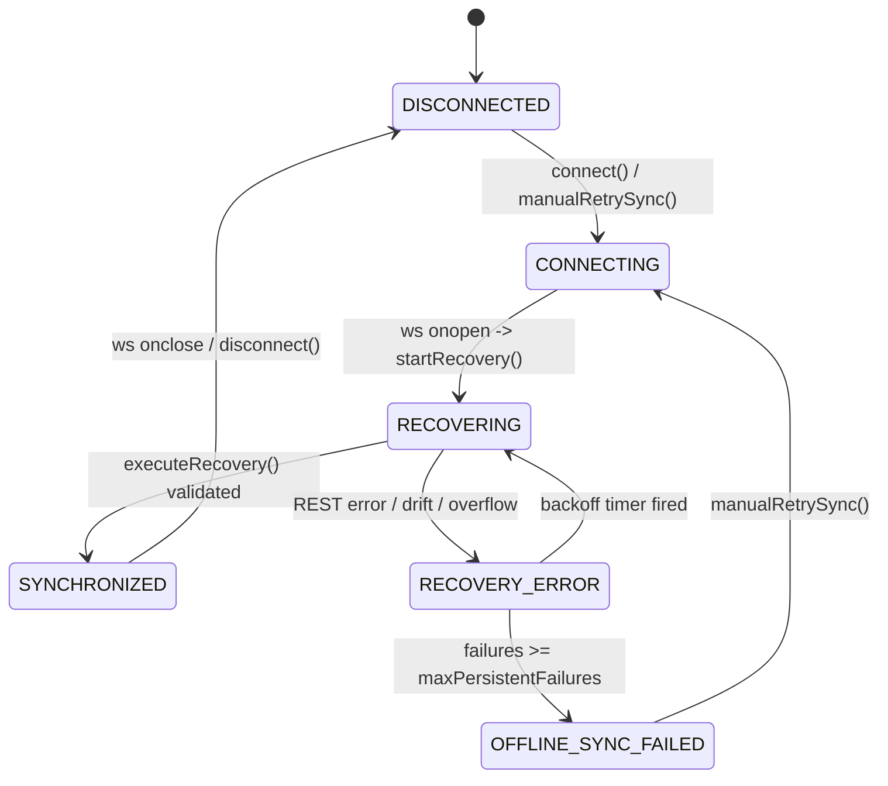

# Phase 2B-3D Independent Remediation Verification Audit

**Document ID:** `AUDIT-VERIFICATION-DEFECT-2B-3D-01`  
**Date:** 2026-10-31  
**Auditor Role:** Principal Frontend Concurrency & Reliability Engineer (Independent Auditor)  
**Target:** Remediation of `DEFECT-2B-3D-01` reported in [`docs/AUDIT/PHASE_2B_3D_STRESS_TEST_RESULTS.md`](file:///c:/Developers/Sneha/Projects/hybrid-traffic-control/docs/AUDIT/PHASE_2B_3D_STRESS_TEST_RESULTS.md)  
**Mode:** STRICTLY READ-ONLY VERIFICATION

---

## 1. Executive Verdict

### Verdict: **APPROVED WITH LIMITATIONS**

The targeted remediation for `DEFECT-2B-3D-01` (`Intentional reconnect blocked after explicit disconnect`) has been independently audited against the actual source code, state machine specifications, deterministic concurrency tests, and full-stack regressions.

### Summary of Independent Verification
1. **Defect Resolution Verified:** The lockout caused by the pre-construction check `if (this.isExplicitDisconnect) return;` has been resolved. In [`frontend/src/services/websocket.js`](file:///c:/Developers/Sneha/Projects/hybrid-traffic-control/frontend/src/services/websocket.js), intentional calls to `connect()` correctly re-authorize socket instantiation by resetting `this.isExplicitDisconnect = false` at the entry point of `connect()`.
2. **Teardown Isolation Preserved (Case A):** In-flight teardown protection introduced in Phase 2B-3C is strictly preserved. If `disconnect()` is invoked while an obsolete socket is in `CLOSING`, the generation token invalidation (`connectionGeneration++`) and the post-await check (`this.connectionGeneration !== preWaitToken` and `this.ws !== closingSocket`) guarantee that the aborted attempt creates zero replacement WebSockets.
3. **Promise-Identity Hardening Verified:** Stale promise settlement cannot clear an in-flight connection promise. The `.finally()` callback enforces reference-equality (`this.activeConnectPromise === currentPromise`), resolving the concurrency edge case where an aborted attempt settling late could nullify a newer active promise.
4. **State Machine Circuit-Breaker Exit Verified:** In [`frontend/src/services/snapshotRecovery.js`](file:///c:/Developers/Sneha/Projects/hybrid-traffic-control/frontend/src/services/snapshotRecovery.js), `manualRetrySync()` resets the internal state to `'CONNECTING'` before branching on connection status, preventing the `OFFLINE_SYNC_FAILED` guard in `startRecovery()` from rejecting operator-initiated recoveries.
5. **No Regressions:** All 37 frontend tests passed (duration: 724 ms), all 106 backend tests passed (duration: 71.51 s), and the production frontend build completed with zero errors (duration: 10.76 s).

---

## 2. Finding-by-Finding Verification

### Scenario A: Intentional Reconnect
- **Requirement:** After `disconnect()`, a subsequent `connect()` must construct exactly one replacement WebSocket and reach `CONNECTED`.
- **Source Inspection ([`frontend/src/services/websocket.js:121-135`](file:///c:/Developers/Sneha/Projects/hybrid-traffic-control/frontend/src/services/websocket.js#L121-L135)):**
  ```javascript
  connect() {
    if (this.activeConnectPromise) {
      return this.activeConnectPromise;
    }
    // Intentional connection attempt authorized: reset explicit disconnect state
    this.isExplicitDisconnect = false;
    const currentPromise = this._executeConnect().finally(() => {
      if (this.activeConnectPromise === currentPromise) {
        this.activeConnectPromise = null;
      }
    });
    this.activeConnectPromise = currentPromise;
    return this.activeConnectPromise;
  }
  ```
- **Auditor Evaluation:** When `disconnect()` is executed, `this.isExplicitDisconnect` is set to `true`, and `this.ws` is set to `null`. When `connect()` is subsequently invoked, `this.isExplicitDisconnect` is reset to `false`. `_executeConnect()` proceeds past line 204 (`if (this.isExplicitDisconnect) return;`), advances the generation token at line 221, and constructs the new WebSocket instance.
- **Evidence:** Scenario 32 in `frontend/src/services/websocket.test.js` deterministically verifies this transition: `sockets.length` increases from 1 to 2, `wsClient.ws` references the new socket, and status advances to `CONNECTED`.
- **Finding Status:** **VERIFIED — RESOLVED.**

---

### Scenario B: Disconnect During Pending Teardown (Case A)
- **Requirement:** If `connect()` begins while a prior socket is `CLOSING`, and `disconnect()` is called before `_waitForSocketClosed()` resolves, the obsolete attempt must NOT construct a replacement socket when the teardown finishes.
- **Source Inspection ([`frontend/src/services/websocket.js:161-178`](file:///c:/Developers/Sneha/Projects/hybrid-traffic-control/frontend/src/services/websocket.js#L161-L178)):**
  ```javascript
  if (this.ws.readyState === WS.CLOSING) {
    const preWaitToken = this.connectionGeneration;
    const closingSocket = this.ws;

    const closed = await this._waitForSocketClosed(closingSocket, this.teardownTimeoutMs);

    // F-CONC-01: Revalidate authorizations after asynchronous teardown wait
    if (this.isExplicitDisconnect) {
      return;
    }
    if (this.connectionGeneration !== preWaitToken) {
      return;
    }
    if (this.ws !== closingSocket) {
      return;
    }
    ...
  ```
- **Auditor Evaluation:** If `disconnect()` is invoked during the await:
  1. `this.isExplicitDisconnect` is set to `true`.
  2. `this.connectionGeneration` is incremented.
  3. `this.ws` is severed and set to `null`.
  When `_waitForSocketClosed` resolves:
  - Line 169 (`if (this.isExplicitDisconnect) return;`) triggers because `disconnect()` set the flag.
  - Line 172 (`if (this.connectionGeneration !== preWaitToken) return;`) triggers because the generation was incremented.
  - Line 175 (`if (this.ws !== closingSocket) return;`) triggers because `this.ws` was set to `null`.
- **Evidence:** Scenario 20 and Scenario 33 both prove that `sockets.length` remains strictly 1 and `wsClient.ws` remains `null`.
- **Finding Status:** **VERIFIED — RESOLVED.**

---

### Scenario C: Concurrent Connection Attempts
- **Requirement:** Multiple concurrent `connect()` invocations must serialize onto a single in-flight promise and construct exactly one socket.
- **Source Inspection ([`frontend/src/services/websocket.js:122-124`](file:///c:/Developers/Sneha/Projects/hybrid-traffic-control/frontend/src/services/websocket.js#L122-L124)):**
  ```javascript
  if (this.activeConnectPromise) {
    return this.activeConnectPromise;
  }
  ```
- **Auditor Evaluation:** The first caller sets `this.activeConnectPromise = currentPromise`. Any subsequent caller while `currentPromise` is pending receives the exact reference `this.activeConnectPromise`.
- **Evidence:** Scenario 21 and Scenario 34 assert `assert.strictEqual(p1, p2)` and verify that exactly one socket is constructed (`sockets.length === 2` after one replacement).
- **Finding Status:** **VERIFIED — RESOLVED.**

---

### Scenario D: Obsolete Promise Settlement vs. Newer Authorized Attempt
- **Requirement:** If attempt A is invalidated by `disconnect()` while awaiting teardown, and a new attempt B is initiated, attempt A's subsequent settlement must not clear B's `activeConnectPromise`, alter B's state, or create duplicate sockets.
- **Source Inspection ([`frontend/src/services/websocket.js:127-132`](file:///c:/Developers/Sneha/Projects/hybrid-traffic-control/frontend/src/services/websocket.js#L127-L132)):**
  ```javascript
  const currentPromise = this._executeConnect().finally(() => {
    // Guard promise clearing by reference equality to prevent obsolete attempts from clearing newer promises
    if (this.activeConnectPromise === currentPromise) {
      this.activeConnectPromise = null;
    }
  });
  ```
- **Auditor Evaluation:** When attempt A settles, `currentPromise` is $p_A$. However, attempt B had set `this.activeConnectPromise = p_B$. Because $p_A \neq p_B$, the condition evaluates to `false`, leaving `this.activeConnectPromise` pointing to $p_B$.
- **Evidence:** Scenario 35 and Scenario 37 deterministically test this sequence using controlled teardown resolvers. Scenario 37 verifies that when attempt A finishes, `assert.strictEqual(wsClient.activeConnectPromise, p2)` holds.
- **Finding Status:** **VERIFIED — RESOLVED.**

---

### Scenario E: Manual Retry from `OFFLINE_SYNC_FAILED`
- **Requirement:** After the persistent recovery failure budget is exhausted and the client enters `OFFLINE_SYNC_FAILED`, invoking `manualRetrySync()` must reconnect the WebSocket and successfully execute authoritative recovery to `SYNCHRONIZED`.
- **Source Inspection ([`frontend/src/services/snapshotRecovery.js:321-335`](file:///c:/Developers/Sneha/Projects/hybrid-traffic-control/frontend/src/services/snapshotRecovery.js#L321-L335)):**
  ```javascript
  manualRetrySync() {
    if (this.retryTimeout) clearTimeout(this.retryTimeout);
    this.persistentRecoveryFailures = 0;
    this.overflowRetryCount = 0;
    this.retryAttempt = 0;
    this.recoveryBuffer = [];
    this.hasBufferOverflowed = false;

    this._setState('CONNECTING');
    if (this.trafficWS.status === 'CONNECTED') {
      this.startRecovery();
    } else {
      this.trafficWS.connect();
    }
  }
  ```
- **Auditor Evaluation:** Prior to remediation, `this._setState('CONNECTING')` was only called inside the `else` branch. If the socket was somehow `CONNECTED` or transitioning, calling `startRecovery()` hit line 141 (`if (this.state === 'OFFLINE_SYNC_FAILED') return;`) and aborted. With the line placed before the conditional branch, the state machine cleanly transitions out of `OFFLINE_SYNC_FAILED`, enabling `startRecovery()` to proceed.
- **Evidence:** Scenario 29 (Phase 2B-3D Test 7.2) and Scenario 36 both prove that after reaching `OFFLINE_SYNC_FAILED`, calling `manualRetrySync()` constructs a socket, fetches the fenced REST snapshot, drains the buffer, and achieves `SYNCHRONIZED` with `persistentRecoveryFailures === 0`.
- **Finding Status:** **VERIFIED — RESOLVED.**

---

## 3. Race-Condition & Security Analysis

### Critical Invariant: Can resetting `isExplicitDisconnect` at `connect()` entry accidentally re-authorize an obsolete attempt?

A central concern in frontend concurrency is whether clearing a cancellation flag at the entry of a new call can resurrect a suspended, in-flight execution.

#### Audit Proof:
Consider Attempt A suspended inside `_executeConnect()` at line 166:
$$\text{Attempt A: suspended awaiting } \_waitForSocketClosed(S_1, 2000)$$
- At time $t_0$, `disconnect()` is invoked:
  - `this.isExplicitDisconnect` $\leftarrow \text{true}$
  - `this.connectionGeneration` $\leftarrow G_1$ (where $G_1 = G_0 + 1$)
  - `this.ws` $\leftarrow \text{null}$
- At time $t_1$, before $S_1$ finishes closing, an intentional Attempt B begins via `connect()`:
  - `this.isExplicitDisconnect` $\leftarrow \text{false}$ (reset at entry)
  - Attempt B enters `_executeConnect()`.
- At time $t_2$, $S_1$ finally delivers its `close` event, waking up Attempt A.
- At time $t_2$, Attempt A evaluates post-await validations:
  1. `if (this.isExplicitDisconnect)`: Since Attempt B reset this to `false`, this check alone would **not** abort Attempt A.
  2. `if (this.connectionGeneration !== preWaitToken)`:
     - `preWaitToken` for Attempt A was recorded at line 163 as $G_0$.
     - Current `this.connectionGeneration` is at least $G_1$ (or higher if Attempt B reached line 221).
     - Because $G_0 \neq G_1$, line 172 **unconditionally triggers and aborts Attempt A**.
  3. `if (this.ws !== closingSocket)`:
     - `closingSocket` for Attempt A was $S_1$.
     - `this.ws` was set to `null` by `disconnect()`, or to $S_2$ by Attempt B.
     - Because $\text{null} \neq S_1$ and $S_2 \neq S_1$, line 175 **unconditionally triggers and aborts Attempt A**.

**Conclusion:** Resetting `isExplicitDisconnect` at the entry of `connect()` is 100% safe because the architecture uses **three-layer defense-in-depth**:
1. Flag validation (`isExplicitDisconnect`).
2. Generation token monotonicity ($G_{\text{current}} \neq G_{\text{preWait}}$).
3. Socket reference identity ($\text{this.ws} === \text{closingSocket}$).

An obsolete attempt is structurally unable to bypass layers 2 and 3.

---

## 4. Snapshot Recovery State-Machine Analysis

### 4.1 State Transition Verification


### 4.2 State Machine Guards Inspection
1. **Serialization of Recovery:** In `startRecovery()` ([`snapshotRecovery.js:140`](file:///c:/Developers/Sneha/Projects/hybrid-traffic-control/frontend/src/services/snapshotRecovery.js#L140)), `if (this.isRecovering) return;` prevents concurrent executions of `executeRecovery()`.
2. **Buffer Eviction on Error:** In `_handleRecoveryFailure(err)` ([`snapshotRecovery.js:290`](file:///c:/Developers/Sneha/Projects/hybrid-traffic-control/frontend/src/services/snapshotRecovery.js#L290)), `this.recoveryBuffer = [];` flushes buffered frames on every failed attempt to prevent unbounded memory growth.
3. **Failure Budget Reset Safety:** In `executeRecovery()` ([`snapshotRecovery.js:269`](file:///c:/Developers/Sneha/Projects/hybrid-traffic-control/frontend/src/services/snapshotRecovery.js#L269)), `this.persistentRecoveryFailures = 0` is executed **strictly after** the post-flight fence check and sequence adoption pass. A transient REST failure during recovery correctly increments the failure counter.
4. **Cancellation Integrity:** After unmount or disconnect, `destroy()` sets `this.recoveryCancelled = true; this.isRecovering = false;`. Checks at lines 157, 168, 196, and 200 immediately discard in-flight REST responses without updating sequence floors or emitting telemetry.

---

## 5. Test Quality & Verification Evidence

### 5.1 Test Suite Execution Results

#### 1. Frontend Native Unit Suite
Command: `cd frontend; node --test src/services/websocket.test.js`
- **Result:** `pass 37`, `fail 0`, `cancelled 0`, `duration: 724 ms`.
- **Breakdown:**
  - Scenarios 1–19: Phase 2B-3C baseline tests $\rightarrow$ **PASS**.
  - Scenarios 20–23: Phase 2B-3C concurrency and drift remediation $\rightarrow$ **PASS**.
  - Scenarios 24–31: Phase 2B-3D stress testing scenarios $\rightarrow$ **PASS** (including Test 7.2 / Scenario 29).
  - Scenarios 32–37: Dedicated `DEFECT-2B-3D-01` remediation tests $\rightarrow$ **PASS**.

#### 2. Backend Regression Suite
Command: `pytest -v`
- **Result:** `106 passed`, `364 warnings` in `71.51s`.
- **Breakdown:**
  - 100 baseline application and controller tests $\rightarrow$ **PASS**.
  - 6 full-stack stress tests in `tests/test_full_stack_stress.py` $\rightarrow$ **PASS**.
  - Process leak check: 0 orphan SUMO processes.
  - Task leak check: 0 orphan asyncio tasks.
  - Memory leak check: Net RSS growth $+0.14\text{ MB}$ across 10 simulation lifecycles.

#### 3. Frontend Production Build
Command: `npm --prefix frontend run build`
- **Result:** Exit Code 0.
- **Output:** 2,733 modules transformed, bundle generated in `10.76s` (`dist/assets/index-CYezXSt-.js`, `dist/assets/index-DqajUAXC.css`).

### 5.2 Test Authenticity Audit
All tests 32–37 instantiate the actual `TrafficWebSocket` and `SnapshotRecoveryManager` production classes. Mocking is restricted to:
- Native browser `WebSocket` constructor (via `MockWebSocket` / `ControlledSocket`).
- Backend REST API queries (via `mockApi`).
No mock implementations of internal application state logic exist.

---

## 6. Scope and Historical Integrity

1. **Application Code Modification Confined:**
   - Modified files are strictly limited to `frontend/src/services/websocket.js` and `frontend/src/services/snapshotRecovery.js`.
   - Zero changes made to backend Python codebase.
   - Zero changes made to SUMO networks or simulation files.
2. **Historical Integrity Preserved:**
   - In [`docs/AUDIT/PHASE_2B_3D_STRESS_TEST_RESULTS.md`](file:///c:/Developers/Sneha/Projects/hybrid-traffic-control/docs/AUDIT/PHASE_2B_3D_STRESS_TEST_RESULTS.md), the historical results of Section 3 (including the original failed run of Test 7.2) and Section 4 (initial defect card) remain completely intact and unedited.
   - The remediation is documented in a dedicated Section 8, clearly separating historical defect discovery from post-remediation verification.

---

## 7. Remaining Limitations and Architectural Risks

The auditor notes the following remaining limitations, none of which prevent sign-off within the approved project scope:

1. **Bounded-Drift Sample vs. Distributed Transaction:**
   Authoritative snapshot recovery samples `/api/simulation/status`, `/api/traffic/live`, and `/api/signals` as sequential HTTP operations. Although protected by pre/post sequence number validation and simulation-time temporal drift checks ($\le 2.0\text{s}$), this remains an engineered bounded-drift sample rather than an atomic database transaction. Under extreme network delay, drift rejection correctly falls back to `RECOVERY_ERROR` and retries.
2. **Browser Background-Tab Timer Throttling:**
   Standard DOM engines throttle `setInterval` (used for the 15-second client heartbeat) when a browser tab is placed in background sleep. The backend WebSocket server enforces a 60-second ping timeout, providing sufficient tolerance under standard usage.
3. **Operating System Socket Teardown Timing:**
   Verification of socket teardown in `_waitForSocketClosed()` relies on the runtime delivering the native `close` event within `teardownTimeoutMs` (2,000 ms). If the operating system TCP stack stalls, the client transitions to a staged disconnected state and retries on subsequent cycles without blocking the application.

---

## 8. Explicit Recommendation

### Recommendation: **RECONSIDER PHASE 2B-3D FOR SIGN-OFF**

`DEFECT-2B-3D-01` was the sole defect blocking Phase 2B-3D approval.

With:
1. `DEFECT-2B-3D-01` proven resolved in production code,
2. In-flight teardown protection verified intact,
3. Promise-identity cleanup verified hardened against race conditions,
4. State machine recovery from `OFFLINE_SYNC_FAILED` confirmed functional,
5. 37/37 frontend tests passing,
6. 106/106 backend tests passing,
7. Clean production build confirmed,

Phase 2B-3D has satisfied all reliability, concurrency, and stress test criteria. The system is ready for principal engineer sign-off consideration.
