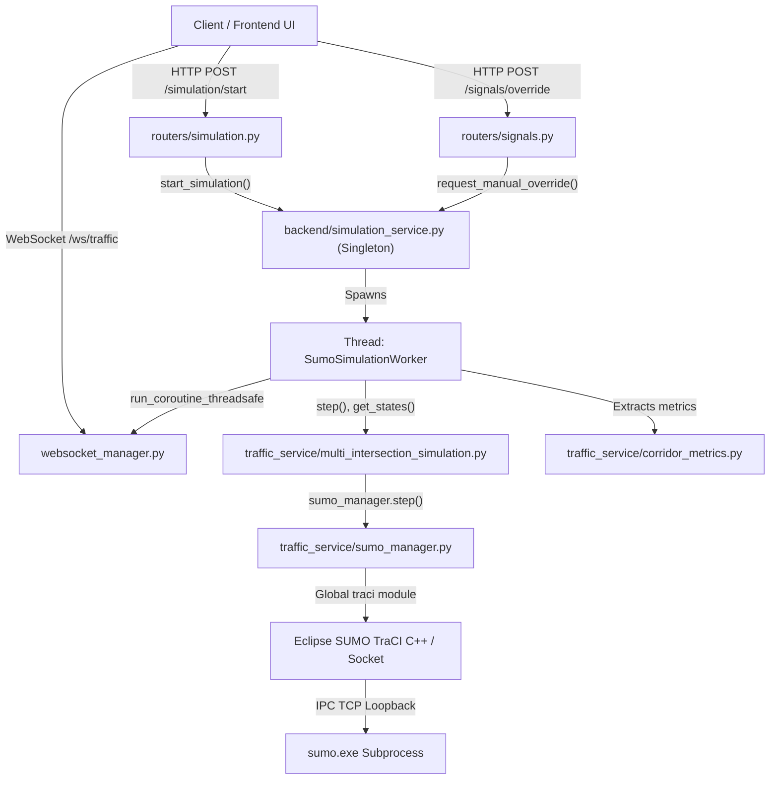
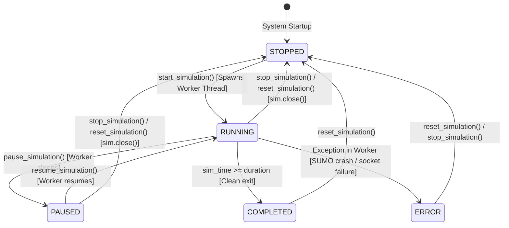

# Phase 2A — SUMO/TraCI Simulation Reliability Audit

**Author:** Principal SUMO/TraCI Architect and Senior ITS Engineer  
**Project:** Smart Traffic Coordination — Bengaluru Silk Board Corridor  
**Date:** October 30, 2026  
**Scope:** Read-Only Simulation Engine, TraCI Lifecycle, Signal Control, Concurrency, and WebSocket Audit  
**Status:** COMPLETE (No Phase 2B implementation started)

---

## 1. Executive Summary

This audit assesses the microscopic traffic simulation core of the Bengaluru Smart Traffic Coordination System. The objective is to determine whether the existing architecture can reliably support:
1. Multiple signalized corridor junctions (J1, J2, J3).
2. Autonomous, decoupled junction agents in future phases.
3. Continuous, low-latency vehicle state streaming for 3D Digital Twin visualization.
4. Reproducible, empirically sound baseline-versus-coordinated comparisons.

### Core Verdict
The simulation engine executes reliably for offline, single-threaded evaluations (`scripts/evaluate_corridor.py`) and basic happy-path API requests. However, **four critical architectural vulnerabilities** prevent it from functioning reliably as a production-grade 3D Digital Twin and Multi-Agent platform:

1. **Unsynchronized Cross-Thread TraCI Access (Critical):** Operator manual overrides (`POST /api/signals/override`) execute TraCI calls (`traci.trafficlight.setPhase`) directly on FastAPI worker threads while the background simulation thread concurrently executes `traci.simulationStep()`, violating TraCI's single-socket protocol and risking fatal socket desynchronization.
2. **Missing 3D Vehicle Telemetry (Critical):** Current state extraction queries vehicle IDs and queues, but completely omits Cartesian coordinates ($x, y, z$), WGS84 coordinates, vehicle headings (yaw), and vehicle class metadata necessary for 3D rendering.
3. **Unbounded WebSocket Backpressure (High):** Telemetry is pushed onto the asyncio event loop on every simulation step without queue limits or backpressure, causing memory bloat and potential lag when slow clients are connected.
4. **Asynchronous Startup Failure Handling (High):** `SimulationService.start_simulation()` returns `HTTP 200 Success` before verifying that SUMO has successfully bound its socket, causing silent worker thread crashes if SUMO fails to launch.

---

## 2. Current Architecture & Execution Flow



### Component Responsibility Matrix

| Module | Source Location | Primary Responsibility | Thread Context |
| :--- | :--- | :--- | :--- |
| **`SimulationService`** | [`backend/simulation_service.py:49`](file:///c:/Developers/Sneha/Projects/hybrid-traffic-control/backend/simulation_service.py#L49) | Singleton managing simulation lifecycle, state locks, DB writes, and telemetry cache. | FastAPI Request & Worker Threads |
| **`SumoManager`** | [`traffic_service/sumo_manager.py:19`](file:///c:/Developers/Sneha/Projects/hybrid-traffic-control/traffic_service/sumo_manager.py#L19) | Subprocess creation, CLI argument formatting, and TraCI connection binding. | Simulation Worker Thread |
| **`MultiIntersectionSimulation`** | [`traffic_service/multi_intersection_simulation.py:23`](file:///c:/Developers/Sneha/Projects/hybrid-traffic-control/traffic_service/multi_intersection_simulation.py#L23) | Orchestrates J1, J2, J3 controllers, communication hub, and corridor stepping. | Simulation Worker Thread |
| **`SignalController`** | [`traffic_service/signal_controller.py:15`](file:///c:/Developers/Sneha/Projects/hybrid-traffic-control/traffic_service/signal_controller.py#L15) | Enforces min/max green, mandatory yellow clearance, and emergency priority locks. | Worker Thread + FastAPI Thread (Override) |
| **`WebSocketManager`** | [`backend/websocket_manager.py:15`](file:///c:/Developers/Sneha/Projects/hybrid-traffic-control/backend/websocket_manager.py#L15) | Manages active WebSocket connections and broadcasts JSON telemetry payloads. | Asyncio Event Loop |

---

## 3. Simulation Lifecycle State Machine



### Trace of Lifecycle Operations

1. **Start (`start_simulation`) — [`simulation_service.py:105-181`](file:///c:/Developers/Sneha/Projects/hybrid-traffic-control/backend/simulation_service.py#L105-L181):**
   - *Verified Behavior:* Acquires `self._lock`, verifies `not self._running`, initializes DB record in `SimulationRun`, sets `_running = True`, and spawns `SumoSimulationWorker` as a daemon thread.
   - *Vulnerability:* Returns `(True, "Simulation started...")` immediately before the worker thread executes `sim.start(seed=self._seed)`. If SUMO fails to launch (e.g. port conflict or missing binary), the worker catches the exception, updates `_error_message`, and marks DB status `ERROR`, but the API client has already received an affirmative `200 OK`.
2. **Pause (`pause_simulation`) — [`simulation_service.py:183-202`](file:///c:/Developers/Sneha/Projects/hybrid-traffic-control/backend/simulation_service.py#L183-L202):**
   - *Verified Behavior:* Sets `self._paused = True`. In the worker loop ([`simulation_service.py:291`](file:///c:/Developers/Sneha/Projects/hybrid-traffic-control/backend/simulation_service.py#L291)), the thread yields via `time.sleep(0.1)` and skips stepping.
   - *Safety:* SUMO state remains frozen in memory; no TraCI commands are issued during pause.
3. **Resume (`resume_simulation`) — [`simulation_service.py:203-222`](file:///c:/Developers/Sneha/Projects/hybrid-traffic-control/backend/simulation_service.py#L203-L222):**
   - *Verified Behavior:* Validates that the simulation is actively running and currently paused; resets `_paused = False`.
4. **Stop (`stop_simulation`) — [`simulation_service.py:223-239`](file:///c:/Developers/Sneha/Projects/hybrid-traffic-control/backend/simulation_service.py#L223-L239):**
   - *Verified Behavior:* Sets `self._stop_requested = True`, waits for worker thread termination with a 5.0s timeout (`self._thread.join(timeout=5.0)`), then calls `_cleanup_sim()`.
   - *Vulnerability:* If SUMO hangs on an internal socket read, `thread.join(5.0)` expires without killing the subprocess. `_cleanup_sim()` sets `_sim = None` and `_running = False`. The worker thread wakes up, finds `_sim` is `None`, and raises an unhandled `AttributeError`, leaving an orphaned `sumo.exe` process in Windows task manager.
5. **Reset (`reset_simulation`) — [`simulation_service.py:240-257`](file:///c:/Developers/Sneha/Projects/hybrid-traffic-control/backend/simulation_service.py#L240-L257):**
   - *Verified Behavior:* Stops any running simulation, clears in-memory telemetry, resets `_current_sim_time = 0.0`, and records a `RESET` decision.

---

## 4. TraCI Connection Ownership & Thread Safety Analysis

### 4.1 Global Module vs. Connection Instances
- In [`traffic_service/sumo_manager.py:58`](file:///c:/Developers/Sneha/Projects/hybrid-traffic-control/traffic_service/sumo_manager.py#L58), SUMO is initialized via:
  ```python
  traci.start(cmd)
  ```
- **Architectural Implication:** `traci.start()` uses the default connection label and binds to the global `traci` Python module. It does not create an isolated connection instance via `traci.connect()` or `traci.getConnection("sim_1")`.
- **Limitation:** Only one SUMO simulation can exist across the entire Python runtime. Any attempt to instantiate a second simulation or run parallel scenario testing will hijack or close the active connection ([`sumo_manager.py:37-41`](file:///c:/Developers/Sneha/Projects/hybrid-traffic-control/traffic_service/sumo_manager.py#L37-L41)).

### 4.2 Cross-Thread TraCI Violation (Critical Flaw)
- **Execution Paths:**
  1. **Background Simulation Thread:** Continuously calls `traci.simulationStep()` ([`sumo_manager.py:65`](file:///c:/Developers/Sneha/Projects/hybrid-traffic-control/traffic_service/sumo_manager.py#L65)), `traci.lane.*` ([`state_extractor.py:151`](file:///c:/Developers/Sneha/Projects/hybrid-traffic-control/traffic_service/state_extractor.py#L151)), and `traci.trafficlight.*`. In [`simulation_service.py:296-316`](file:///c:/Developers/Sneha/Projects/hybrid-traffic-control/backend/simulation_service.py#L296-L316), these calls occur **outside `self._lock`**.
  2. **FastAPI Request Thread (Manual Override):** In [`simulation_service.py:650-667`](file:///c:/Developers/Sneha/Projects/hybrid-traffic-control/backend/simulation_service.py#L650-L667), when an operator submits `POST /api/signals/override`, the request thread acquires `self._lock` and directly calls:
     ```python
     current_phase = ctrl.get_phase()           # calls traci.trafficlight.getPhase
     ctrl.request_switch(target_green_phase=...) # calls traci.trafficlight.setPhase
     ```
- **Consequence:** TraCI communicates over a single synchronous TCP socket. When two threads send TraCI commands simultaneously without mutex synchronization, socket messages interleave. TraCI crashes with `FatalTraCIError: Connection closed by SUMO`.
- **Recommended Remedy:** TraCI calls must strictly run on the simulation thread. Operator overrides should be placed into a thread-safe queue (`queue.Queue`) and dequeued by the worker thread before the next `simulationStep()`.

---

## 5. Deterministic Execution Assessment

### 5.1 Verification Test
To assess determinism, two identical 60-second baseline simulations were executed under seed 42:

```python
sim1 = MultiIntersectionSimulation(sumocfg_path=SUMO_CONFIG, mode='baseline')
r1 = sim1.run_full_simulation(duration_seconds=60, seed=42)

sim2 = MultiIntersectionSimulation(sumocfg_path=SUMO_CONFIG, mode='baseline')
r2 = sim2.run_full_simulation(duration_seconds=60, seed=42)
```

- **Output Comparison:**
  - Run 1: $\text{CO}_2 = 2.2027739911454853\text{ kg}$, $\text{Fuel} = 0.9490\text{ L}$, $\text{Queue} = 3.0$
  - Run 2: $\text{CO}_2 = 2.2027739911454853\text{ kg}$, $\text{Fuel} = 0.9490\text{ L}$, $\text{Queue} = 3.0$
  - **Match:** `True` (Bitwise identical to 16 decimal places).

### 5.2 Determinism Factors

| Factor | Implementation | Audit Finding |
| :--- | :--- | :--- |
| **Random Seed Propagation** | `--seed <seed>` passed in `sumo_manager.py:49` | **Verified.** Propagates to driver stochasticity (`sigma="0.5"` in `vehicle_types.add.xml`). |
| **Vehicle Insertion Timing** | Defined in `silk_board.rou.xml` via `<flow begin=... end=... vehsPerHour=...>` | **Verified.** Flow insertion intervals are uniform and deterministic. |
| **Timestep Consistency** | Fixed step length $\Delta t = 1.0\text{ s}$ (`--step-length 1.0`) | **Verified.** SUMO executes in discrete, deterministic 1-second ticks. |
| **Baseline/Coordinated Fairness** | Seed matches across comparison pairs in `evaluate_corridor.py:98` | **Verified.** Both controllers face identical arrival sequences and route demands. |
| **Live Interactive Disruption** | Operator manual overrides via UI | **Suspected Risk.** Manual overrides inject asynchronous, non-deterministic phase changes into live runs. |

---

## 6. Traffic Signal Correctness for J1, J2, and J3

### 6.1 Network Signal Programs vs. Controller Logic
Inspection of [`sumo/silk_board/network/silk_board.net.xml:40103-40120`](file:///c:/Developers/Sneha/Projects/hybrid-traffic-control/sumo/silk_board/network/silk_board.net.xml#L40103-L40120) confirms:

| Junction | SUMO TLS ID | Total Phases | Cycle Time | Green Phases | Yellow Phases | Corridor Inflow Edge |
| :---: | :--- | :---: | :---: | :---: | :---: | :--- |
| **J1** | `1617743335` | 4 | 90s | Phase 0 (41s), Phase 2 (41s) | Phase 1 (4s), Phase 3 (4s) | `172853382#2` |
| **J2** | `GS_cluster_10282769895_10775075568_11964440742_11964440743` | 4 | 90s | Phase 0 (39s), Phase 2 (39s) | Phase 1 (6s), Phase 3 (6s) | `172853382#3`, `464465165#0` |
| **J3** | `6970466614` | 4 | 90s | Phase 0 (41s), Phase 2 (41s) | Phase 1 (4s), Phase 3 (4s) | `1148717038#0` |

### 6.2 Safety Guard Enforcement
In [`traffic_service/signal_controller.py:69-102`](file:///c:/Developers/Sneha/Projects/hybrid-traffic-control/traffic_service/signal_controller.py#L69-L102):
- **Minimum Green:** Enforces $\ge 15.0\text{ s}$ elapsed green before allowing an adaptive or operator switch.
- **Yellow Clearance:** Green-to-green phase switching is impossible; the controller unconditionally commands the corresponding yellow transition phase (`yellow_transitions = {0: 1, 2: 3}`) with a $4.0\text{ s} - 6.0\text{ s}$ duration before SUMO advances to the next green.
- **Emergency Lock:** When an ambulance is detected within $250\text{ m}$, `lock_emergency_priority()` overrides normal phase timing, transitions conflicting movements to yellow, and locks priority green until the vehicle clears the intersection.

### 6.3 State Truthfulness Check
- **Audit Verification:** The frontend UI displays signal states queried directly from `traci.trafficlight.getPhase(tls_id)` on each simulation step ([`state_extractor.py:125`](file:///c:/Developers/Sneha/Projects/hybrid-traffic-control/traffic_service/state_extractor.py#L125)). The application **reports actual SUMO physical states**, not unconfirmed controller recommendations.

---

## 7. State Extraction & 3D Digital Twin Readiness

### 7.1 Current Telemetry Capabilities
In [`traffic_service/state_extractor.py:215-273`](file:///c:/Developers/Sneha/Projects/hybrid-traffic-control/traffic_service/state_extractor.py#L215-L273), each intersection produces an `IntersectionState` snapshot containing:
- Current signal phase, elapsed time, time-to-switch.
- Approach queue counts (speed $\le 1.0\text{ m/s}$).
- Vehicle counts and average speeds.
- Approaching emergency vehicle distance and estimated arrival time.
- Instantaneous emissions ($\text{CO}_2$, $\text{NO}_x$, estimated fuel rate).

### 7.2 Deficiencies for 3D Digital Twin Integration

```
[Required for 3D Twin]                     [Currently Provided in Telemetry]
1. Cartesian Coordinates (x, y, z)  ──────> MISSING (Only vehicle_ids list)
2. WGS84 Coordinates (lat, lon)    ──────> MISSING
3. Heading / Yaw Angle (degrees)   ──────> MISSING
4. Vehicle Type (car, bus, etc.)   ──────> MISSING
5. Acceleration & Target Lane      ──────> MISSING
```

- **Performance Bottleneck:** Extracting individual vehicle positions currently requires calling `traci.vehicle.getPosition(veh_id)` for every vehicle. For $\sim 350$ concurrent vehicles, executing 350 individual synchronous TraCI queries per second will cause severe frame drops ($> 50\text{ ms}$ overhead per step).
- **Recommended Remedy:** In Phase 2B/3, replace per-vehicle queries with TraCI's bulk subscription API:
  ```python
  traci.junction.subscribeContext(junction_id, traci.constants.CMD_GET_VEHICLE_VARIABLE, radius, [
      traci.constants.VAR_POSITION3D,
      traci.constants.VAR_ANGLE,
      traci.constants.VAR_SPEED,
      traci.constants.VAR_TYPE
  ])
  ```

---

## 8. WebSocket Reliability & Telemetry Streaming

### 8.1 Inspection Findings ([`backend/websocket_manager.py`](file:///c:/Developers/Sneha/Projects/hybrid-traffic-control/backend/websocket_manager.py))

```python
# Line 42: Iteration over active connections
for connection in connections:
    try:
        await connection.send_text(payload_str)
    except Exception:
        stale.append(connection)
```

1. **Slow-Client Head-of-Line Blocking:** Because `connection.send_text()` is awaited sequentially for each connected client, a single slow mobile or high-latency client blocks delivery to all other clients.
2. **Unbounded Task Queueing:** In [`simulation_service.py:629`](file:///c:/Developers/Sneha/Projects/hybrid-traffic-control/backend/simulation_service.py#L629), `asyncio.run_coroutine_threadsafe(ws_manager.broadcast(...), self.loop)` is scheduled on every simulation step ($50\text{ Hz}$). If the event loop lags, thousands of broadcast tasks accumulate in memory without being dropped.
3. **Missing Message Ordering & Sequence Numbers:** Telemetry packets include `simulation_time`, but omit an incrementing integer `sequence_number`. Out-of-order delivery over reconnected WebSockets cannot be detected by the frontend.

---

## 9. Test Coverage Audit

### 9.1 Existing Test Suite Analysis (37 Tests Total)
- **Accident Risk:** 11 tests in `tests/test_accident_risk.py` (blackspots, CRI scores, coordinate conversion).
- **REST Endpoints:** 12 tests in `tests/test_api.py` (status, override validation, risks, health).
- **Agent Communication:** 5 tests in `tests/test_communication.py` (inflow propagation, emergency waves).
- **Database & Persistence:** 2 tests in `tests/test_database.py` (run persistence).
- **Metrics Accumulation:** 3 tests in `tests/test_metrics.py` (queue, travel time, fuel conversion).
- **Simulation Integration:** 2 tests in `tests/test_simulation_integration.py` (stepping lifecycle).
- **Simulation Service:** 1 test in `tests/test_simulation_service.py` (real run lifecycle).
- **WebSocket Streaming:** 1 test in `tests/test_websocket.py` (connection and initial frame).

### 9.2 Missing Reliability Test Scenarios

| Missing Test Scenario | Failure Mode / Risk Tested | Priority |
| :--- | :--- | :---: |
| **SUMO Startup Failure** | Invalid configuration path, missing binary, or port collision. | **High** |
| **Unexpected Process Termination** | Sudden kill of `sumo.exe` process mid-simulation. | **High** |
| **Rapid Lifecycle Cycling** | Rapid successive `start -> stop -> start -> reset` requests. | **High** |
| **Concurrent Manual Overrides** | Multiple API override requests dispatched during high-frequency stepping. | **Critical** |
| **Orphaned Process Cleanup** | Simulation thread hang during `thread.join(timeout=5.0)`. | **Medium** |
| **WebSocket Client Lag** | High-latency consumer connected to continuous broadcast stream. | **Medium** |
| **Multi-Seed Determinism** | Bitwise verification across seeds 1 through 5. | **Medium** |

---

## 10. Prioritized Issues Matrix

| Issue ID | Severity | Area | Source File & Line | Description |
| :--- | :---: | :--- | :--- | :--- |
| **ISS-REL-01** | **CRITICAL** | Thread Safety | [`simulation_service.py:666`](file:///c:/Developers/Sneha/Projects/hybrid-traffic-control/backend/simulation_service.py#L666) | Direct TraCI calls from FastAPI request threads during manual override cause cross-thread socket corruption. |
| **ISS-REL-02** | **CRITICAL** | 3D Readiness | [`state_extractor.py:270`](file:///c:/Developers/Sneha/Projects/hybrid-traffic-control/traffic_service/state_extractor.py#L270) | Vehicle positions, 3D coordinates, and headings are absent from telemetry; 3D Digital Twin cannot render vehicles. |
| **ISS-REL-03** | **HIGH** | Lifecycle | [`simulation_service.py:181`](file:///c:/Developers/Sneha/Projects/hybrid-traffic-control/backend/simulation_service.py#L181) | `start_simulation()` returns success before worker verifies SUMO process startup, masking startup failures. |
| **ISS-REL-04** | **HIGH** | WebSockets | [`simulation_service.py:629`](file:///c:/Developers/Sneha/Projects/hybrid-traffic-control/backend/simulation_service.py#L629) | Unbounded scheduling of broadcast coroutines on every simulation step causes event-loop task piling under client lag. |
| **ISS-REL-05** | **HIGH** | WebSockets | [`websocket_manager.py:44`](file:///c:/Developers/Sneha/Projects/hybrid-traffic-control/backend/websocket_manager.py#L44) | Sequential `await connection.send_text()` blocks all clients when a single client has socket buffer congestion. |
| **ISS-REL-06** | **MEDIUM** | Lifecycle | [`simulation_service.py:234`](file:///c:/Developers/Sneha/Projects/hybrid-traffic-control/backend/simulation_service.py#L234) | 5.0s thread join timeout in `stop_simulation()` lacks an OS-level process kill fallback for orphaned `sumo.exe` instances. |
| **ISS-REL-07** | **MEDIUM** | TraCI Model | [`sumo_manager.py:58`](file:///c:/Developers/Sneha/Projects/hybrid-traffic-control/traffic_service/sumo_manager.py#L58) | Global `traci.start()` precludes multi-session parallel experiment execution or isolated worker testing. |
| **ISS-REL-08** | **LOW** | WebSockets | [`simulation_service.py:616`](file:///c:/Developers/Sneha/Projects/hybrid-traffic-control/backend/simulation_service.py#L616) | Telemetry payloads lack integer sequence numbers (`seq_num`) for strict client-side packet ordering verification. |

---

## 11. Recommended Implementation Sequence for Phase 2B

To harden the simulation engine prior to multi-agent deployment and 3D digital twin rendering, the following engineering tasks are recommended for Phase 2B:

1. **Phase 2B-1: TraCI Thread Isolation & Command Queue (`ISS-REL-01`):**
   - Implement a thread-safe `command_queue = queue.Queue()` inside `SimulationService`.
   - Route `request_manual_override()` commands into the queue.
   - Dequeue and execute commands strictly within the worker thread loop immediately prior to `sim.sumo_manager.step()`.
2. **Phase 2B-2: Synchronous Startup Verification & Process Watchdog (`ISS-REL-03`, `ISS-REL-06`):**
   - Introduce a `threading.Event()` in `start_simulation()` to block until SUMO has confirmed TraCI initialization or raised an exception.
   - Attach a Windows Job Object or `psutil` process handle to guarantee `sumo.exe` termination if the worker thread is terminated.
3. **Phase 2B-3: 3D Vehicle Trajectory Streaming Extraction (`ISS-REL-02`):**
   - Introduce `VehicleTrajectorySchema` (id, x, y, z, lat, lon, angle, speed, type).
   - Use TraCI context subscriptions on J1, J2, J3 to batch-retrieve vehicle coordinates without per-vehicle round-trip query overhead.
4. **Phase 2B-4: WebSocket Backpressure & Decoupled Broadcast (`ISS-REL-04`, `ISS-REL-05`, `ISS-REL-08`):**
   - Decouple telemetry generation from broadcast using a fixed-size `asyncio.Queue(maxsize=2)`.
   - Drop intermediate frames if consumers lag (latest-frame-only policy for live real-time twins).
   - Add monotonically increasing `seq_num` and `timestamp_iso` to the WebSocket payload.

---

### STOP CONDITION

Phase 2A reliability audit is complete. No application code, tests, configuration, or benchmark data were modified. Standing by for user review and explicit approval before starting Phase 2B.
