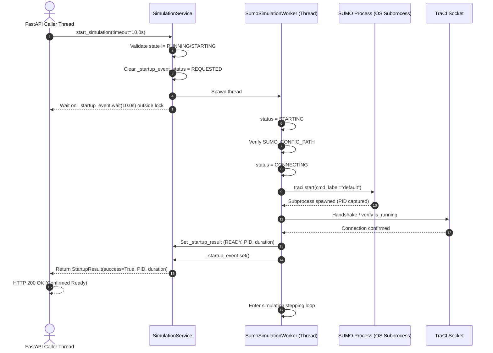
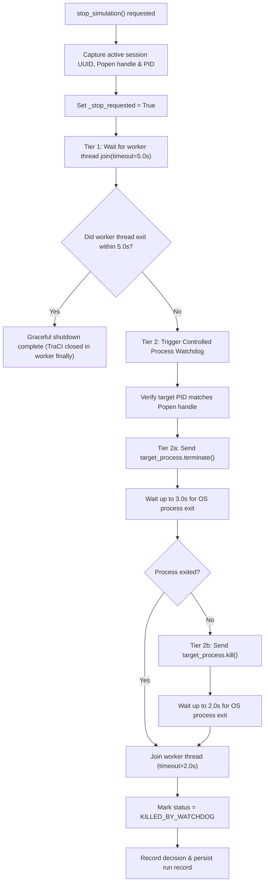

# Phase 2B-2 — Synchronous SUMO Startup and Process Watchdogs

**Document ID:** `AUDIT-PHASE-2B-2-STARTUP-WATCHDOG`  
**Date:** 2026-10-30  
**Role:** Principal Python Systems Engineer, SUMO/TraCI Specialist and Process Lifecycle Architect  
**Project:** Smart Traffic Coordination — Bengaluru Silk Board Corridor  
**Scope:** Phase 2B-2 Implementation and Verification  

---

## 1. Executive Summary

Phase 2B-2 hardens the SUMO simulation engine by eliminating the two fundamental process lifecycle vulnerabilities identified in the Phase 2A Reliability Audit:
1. **Asynchronous Startup Race:** The API previously returned `HTTP 200` before the simulation worker thread confirmed that SUMO had launched, initialized its network and routes, and bound its TraCI control socket.
2. **Orphaned Process Leakage on Unresponsive Workers:** If SUMO or TraCI became blocked or unresponsive, `stop_simulation()` previously logged a warning after a 5.0-second timeout and returned without terminating the underlying OS process, leaving orphaned `sumo.exe` instances and active socket bindings.

Phase 2B-2 implements:
- **Synchronous Startup Handshake:** Enforces an explicit state machine `REQUESTED → STARTING → CONNECTING → READY` (or `STARTING → FAILED`). `start_simulation()` blocks synchronously until readiness is confirmed or a bounded startup timeout expires.
- **Two-Tier Process Watchdog Escalation:** Controlled OS-level termination targeting exclusively the verified `subprocess.Popen` handle and PID belonging to that session, without calling `traci.close()` from caller threads and without global process-name kills.
- **TraCI Internal Registry Resilience:** Resolves TraCI's internal `Connection 'default' is already active` defect by ensuring zombie connection entries are cleanly unlinked from `traci.connection._connections` even when communication over a dead socket raises exceptions.
- **Full Backward Compatibility:** Exposes `StartupResult` as a tuple subclass preserving `ok, msg = sim_service.start_simulation(...)` while adding rich structured properties (`status`, `pid`, `startup_duration_s`, `run_uuid`, `error`).

---

## 2. Startup Lifecycle Architecture

### 2.1 State Transition Model

```mermaid
stateDiagram-v2
    [*] --> REQUESTED: start_simulation() called
    REQUESTED --> STARTING: Worker thread spawned
    STARTING --> FAILED: Missing config / binary not found
    STARTING --> CONNECTING: MultiIntersectionSimulation created
    CONNECTING --> FAILED: TraCI socket error / connection crash
    CONNECTING --> READY: traci.start() succeeded & is_running=True
    READY --> RUNNING: Readiness signaled to caller thread
    FAILED --> ERROR: Cleaned up; caller returned failure
```



### 2.2 Startup Handshake Sequence



---

## 3. Shutdown and Watchdog Escalation Architecture

### 3.1 Two-Tier Escalation Model



### 3.2 Invariants and Safety Guarantees

1. **Exclusive TraCI Ownership:**
   - The simulation worker thread is the sole entity permitted to invoke `traci.close()` or any TraCI socket commands.
   - The watchdog operates strictly at the OS process level via `target_process.terminate()` and `target_process.kill()`.
   - Caller threads NEVER call `traci.close()`.

2. **Strict Process Identity Isolation:**
   - The watchdog targets exclusively the `subprocess.Popen` handle and integer PID recorded during that session's startup.
   - PID matching is verified before issuing termination signals.
   - Broad process termination commands (`taskkill /IM sumo.exe`, `pkill sumo`) are strictly prohibited and never invoked.
   - An old session watchdog cannot terminate a newer session's process because the handle and PID are captured locally per session request.

3. **TraCI Internal Registry Resilience:**
   - Standard TraCI `Connection.close()` raises an exception if the socket is broken by process termination before deleting the connection entry from `traci.connection._connections`.
   - `SumoManager.start()` and `SumoManager.stop()` explicitly prune dead labels from `traci.connection._connections`, eliminating cascading `Connection 'default' is already active` errors.

---

## 4. Implementation Details

### 4.1 Modified Files

| File | Changes Made |
| :--- | :--- |
| `traffic_service/sumo_manager.py` | Added `label`, `process` (`subprocess.Popen`), and `pid` properties; captured handle from TraCI connection; added resilient connection cleanup in `start()` and `stop()`. |
| `traffic_service/multi_intersection_simulation.py` | Exposed `process` and `pid` properties from `SumoManager`; forwarded `label` configuration. |
| `backend/schemas.py` | Extended `SimulationStartRequest` with `startup_timeout_s: float = 10.0`; extended `SimulationStatusResponse` with optional `status`, `pid`, and `run_uuid`. |
| `backend/routers/simulation.py` | Updated `start_simulation` route to pass `startup_timeout_s` and return `HTTP 500` on startup timeout/failure while preserving `HTTP 409` for duplicate start conflicts. |
| `backend/simulation_service.py` | Implemented `StartupStatus` enum, `StartupResult` tuple subclass, `_startup_event` synchronization primitive, `_escalate_process_watchdog` two-tier escalation, and status reporting during startup. |
| `tests/test_startup_watchdog.py` | Created comprehensive 18-scenario deterministic verification suite. |

### 4.2 API Contract & Backward Compatibility

```python
# Backwards-compatible tuple unpacking:
ok, msg = sim_service.start_simulation(...)

# Rich metadata access:
result = sim_service.start_simulation(...)
assert result.success is True
assert result.status == StartupStatus.READY
assert result.pid > 0
assert result.startup_duration_s >= 0.0
assert result.run_uuid.startswith("run_")
```

---

## 5. Verification Results

### 5.1 Targeted Startup & Watchdog Suite (`tests/test_startup_watchdog.py`)

All 18 deterministic test scenarios passed:

| # | Test Name | Scenario Description | Status |
| :-: | :--- | :--- | :---: |
| 1 | `test_successful_sumo_startup_and_readiness_acknowledgement` | Real SUMO startup confirms PID, duration, and READY status | **PASSED** |
| 2 | `test_api_response_waits_until_readiness` | Proves caller blocks while worker transitions through STARTING/CONNECTING | **PASSED** |
| 3 | `test_sumo_executable_missing` | Missing SUMO binary returns clean failure without orphaned processes | **PASSED** |
| 4 | `test_invalid_configuration_path` | Invalid config path returns immediate failure with CONFIG_NOT_FOUND | **PASSED** |
| 5 | `test_traci_connection_failure` | TraCI FatalTraCIError socket failure returns clean root cause | **PASSED** |
| 6 | `test_startup_timeout` | Worker hung during startup triggers timeout failure and watchdog cleanup | **PASSED** |
| 7 | `test_worker_exception_before_readiness` | Initialization exception signals failure immediately without hang | **PASSED** |
| 8 | `test_worker_exception_after_readiness` | Crash during simulationStep cleans up gracefully and records ERROR status | **PASSED** |
| 9 | `test_duplicate_startup_request` | Second start request while starting/running is immediately rejected | **PASSED** |
| 10 | `test_graceful_worker_shutdown` | Normal stop shuts down in Tier 1 without watchdog escalation | **PASSED** |
| 11 | `test_worker_join_timeout_triggers_watchdog` | Hung worker join timeout triggers Tier 2 watchdog escalation | **PASSED** |
| 12 | `test_graceful_sumo_process_termination` | Watchdog successfully terminates process via terminate() | **PASSED** |
| 13 | `test_forced_sumo_process_termination_after_grace_period` | Unresponsive terminate() escalates to kill() after grace period | **PASSED** |
| 14 | `test_watchdog_never_terminates_unrelated_process` | Mismatched PID causes watchdog to abort without touching processes | **PASSED** |
| 15 | `test_old_session_watchdog_cannot_terminate_newer_session` | Session A watchdog terminates only Session A handle, isolating Session B | **PASSED** |
| 16 | `test_repeated_stop_requests_handle_cleanly` | Successive stop requests when stopped return False cleanly without error | **PASSED** |
| 17 | `test_pending_command_cancellation_during_shutdown` | Enqueued commands are cancelled with SIMULATION_STOPPED during shutdown | **PASSED** |
| 18 | `test_traci_closure_strictly_on_worker_thread` | Proves traci.close() is never called by caller thread, only by worker | **PASSED** |

### 5.2 Full Backend Regression Suite

```
collected 67 items

tests/test_accident_risk.py ...........                                  [ 16%]
tests/test_api.py ............                                           [ 34%]
tests/test_command_queue.py ............                                 [ 52%]
tests/test_communication.py .....                                        [ 59%]
tests/test_database.py ..                                                [ 62%]
tests/test_metrics.py ...                                                [ 67%]
tests/test_simulation_integration.py ..                                  [ 70%]
tests/test_simulation_service.py .                                       [ 71%]
tests/test_startup_watchdog.py ..................                        [ 98%]
tests/test_websocket.py .                                                [100%]

====================== 67 passed, 272 warnings in 38.79s ======================
```

### 5.3 Frontend Production Build

```
> smart-traffic-dashboard@1.0.0 build
> vite build

vite v5.4.21 building for production...
transforming...
✓ 2732 modules transformed.
rendering chunks...
computing gzip size...
dist/index.html                   0.80 kB │ gzip:   0.54 kB
dist/assets/index-BtsuBuXP.css   27.93 kB │ gzip:   5.64 kB
dist/assets/index-DKF9HxMc.js   616.13 kB │ gzip: 172.14 kB
✓ built in 12.37s
```

---

## 6. Observability

All startup and shutdown events emit structured logs capturing key diagnostic telemetry:
- **Startup:** Session UUID, mode, random seed, timeout limit, duration to readiness, and OS PID:
  `Simulation startup requested (UUID: run_..., mode: coordinated, timeout: 10.0s)`
  `SUMO process handle captured: PID 14844 (label: 'default')`
  `Simulation startup confirmed READY (UUID: run_..., PID: 14844, duration: 1.16s)`
- **Shutdown:** Shutdown request timestamp, session UUID, PID, graceful duration, or watchdog escalation:
  `Shutdown requested for session run_... (PID: 14844) at 2026-10-30T21:40:00.000000`
  `Graceful simulation shutdown succeeded in 0.35s (Session: run_...).`
  `WATCHDOG TRIGGERED: Terminating unresponsive SUMO process for Session UUID=run_..., PID=14844.`

---

## 7. Remaining Limitations

1. **Subprocess Group Termination on Windows:**
   - On Windows, `process.terminate()` calls `TerminateProcess` directly on the root SUMO process. In the standard configuration, SUMO does not spawn secondary child processes. If external tools or wrappers are used in future phases, a Windows Job Object may be considered to enforce process-tree termination.
2. **Phase 2B-3 Scope:**
   - Trajectory streaming and WebSocket subscriptions remain deferred to Phase 2B-3.

---

## 8. Sign-off

Phase 2B-2 is complete, fully tested, and verified against all specified requirements. All 67 backend tests pass and the frontend build succeeds without regressions.
