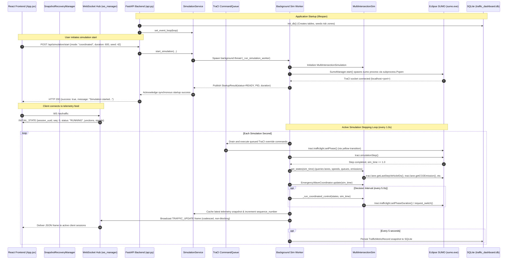
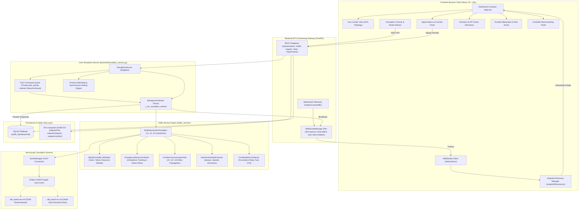

# Document 01: Project Overview & System Architecture

**Project:** Smart Traffic Coordination System — Bengaluru Silk Board Corridor  
**Audit Date:** October 31, 2026  
**Auditor:** Principal Software Architect, Traffic Simulation Engineer & ML/RL Systems Auditor  
**Audit Scope:** End-to-End Repository Inspection, Architectural Verification, Data Flow Mapping, and Source of Truth Identification  

---

## 1. System Identity & Problem Space

### 1.1 Corridor Context
The **Central Silk Board** junction in Bengaluru, Karnataka, India (approx. $12.9172^\circ\text{ N}, 77.6228^\circ\text{ E}$) represents one of the most notoriously congested, high-friction arterial choke points in South Asia. Located at the intersection of Hosur Road (National Highway 44) and the Outer Ring Road (ORR), it experiences extreme multi-modal vehicular density, significant heavy-vehicle and BMTC bus transit, aggressive mixed-fleet merging, and critical emergency transit bottlenecks between major healthcare centers (e.g., St. John's Medical College Hospital to the north and Electronic City to the south).

### 1.2 System Purpose
The **Smart Traffic Coordination System** is designed as a microscopic traffic simulation platform, adaptive corridor signal coordinator, and real-time operations dashboard. It models a contiguous multi-intersection corridor along Hosur Road:
- **J1 (Hosur North Feeder):** TLS `1617743335` — upstream feeder signal at Madiwala Checkpost / Ayyappa Temple approach.
- **J2 (Silk Board Central Junction):** TLS `GS_cluster_10282769895_10775075568_11964440742_11964440743` — primary 4-way conflict intersection.
- **J3 (Hosur South Feeder):** TLS `6970466614` — downstream feeder signal towards Rupena Agrahara and Electronic City.

### 1.3 Key Architectural Disclaimer
As explicitly recorded in the SUMO configuration (`sumo/silk_board/silk_board.sumocfg`), this system is an **OpenStreetMap (OSM)-derived microscopic simulation running on Eclipse SUMO and TraCI**. It is **not** connected to physical Bengaluru Traffic Police roadside loop detectors, physical radar sensors, or live ATC controllers. All runtime telemetry is synthesized inside the microscopic simulation engine.

---

## 2. Complete Repository Subsystem Inventory

The repository is structured into distinct, decoupled subsystems:

```
c:\Developers\Sneha\Projects\hybrid-traffic-control\
├── backend/                # FastAPI application, TraCI bridge, WebSocket hub, SQLite ORM
│   ├── routers/            # Modular REST endpoints (health, simulation, traffic, signals, etc.)
│   ├── config.py           # Path resolution, environment variables, CORS settings
│   ├── database.py         # SQLAlchemy engine, session management, risk zone seeding
│   ├── main.py             # FastAPI entry point, lifespan lifecycle, WebSocket route
│   ├── models.py           # SQLAlchemy declarative database models
│   ├── risk_service.py     # Static reader for pre-computed risk zones and hotspot clusters
│   ├── schemas.py          # Pydantic v2 validation schemas
│   ├── simulation_service.py # Core background simulation worker, TraCI command queue, telemetry
│   └── websocket_manager.py# Thread-safe bounded WebSocket connection manager
├── common/                 # Shared cross-cutting utilities
│   └── sumo_env.py         # Cross-platform SUMO_HOME, binary, and tools resolution
├── data/                   # Official and semi-curated road safety datasets
│   └── accidents/
│       ├── raw/            # BTP station crashes (2020-2023), station KML, raw corridor blackspots
│       ├── processed/      # Cleaned and standardized blackspot observations
│       └── README.md       # Data provenance and methodology documentation
├── docs/                   # Architectural audits, hardening records, and test plans
│   ├── AUDIT/              # Phase 1, Phase 2A, Phase 2B-1/2/3A/3B/3C/3D audit history
│   └── PROJECT_AUDIT/      # Current comprehensive technical health deliverables
├── frontend/               # Single-Page Web Application (React 18 + Vite 5 + Tailwind CSS)
│   ├── src/
│   │   ├── components/     # UI widgets (LiveCorridorView, SignalStatus, KPIs, Controls, etc.)
│   │   ├── services/       # API client, WebSocket client, SnapshotRecoveryManager
│   │   ├── App.jsx         # Root dashboard container and manual override modal
│   │   └── main.jsx        # React DOM entry point
│   └── package.json        # Dependencies (React 18, Lucide-React, Recharts, Vite 5)
├── outputs/                # Persistent offline analysis artifacts
│   ├── accidents/          # Cleaned accident data & spatial mapping summaries
│   ├── corridor/           # Multi-seed evaluation benchmarks (baseline vs coordinated)
│   ├── hotspots/           # DBSCAN hotspot clusters (hotspots.csv)
│   └── risk/               # MoRTH/IRC risk zones (risk_zones.json, risk_summary.csv)
├── scripts/                # Network building, demand generation, and offline evaluation
│   ├── build_silk_board_network.py    # Generates silk_board.net.xml from OSM
│   ├── download_silk_board_osm.py     # Overpass API downloader for Silk Board bbox
│   ├── evaluate_corridor.py           # Multi-seed baseline vs coordinated evaluator
│   ├── generate_silk_board_demand_v2.py # Deterministic multi-class demand generator
│   ├── run_accident_pipeline.py       # End-to-end spatial blackspot & DBSCAN pipeline
│   └── validate_silk_board_network.py # Network geometry and connectivity validator
├── sumo/silk_board/        # SUMO simulation definitions
│   ├── demand/             # silk_board.rou.xml, vehicle_types.add.xml
│   ├── network/            # silk_board.net.xml (OSM converted road network)
│   ├── junction_mapping.json # Mapping between logical IDs (J1, J2, J3) and SUMO TLS IDs
│   └── silk_board.sumocfg  # Master SUMO configuration file
├── tests/                  # Pytest test suite (106 tests)
│   ├── test_accident_risk.py          # Blackspot mapping and DBSCAN tests
│   ├── test_api.py                    # REST API integration tests
│   ├── test_command_queue.py          # Concurrency and timeout lifecycle tests
│   ├── test_communication.py          # Corridor communication hub tests
│   ├── test_database.py               # SQLite schema and persistence tests
│   ├── test_full_stack_stress.py      # Flapping, backpressure, and stress tests
│   ├── test_metrics.py                # Corridor metrics and unit conversion tests
│   ├── test_simulation_integration.py # SUMO TraCI lifecycle integration tests
│   ├── test_simulation_service.py     # Background simulation worker tests
│   ├── test_startup_watchdog.py       # Synchronous startup and watchdog escalation tests
│   ├── test_websocket.py              # WebSocket endpoint tests
│   ├── test_websocket_ordering.py     # Monotonic sequencing and session rejection tests
│   └── test_websocket_resilience.py   # Multi-client isolation and slow consumer tests
└── traffic_service/        # SUMO simulation orchestrator and domain algorithms
    ├── accident_dataset.py            # Blackspot data ingestion and cleaning
    ├── communication.py               # Inter-intersection messaging hub
    ├── corridor_metrics.py            # Cumulative travel time and emissions accounting
    ├── emergency_wave.py              # Ambulance tracking and progressive green wave
    ├── hotspot_analyzer.py            # Spatial DBSCAN clustering & severity scoring
    ├── multi_intersection_simulation.py# Multi-junction corridor stepping coordinator
    ├── risk_mapper.py                 # MoRTH Composite Risk Index (CRI) calculation
    ├── scenario_generator.py          # Dynamic route and flow scaling generator
    ├── signal_controller.py           # Constraint-enforcing phase controller (min/max green)
    ├── spatial_mapper.py              # WGS84 to SUMO UTM Zone 43N coordinate projection
    ├── state_extractor.py             # TraCI queue, speed, and emission snapshot extraction
    └── sumo_manager.py                # Process launcher, TraCI socket client, and watchdog
```

---

## 3. End-to-End Simulation & Runtime Control Flow

The runtime execution flow spans from backend server initialization to browser rendering:



---

## 4. End-to-End Architectural Decomposition



---

## 5. Canonical Source of Truth Matrix

In distributed and multi-threaded simulation architectures, ambiguities regarding which layer holds authoritative state lead to state drift and race conditions. The following matrix documents the exact source of truth for all operational variables:

| Telemetry Variable | Primary Source of Truth | Extraction Method / Code Location | Caching / Secondary Storage | Frontend Presentation |
|---|---|---|---|---|
| **Simulation Time** | SUMO Simulation Engine | `traci.simulation.getTime()` via `SumoManager.step()` | Cached in `sim_service._current_sim_time` | Displayed in Header (`Clock`), Timeline |
| **Vehicle Positions** | SUMO TraCI Micro-State | `traci.vehicle.getPosition(veh_id)` | Not broadcast over WS to save bandwidth; sampled for emergency ambulance | SVG Schematic Topology (relative approach lane counts) |
| **Approach Queue Lengths** | SUMO TraCI Lane State | Count of vehicles with speed $\le 1.39\text{ m/s}$ (`state_extractor.py:102`) | Aggregated into `IntersectionState.approach_queues` | LiveCorridorView approach queue badges (J1, J2, J3) |
| **Corridor Vehicle Counts** | SUMO TraCI Lane State | `len(traci.lane.getLastStepVehicleIDs(lane_id))` | Cached in `sim_service._latest_states` | OverviewKPIs ("Active Vehicles") |
| **Signal Phase & Color** | SUMO Traffic Light State | `traci.trafficlight.getPhase(tls_id)` via `signal_controller.py:38` | `IntersectionState.current_phase`, `is_green`, `is_yellow` | LiveCorridorView signal badges, SignalStatusPanel |
| **Elapsed Green Duration** | Calculated from TraCI | `phase_duration - max(0, getNextSwitch() - sim_time)` | `SignalController.get_green_elapsed(sim_time)` | SignalStatusPanel elapsed seconds bar |
| **Instantaneous Emissions** | SUMO HBEFA3 Models | `traci.lane.getCO2Emission()`, `getNOxEmission()` (mg/s) | `state_extractor.py:145` | Real-time emission rate indicators |
| **Volumetric Fuel Consumption** | Derived from TraCI Mass Flow | `lane.getFuelConsumption()` (mg/s) divided by $750.0\text{ mg/ml}$ | `state_extractor.py:165` (`fuel_ml_s`, `accumulated_fuel_liters`) | OverviewKPIs & EmissionAnalytics chart |
| **Emergency Ambulance Status** | TraCI Vehicle Scanner & Tracking | Scans approach lanes within 250m (`state_extractor.py:183`) | `EmergencyWaveCoordinator.metrics` | EmergencyPanel ("Active Preemption", ETAs) |
| **Inter-Junction Outflow Messages** | In-Memory Message Bus | `CorridorCommunicationHub` (`communication.py:59`) | In-memory deques and inflow cache | Factored into J2 adaptive decision bonuses |
| **Controller Decisions** | Simulation Service Logger | Generated during `_run_coordinated_control()` | Appended to `sim_service._latest_decisions` & `signal_decisions` table | What-If Scenario decision logs, initial state payload |
| **Accident Hotspots & Risk Zones** | Static Pre-computed JSON/CSV | `outputs/risk/risk_zones.json` and `outputs/hotspots/hotspots.csv` | Pre-seeded into SQLite `risk_zones` table on startup | RiskHotspotsPanel & live map markers |
| **Controller Benchmarks** | Static Pre-computed Multi-Seed CSV | `outputs/corridor/corridor_multi_seed_summary.csv` | Read by `backend/routers/experiments.py:37` | ControllerComparison bar charts & data table |

---

## 6. Subsystem Reality vs. Documented Scope

A critical finding of this audit is distinguishing what is **actively operational**, what is **offline-evaluated**, and what exists as an **architectural placeholder**:

1. **Active Real-Time Pipeline:**
   - SUMO execution via TraCI.
   - Fixed-Time Baseline and Coordinated Adaptive Controller with green-wave preemption.
   - State extraction, queue calculation, and HBEFA3 emission tracking.
   - Bounded WebSocket broadcast with monotonic sequencing and recovery circuit-breaking.
   - React UI displaying live topology, KPIs, emissions, and manual override modal.
   - SQLite persistence for simulation runs, metrics, and decisions.

2. **Offline Data Pipeline (Functional but not invoked during live simulation):**
   - BTP accident data cleaning (`scripts/run_accident_pipeline.py`).
   - Spatial blackspot snapping (`spatial_mapper.py`).
   - Metric DBSCAN clustering (`hotspot_analyzer.py`).
   - MoRTH Composite Risk Index scoring (`risk_mapper.py`).
   - Multi-seed corridor evaluation script (`scripts/evaluate_corridor.py`).
   - *Note:* The outputs of these offline pipelines (`risk_zones.json`, `hotspots.csv`, `corridor_multi_seed_summary.csv`) are statically served to the frontend via REST endpoints.

3. **Architectural Placeholders (Code interfaces exist, but no operational model):**
   - **PPO & DQN Reinforcement Learning:** The `MultiIntersectionSimulation` class provides a clean observation method (`get_ai_observations()`) and action receiver (`step(actions)`), but no neural network models, policy networks, replay buffers, or weights exist. In `backend/routers/experiments.py`, PPO and DQN are explicitly returned with `status="Not implemented"`.
   - **Decentralized Multi-Agent Actors:** J1, J2, and J3 do not run as independent asynchronous agent processes; they are coordinated within a single centralized stepping loop in `MultiIntersectionSimulation`.

---

## 7. Architectural Integrity Verdict

The core simulation, TraCI command queuing, WebSocket streaming, and frontend snapshot recovery architectures are **exceptionally robust, hardened against race conditions, and fully verified by automated stress suites**. Concurrency bugs previously identified (e.g., TraCI thread safety, process capture, disconnect lifecycle) have been completely resolved. The primary architectural limitation is that adaptive signal coordination is currently driven by a centralized rule-based heuristic rather than decentralized autonomous ML/RL agents.
