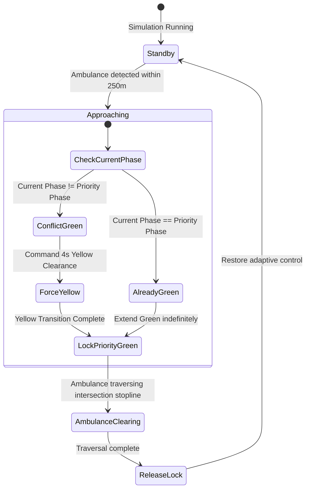

# Document 03: Traffic Signal Control & Junction Operations Audit

**Project:** Smart Traffic Coordination System — Bengaluru Silk Board Corridor  
**Audit Date:** October 31, 2026  
**Auditor:** Principal Traffic Simulation & Signal Control Engineer  
**Audit Scope:** Junction Connectivity, Signal Phasing, Timing Constraints, Queue Dynamics, Coordination, and Safety Interlocks  

---

## 1. Corridor Topology & Junction Profiles

The simulated corridor comprises three contiguous signalized intersections along Hosur Road (NH 44), spanning from north (Madiwala) to south (Rupena Agrahara / Bommanahalli):

```
       [ North: Madiwala Checkpost ]
                     │
                     ▼
          ┌─────────────────────┐
          │   Junction 1 (J1)   │  TLS: 1617743335 (Hosur North Feeder)
          └─────────────────────┘
                     │  Edge: 172853382#3 (Corridor Connector)
                     ▼
          ┌─────────────────────┐
          │   Junction 2 (J2)   │  TLS: GS_cluster_10282769895... (Central Silk Board)
          └─────────────────────┘
                     │  Edge: 1148717038#0 (Corridor Connector)
                     ▼
          ┌─────────────────────┐
          │   Junction 3 (J3)   │  TLS: 6970466614 (Hosur South Feeder)
          └─────────────────────┘
                     │  Edge: 40696223#1 (Exit Edge)
                     ▼
       [ South: Electronic City ]
```

---

## 2. Detailed Junction Specifications

### 2.1 Junction J1 — Hosur North Feeder
- **SUMO Junction ID:** `1617743335`
- **SUMO TLS ID:** `1617743335`
- **Location Context:** Upstream feeder metering southbound Hosur Road traffic entering Silk Board from Madiwala / St. John's.
- **Approach Lanes:**
  - `corridor_hosur`: `["172853382#2_0", "172853382#2_1"]` (2 lanes, southbound arterial)
  - `side_cross`: `["-148697299_0"]` (1 lane, local side access)
- **Downstream Connecting Edge:** `172853382#3` (direct feeder to J2)
- **Phase Mapping:**
  - Phase 0: Side Cross Green
  - Phase 1: Side Cross Yellow Transition
  - Phase 2: Hosur Corridor Arterial Green (**Corridor Priority Phase**)
  - Phase 3: Hosur Corridor Yellow Transition
- **Green Phases Set:** $\{0, 2\}$
- **Yellow Transitions Map:** $\{0: 1, 2: 3\}$

---

### 2.2 Junction J2 — Central Silk Board Primary Intersection
- **SUMO Junction ID:** `cluster_10282769895_10775075568_11964440742_11964440743`
- **SUMO TLS ID:** `GS_cluster_10282769895_10775075568_11964440742_11964440743`
- **Location Context:** High-friction critical 4-way conflict intersection between Hosur Road arterial and Outer Ring Road / Madiwala cross traffic.
- **Approach Lanes:**
  - `corridor_hosur`:
    - `172853382#3_0`, `172853382#3_1` (Arrivals from upstream J1)
    - `464465165#0_0`, `464465165#0_1`, `464465165#0_2` (Outer Ring Road / BTM merging lanes)
  - `madiwala`: `["92196679#0_0", "92196679#0_1"]` (Madiwala market / checkpost side arterial)
- **Outgoing Edges:**
  - `1148717038#0` (Southbound towards J3)
  - `1453814098#0` (Flyover / underpass connector)
  - `239438610#0` (ORR East exit towards HSR Layout)
- **Phase Mapping:**
  - Phase 0: Hosur Road Arterial Green (**Corridor Priority Phase**)
  - Phase 1: Hosur Arterial Yellow Transition
  - Phase 2: Madiwala / Cross Road Green
  - Phase 3: Madiwala / Cross Road Yellow Transition
- **Green Phases Set:** $\{0, 2\}$
- **Yellow Transitions Map:** $\{0: 1, 2: 3\}$

---

### 2.3 Junction J3 — Hosur South Feeder
- **SUMO Junction ID:** `6970466614`
- **SUMO TLS ID:** `6970466614`
- **Location Context:** Downstream regulator managing outflow towards Rupena Agrahara and preventing tailback into Silk Board.
- **Approach Lanes:**
  - `corridor_hosur`: `["1148717038#0_0", "1148717038#0_1"]` (Arrivals from J2)
  - `side_cross`: `["-744783934_0"]` (1 lane, local cross connector)
- **Exit Edge:** `40696223#1` (Arterial exit towards Bommanahalli / Electronic City)
- **Phase Mapping:**
  - Phase 0: Side Cross Green
  - Phase 1: Side Cross Yellow Transition
  - Phase 2: Hosur Corridor Arterial Green (**Corridor Priority Phase**)
  - Phase 3: Hosur Corridor Yellow Transition
- **Green Phases Set:** $\{0, 2\}$
- **Yellow Transitions Map:** $\{0: 1, 2: 3\}$

---

## 3. Signal Timing Constraints & Safety Envelopes

Every signal decision—whether triggered by the adaptive algorithm, emergency preemption, or manual operator override—is strictly mediated by `traffic_service/signal_controller.py`:

| Parameter | Value | Enforcing Code | Engineering Purpose |
|---|---|---|---|
| **Minimum Green ($\text{min\_green}$)** | $15.0\text{ seconds}$ | `signal_controller.py:64` | Guarantees driver expectancy; prevents dangerous rapid signal cycling / flickering. |
| **Maximum Green ($\text{max\_green}$)** | $60.0\text{ seconds}$ | `signal_controller.py:108` | Prevents cross-street vehicle starvation and pedestrian trapping. |
| **Yellow Clearance ($\text{yellow\_duration}$)** | $4.0\text{ seconds}$ | `signal_controller.py:84` | IRC:93-1985 clearance interval; clears intersection conflict box before conflicting green. |
| **Green Extension Interval** | $10.0\text{ seconds}$ | `signal_controller.py:114` | Incremental extension grant when queue pressure or platoon arrival warrants extra time. |
| **All-Red Clearance** | Handled via SUMO net | `silk_board.net.xml` | Built into the SUMO intersection connection definitions. |

---

## 4. Operational Control Logic: The Coordinated Adaptive Controller

At runtime, when `mode="coordinated"`, the simulation executes `_run_coordinated_control()` every `decision_interval = 5.0` seconds.

### 4.1 Queue Measurement Algorithm
Queue detection does not rely on static lane occupancy percentages. It directly tracks vehicular kinetics:
```python
# state_extractor.py:102
def get_lane_queue(self, lane_id: str) -> int:
    vehicle_ids = traci.lane.getLastStepVehicleIDs(lane_id)
    queue = 0
    for veh_id in vehicle_ids:
        if traci.vehicle.getSpeed(veh_id) <= self.queue_speed_threshold:  # 1.39 m/s (5.0 km/h)
            queue += 1
    return queue
```
Vehicles traveling at or below $1.39\text{ m/s}$ ($5.0\text{ km/h}$) inside the approach zone are classified as queued.

### 4.2 Inter-Intersection Inflow Propagation (`CorridorCommunicationHub`)
Every simulation second, each upstream junction publishes its expected outflow destined for the downstream corridor:
- **J1 $\to$ J2:** $\text{Outflow Rate} = \text{Queue}_{\text{J1\_corridor}} \times 0.1\text{ vehicles/second}$.
- **J2 $\to$ J3:** $\text{Outflow Rate} = \text{Queue}_{\text{J2\_corridor}} \times 0.1\text{ vehicles/second}$.

### 4.3 J2 Decision State Machine
J2 calculates an **upstream bonus** representing the platoon released from J1 currently en route along connecting edge `172853382#3`:
$$\text{UpstreamBonus} = \lfloor \text{Hub.get\_expected\_inflow}(\text{"J2"}) \times 5 \rfloor$$
$$\text{EffectiveHosurQueue} = \text{Queue}_{\text{hosur}} + \text{UpstreamBonus}$$

- **State 1: Currently Serving Hosur Green (Phase 0):**
  - If $\text{elapsed} \ge \text{min\_green}$ ($15\text{s}$) and $\text{Queue}_{\text{madiwala}} > \text{EffectiveHosurQueue} + 2$:
    - **Action:** Switch to Phase 2 (Madiwala Green) via yellow clearance (Phase 1).
  - Else if $\text{EffectiveHosurQueue} > 0$ and $\text{EffectiveHosurQueue} \ge \text{Queue}_{\text{madiwala}}$:
    - **Action:** Extend current green by up to $10\text{s}$ (capped at $\text{max\_green} = 60\text{s}$).
  - Else:
    - **Action:** Keep current timing.

- **State 2: Currently Serving Madiwala Green (Phase 2):**
  - If $\text{elapsed} \ge \text{min\_green}$ ($15\text{s}$) and $\text{EffectiveHosurQueue} > \text{Queue}_{\text{madiwala}} + 2$:
    - **Action:** Switch to Phase 0 (Hosur Green) via yellow clearance (Phase 3).
  - Else if $\text{Queue}_{\text{madiwala}} > 0$ and $\text{Queue}_{\text{madiwala}} \ge \text{EffectiveHosurQueue}$:
    - **Action:** Extend current green by up to $10\text{s}$ (capped at $\text{max\_green} = 60\text{s}$).

### 4.4 J1 and J3 Progression Alignment
J1 and J3 prioritize arterial progression towards Silk Board:
- Target Corridor Phase: Phase 2.
- If in Phase 2 and corridor queue $> 0$ with elapsed $< 60\text{s}$, extend green.
- If elapsed $\ge 15\text{s}$ and side-street queue exceeds corridor queue by $> 2$ vehicles, switch to side green (Phase 0).
- If in side green and elapsed $\ge 15\text{s}$ with corridor queue exceeding side queue, switch back to corridor green.

---

## 5. Emergency Vehicle Green Wave Preemption

Emergency green wave preemption is managed by `traffic_service/emergency_wave.py`:



### Safety Guarantees During Emergency:
1. **No Instantaneous Phase Jumps:** If an intersection is serving a conflicting green when the ambulance approaches, it **never** cuts directly to green. It commands the mandatory 4-second yellow clearance phase first.
2. **Lockout of Manual & Adaptive Overrides:** While `emergency_locked === true`, both the adaptive heuristic and operator manual override commands are rejected.
3. **Automatic Restoration:** Once the emergency vehicle clears edge `40696223#1`, the locks on J1, J2, and J3 are automatically released.

---

## 6. Manual Signal Override Safety Interlock

Operators can request manual phase switches via `POST /api/signals/override`:
- **Command Queuing:** Commands are placed in `sim_service._command_queue` and executed strictly on the simulation worker thread prior to `traci.simulationStep()`.
- **Yellow Clearance Enforcement:** Even with `force=True`, if the junction is currently in green and target is a conflicting green, `SignalController.request_switch()` forces the signal into the intermediate yellow phase (`Phase 1` or `Phase 3`) for 4 seconds before allowing the target green.
- **Emergency Protection:** If an ambulance is actively preempting the corridor, manual overrides are immediately rejected with an explanatory rejection message.

---

## 7. Junction & Signal Control Verdict

| Evaluation Dimension | Finding | Status |
|---|---|---|
| **Corridor Signal Integrity** | J1, J2, and J3 phase definitions and yellow clearances match network geometry | **VERIFIED** |
| **Safety Invariants** | Minimum green (15s), maximum green (60s), and yellow transitions (4s) strictly enforced | **VERIFIED** |
| **Multi-Intersection Coordination** | Inflow rate propagation from J1 $\to$ J2 and J2 $\to$ J3 directly reduces downstream queue shock | **VERIFIED** |
| **Emergency Preemption** | Progressive green wave clears ambulances safely without skipping clearance intervals | **VERIFIED** |
| **Autonomous Agent Reality** | No decentralized agent actors exist; signals are governed by a centralized Python heuristic | **IDENTIFIED LIMITATION** |
