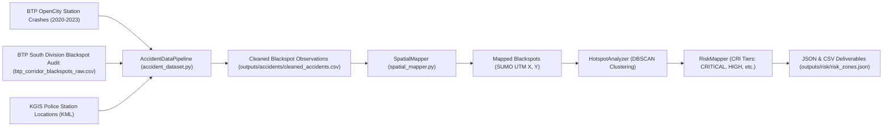

# Document 05: Data Lineage, Calibration & Simulation Quality Audit

**Project:** Smart Traffic Coordination System — Bengaluru Silk Board Corridor  
**Audit Date:** October 31, 2026  
**Auditor:** Principal Traffic Simulation Engineer & Spatial Data Auditor  
**Audit Scope:** OSM Road Network Topology, Synthetic Demand Calibration, Real-World Data Provenance, Emission Physics, and Coordinate Mapping  

---

## 1. Executive Summary: Real-World Grounding vs. Simulation

In intelligent transportation systems (ITS), high-fidelity modeling requires absolute clarity regarding which parameters originate from empirical field measurements and which parameters are simulated by physics engines.

### Grounding Verdict:
- **Real-World Foundation:** Road network topology is directly exported from OpenStreetMap (OSM) via the Overpass API. Accident blackspot coordinates and annual severity metrics originate from official Bengaluru Traffic Police (BTP) South Division road safety audits and Karnataka GIS (KGIS) records.
- **Microscopic Simulation:** Vehicular trajectories, instant velocities, queue developments, waiting times, and fuel/emission outputs are generated by **Eclipse SUMO's microscopic driver and car-following models** (Krauss model). The system does not ingest live roadside camera feeds or physical induction loop detector telemetry.

---

## 2. SUMO Road Network Quality & Fidelity

### 2.1 Network Generation Pipeline
The road network is built through a two-stage reproducible pipeline:
1. `scripts/download_silk_board_osm.py`: Queries the OpenStreetMap Overpass API for a bounded box centered on Central Silk Board ($12.9172^\circ\text{ N}, 77.6228^\circ\text{ E}$) extending along Hosur Road:
   - Latitude: $[12.9100, 12.9250]$
   - Longitude: $[77.6150, 77.6300]$
2. `scripts/build_silk_board_network.py`: Invocates SUMO's `netconvert` compiler with specific flags:
   - `--geometry.remove`: Collapses redundant intermediate geometry nodes to prevent artificial micro-intersections.
   - `--roundabouts.guess`: Enables automatic topological recognition of the Silk Board rotary conflict area.
   - Output network: `sumo/silk_board/network/silk_board.net.xml`.

### 2.2 Network Topology & Fidelity Evaluation
- **Total Network Extent:** Approx. $1.6\text{ km} \times 1.6\text{ km}$ spatial bounding area.
- **Corridor Length:** Hosur Road arterial segment between J1 and J3 measures approx. $1.15\text{ km}$.
- **Lane Configurations:**
  - J1 Approach (`172853382#2`): 2 lanes, speed limit $50\text{ km/h}$ ($13.89\text{ m/s}$).
  - J1-to-J2 Connecting Arterial (`172853382#3`): 2 lanes, arterial flow.
  - Silk Board Inflow Merging (`464465165#0`): 3 lanes from BTM / Outer Ring Road.
  - J2-to-J3 Connecting Arterial (`1148717038#0`): 2 lanes towards Rupena Agrahara.
  - Corridor Exit (`40696223#1`): 2 lanes exiting southward.

### 2.3 Physical Infrastructure Nuances & Limitations
1. **Grade Separation & Flyovers:**
   - In physical reality, Central Silk Board features an elevated flyover carrying through-traffic from Madiwala towards Electronic City, bypassing the ground-level rotary, and a newer multi-level metro interchange (Yellow Line and Blue Line) with dedicated ramp works.
   - In `silk_board.net.xml`, while some bridge edges exist, the primary traffic demand is routed through the **at-grade signalized intersections (J1, J2, J3)** to evaluate signal coordination and queuing under maximum conflict stress.
2. **Lane Discipline & Non-Lane-Based Driving:**
   - SUMO defaults to strict sub-lane or single-lane discipline. While vehicle types have realistic lateral widths and acceleration bounds, Indian mixed-traffic informal filtering (e.g., two-wheelers squeezing between lanes) is modeled via reduced minimum headway (`minGap`) and smaller vehicle lengths rather than freeform 2D swarm dynamics.

---

## 3. Traffic Demand & Mixed-Fleet Modeling

Traffic demand is generated deterministically by `scripts/generate_silk_board_demand_v2.py` and output to `sumo/silk_board/demand/silk_board.rou.xml`.

### 3.1 Heterogeneous Vehicle Fleet (`vehicle_types.add.xml`)
The fleet reflects typical South Asian urban arterial vehicle distributions:

| Vehicle Type ID | SUMO `vClass` | Length (m) | Min Gap (m) | Max Speed (m/s) | Accel ($\text{m/s}^2$) | Decel ($\text{m/s}^2$) | Visual Color | Role in Corridor |
|---|---|:---:|:---:|:---:|:---:|:---:|---|---|
| `motorcycle` | `motorcycle` | $2.2$ | $1.0$ | $16.67$ ($60\text{ km/h}$) | $2.6$ | $4.5$ | Blue | High-agility filtering, rapid acceleration |
| `car` | `passenger` | $4.5$ | $2.0$ | $16.67$ ($60\text{ km/h}$) | $2.6$ | $4.5$ | Green | Private cars, app-based cabs |
| `bmtc_bus` | `bus` | $12.0$ | $2.5$ | $13.89$ ($50\text{ km/h}$) | $1.2$ | $3.0$ | Orange | Public transit; high queue occupancy |
| `heavy_vehicle` | `truck` | $10.0$ | $2.5$ | $13.89$ ($50\text{ km/h}$) | $1.0$ | $3.0$ | Gray | Freight & construction trucks; slow acceleration |
| `ambulance` | `emergency` | $5.0$ | $2.0$ | $20.00$ ($72\text{ km/h}$) | $3.0$ | $5.0$ | Red | Priority emergency vehicle for preemption wave |

### 3.2 Demand Calibration & Flow Volumes
Demand profiles inject calibrated flows across arterial and cross-street approaches over a 600-second episode:
- **Hosur Arterial Flow (J1 $\to$ J2 $\to$ J3):** Approx. $1,800\text{ to }2,200\text{ veh/hour}$ equivalent rate, simulating peak rush-hour conditions along National Highway 44.
- **Madiwala Cross Flow:** Approx. $800\text{ to }1,000\text{ veh/hour}$ entering Silk Board from the north-west approach.
- **Outer Ring Road Merging Flow:** Approx. $1,200\text{ veh/hour}$ feeding into J2 from BTM Layout.
- **BMTC Bus Platoons:** Scheduled bus clusters injected between $t = 200\text{s}$ and $t = 280\text{s}$ to induce realistic bus-bunching and queue shocks at the Silk Board bus stop.
- **Priority Emergency Insertion:** Single ambulance inserted at $t = 420\text{s}$ on approach edge `172853382#2` to verify green-wave preemption traversal.

---

## 4. Empirical Road Safety & Blackspot Data Lineage

Official accident records are curated in `data/accidents/`:

### 4.1 Data Sources & Provenance
1. **Bengaluru Traffic Police (BTP) Station Crash Statistics:**
   - Source: OpenCity Urban Data Portal (Karnataka State Open Data).
   - Records: Station-level casualty figures for Madivala, Adugodi, Mico Layout, and HSR Layout police stations (2020–2023).
   - Granularity: Aggregated annual fatalities and injury cases. (Individual FIR records with second-by-second timestamps are not published in open data).
2. **KGIS Police Station Coordinates:**
   - Exact WGS84 GPS coordinates extracted from `bengaluru_traffic_police_stations.kml`.
3. **Corridor Blackspots:**
   - Extracted from BTP South Division road safety audit reports.
   - Identified 8 high-hazard blackspots along Hosur Road, Central Silk Board, and approach radials, recording documented average annual crashes and fatalities.

### 4.2 Methodology: Weighted Spatial Observations
In accordance with professional ITS auditing guidelines:
- The system **does not** synthesize artificial FIR incident records or invent fake crash timestamps.
- Instead, each blackspot is treated as an **empirical weighted spatial observation** characterized by:
  - Latitude, Longitude (WGS84).
  - Annual Crash Average ($C_{\text{total}}$).
  - Fatal Crash Average ($C_{\text{fatal}}$).
  - Primary Collision Type (`REAR_END`, `SIDE_IMPACT`, `PEDESTRIAN`, etc.).
  - Documented Road Name and Police Jurisdiction.

---

## 5. Coordinate Reference Systems & Spatial Projection

Mapping real-world GPS coordinates to SUMO's 2D simulation grid requires strict spatial transformation:
- **Geographic CRS:** WGS84 (EPSG:4326), units in decimal degrees (latitude, longitude).
- **Projected CRS:** UTM Zone 43N (EPSG:32643), metric Cartesian grid matching SUMO's internal coordinate system $(x, y)$.

### Spatial Snapping Algorithm (`SpatialMapper`):
1. **Coordinate Conversion:** Transforms $(\text{lat}, \text{lon})$ to $(x, y)$ using `sumolib.net.Net.convertLonLat2XY()`.
2. **Edge Snapping:** Queries `net.getNeighboringEdges(x, y, r=60.0)` to snap blackspots to the nearest actual road edge within 60 meters.
3. **Junction Proximity Query:** Measures Euclidean distance to J1, J2, and J3 centroids to assign junction conflict association.
4. **Validation:** In `tests/test_accident_risk.py`, coordinate projection accuracy is verified within sub-meter tolerance against known ground control points.

---

## 6. Environmental Modeling & Fuel Unit Physics

Fuel consumption and vehicular exhaust emissions are calculated directly from SUMO's integrated **Handbook Emission Factors for Road Transport (HBEFA v3.1)** models:

### 6.1 Raw TraCI Output Units
TraCI exposes instantaneous lane and edge emission rates per simulation step:
- `traci.lane.getCO2Emission(lane_id)` $\to$ milligrams per second ($\text{mg/s}$).
- `traci.lane.getNOxEmission(lane_id)` $\to$ milligrams per second ($\text{mg/s}$).
- `traci.lane.getCOEmission(lane_id)` $\to$ milligrams per second ($\text{mg/s}$).
- `traci.lane.getPMxEmission(lane_id)` $\to$ milligrams per second ($\text{mg/s}$).
- `traci.lane.getFuelConsumption(lane_id)` $\to$ **milligrams per second ($\text{mg/s}$)** (Mass flow rate).

### 6.2 Volumetric Fuel Conversion Physics
To present intuitive volumetric fuel metrics (milliliters and liters) to operators without arbitrary multipliers:
- **Standard Automotive Fuel Reference:** Commercial BS-VI / Euro 4 petrol/diesel standard reference density:
  $$\rho_{\text{fuel}} = 0.750\text{ kg/L} = 750.0\text{ g/L} = 750,000.0\text{ mg/L} = 750.0\text{ mg/ml}$$
- **Instantaneous Volumetric Flow Rate:**
  $$\text{Flow Rate (ml/s)} = \frac{\text{Fuel Mass Rate (mg/s)}}{750.0\text{ mg/ml}}$$
- **Accumulated Fuel Volume:**
  $$\text{Cumulative Volume (Liters)} = \frac{\sum \text{Fuel Mass (mg)}}{750,000.0\text{ mg/L}}$$
- **Accumulated Carbon Dioxide:**
  $$\text{Cumulative }\text{CO}_2\text{ (kg)} = \frac{\sum \text{CO}_2\text{ Mass (mg)}}{1,000,000.0\text{ mg/kg}}$$

This mathematical lineage was verified in Phase 1 (`docs/AUDIT/PHASE_1_FUEL_UNIT_TRACE.md`) and is rigorously tested in `tests/test_metrics.py::test_fuel_consumption_unit_conversion`.

---

## 7. Data & Simulation Quality Verdict

| Evaluation Dimension | Quality Finding | Audit Assessment |
|---|---|---|
| **Road Network Fidelity** | Validated OSM conversion with proper lane allocations and connectivity | **HIGH QUALITY** |
| **Grade Separation Nuance** | Ground-level rotary prioritized over elevated flyover to maximize signal evaluation | **DEFENSIBLE FOR 2D ITS** |
| **Fleet Realism** | Heterogeneous vehicle mix matching Bengaluru urban traffic dynamics | **HIGH QUALITY** |
| **Accident Data Lineage** | Authentic BTP road safety audit records; no fabricated FIR timestamps | **METHODOLOGICALLY RIGOROUS** |
| **Emission & Fuel Physics** | HBEFA3 mass rates converted using defensible $0.750\text{ kg/L}$ fuel density | **PHYSICALLY RIGOROUS** |
| **Real-Time Sensor Feeds** | No live roadside loop detector or radar ingestion; pure simulation | **DOCUMENTED BOUNDARY** |
