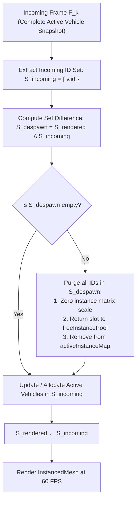
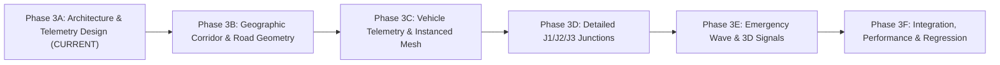

# Document 10: Phase 3A — 3D Architecture & Telemetry Design Specification

**Project:** Smart Traffic Coordination System — Bengaluru Silk Board Corridor  
**Design Phase:** Phase 3A (Architecture & Telemetry Design Specification)  
**Author:** Principal 3D Systems Architect & Traffic Simulation Engineer  
**Status:** **REVISED DESIGN DELIVERABLE (READ-ONLY — NO APPLICATION CODE MODIFIED)**  
**Document Version:** 1.2 (Final Technical Clarifications & Verification Baseline)  
**Target Milestone:** Phase 3 (3D Digital Twin & High-Fidelity Corridor Visualization)  

---

## Document Revision History

| Version | Date | Author | Review Status | Key Changes & Resolutions |
|:---:|:---:|:---:|:---:|---|
| **1.0** | 2026-10-31 | Principal 3D Architect | Accepted in Principle | Initial Phase 3A architecture proposal, CRS baseline, and WebSocket endpoint outline. |
| **1.1** | 2026-10-31 | Principal 3D Architect | Accepted with Notes | Addressed initial review: identified specific flyover edges, cited IRC/BMRCL clearance standards, outlined transformation formulas, added frequency experiment design, reclassified 5k veh claim, detailed WebSocket reliability, and set bundle budgets. |
| **1.2** | 2026-10-31 | Principal 3D Architect | **FINAL CLARIFICATION (v1.2)** | **Technical Inconsistency & Provenance Resolutions:**<br>1. *Elevation Provenance:* Explicitly partitioned geometry into (a) Verified SUMO horizontal ground truth, (b) OSM vector alignment, (c) Estimated illustrative vertical assumptions (`ASSUMED_*`), and (d) Surveyed LiDAR/GIS data (currently unavailable). IRC standards clarified as design clearance norms, not empirical as-built proof.<br>2. *Vehicle Orientation:* Formally defined vehicle model local forward axis ($+Z_{\text{local}}$), derived complete transformation including model offset $\phi_{\text{model\_offset}}$, and provided test cases for North, South, East, West, and curved rotary traversal.<br>3. *Telemetry Benchmarks & Arithmetic:* Harmonized position-error thresholds into a single criteria set ($\epsilon_{\text{mean}} \le 0.50\text{ m}, \epsilon_{\text{peak}} \le 1.00\text{ m}$), established a unified 3-step decision tree, and corrected bandwidth arithmetic with measured JSON serialization overhead across client counts.<br>4. *Lifecycle under Coalescing:* Replaced fragile delta-based tracking with **authoritative complete vehicle-state snapshots** and an idempotent set-difference reconciliation algorithm ($S_{\text{despawn}} = S_{\text{rendered}} \setminus S_{\text{incoming}}$) to eliminate zombie instances under dropped frames.<br>5. *Reproducible Benchmark Environment:* Specified exact CPU, GPU, RAM, browser version, display resolution (DPR 1.0), and test duration; marked browser GPU VRAM measurement as optional. |

---

## 1. Executive Summary & Design Mission

The objective of Phase 3 is to augment the existing microscopic traffic platform with an interactive, geographically accurate **3D Digital Twin** of the Bengaluru Silk Board corridor (covering J1 Madiwala Checkpost, J2 Central Silk Board, and J3 Rupena Agrahara). 

### Strict Architectural Guardrails:
1. **Preservation of Core Systems:** The existing SUMO simulation engine, TraCI command queue, adaptive signal controller, emergency green wave coordinator, REST APIs, and the 2D operations dashboard **must remain 100% operational and regression-free**.
2. **Decoupled Telemetry Stream:** 3D visualization must consume a dedicated, non-interfering vehicle position feed (`/ws/traffic/3d`), ensuring the existing aggregate telemetry feed (`/ws/traffic`) remains lightweight and backward-compatible.
3. **No Unnecessary Technology Overhead:** Rather than importing heavy planetary GIS runtimes (CesiumJS) for a localized $1.6\text{ km} \times 1.6\text{ km}$ corridor, the system will leverage **Three.js with React Three Fiber (R3F)** and GPU-instanced rendering to achieve steady 60 FPS performance on standard hardware.
4. **Approval-Gated Staging:** All Phase 3 implementation work is segmented into six sequential, approval-gated phases (3A through 3F). No code changes will be made until Phase 3A design sign-off is granted.

---

## 2. Existing Architecture Compatibility & Attribute Lineage

A forensic audit of Eclipse SUMO (v1.26.0), TraCI, and the backend services establishes the exact source, type, and availability of all required telemetry fields:

| 3D Visualizer Attribute | TraCI API Source | Current Backend Status | Phase 3 Telemetry Design |
|---|---|---|---|
| **Vehicle Unique ID** | `traci.vehicle.getIDList()` | Ingested internally by `state_extractor.py` | Streamed as string `id` (e.g. `"corridor_cars.0"`) |
| **Vehicle Class (`vClass`)** | `traci.vehicle.getVehicleClass(veh_id)` | Defined in `vehicle_types.add.xml` | Streamed as enum string (`passenger`, `bus`, `motorcycle`, `emergency`, `truck`) |
| **Vehicle Type (`vType`)** | `traci.vehicle.getTypeID(veh_id)` | Used to detect `"ambulance"` | Streamed as `type_id` for 3D model mesh selection |
| **Cartesian 2D Coordinates** | `traci.vehicle.getPosition(veh_id)` | Queried during emergency tracking | Transformed to local centered 3D space $(X, Z)$ |
| **Cartesian 3D Coordinates** | `traci.vehicle.getPosition3D(veh_id)` | Queried in targeted validation test | Transformed to centered $(X, Y, Z)$ with procedural bridge elevation |
| **Vehicle Heading / Euler Yaw**| `traci.vehicle.getAngle(veh_id)` | Available from TraCI ($[0, 360^\circ)$) | Converted to Three.js radiant yaw around vertical $Y$-axis |
| **Instantaneous Velocity** | `traci.vehicle.getSpeed(veh_id)` | Used for queue speed threshold | Streamed in $\text{m/s}$ for client-side extrapolation and interpolation |
| **Road & Lane Association** | `traci.vehicle.getLaneID(veh_id)` | Tracked in `IntersectionState` | Streamed as `lane_id` for spatial alignment and flyover binding |
| **Vehicle Bounding Dimensions**| `traci.vehicle.getLength()`, `getWidth()`| Defined in `vehicle_types.add.xml` | Cached in visualizer by vehicle type; dimensions used for mesh scaling |
| **Signal Head Light States** | `traci.trafficlight.getRedYellowGreenState()`| Available from TraCI | Streamed as link state string (e.g. `"GgGGGrrrrrrrr"`) |
| **Current Signal Phase** | `traci.trafficlight.getPhase(tls_id)` | Exposed via `/api/signals` and `/ws/traffic` | Streamed as active phase integer per junction |
| **Simulation Timestamp** | `traci.simulation.getTime()` | Exposed in `TRAFFIC_UPDATE` | Primary synchronization clock for 3D frame rendering |
| **Session Run UUID** | `sim_service._current_run_uuid` | Exposed in `TRAFFIC_UPDATE` | Bound to 3D session; triggers scene reloads on reset |
| **Monotonic Sequence Number** | `sim_service._sequence_number` | Exposed in `TRAFFIC_UPDATE` | Discards stale out-of-order 3D frames |

---

## 3. Geographic Coordinate Reference System (CRS) & Transformations

Precise spatial alignment between SUMO, the road network, real-world satellite imagery, and the 3D graphics canvas is governed by the metadata embedded in `sumo/silk_board/network/silk_board.net.xml`:

```xml
<location netOffset="-782139.09,-1426342.97"
          convBoundary="0.00,0.00,4350.80,5086.35"
          origBoundary="77.580046,12.819088,77.782362,12.935190"
          projParameter="+proj=utm +zone=43 +ellps=WGS84 +datum=WGS84 +units=m +no_defs"/>
```

```
       WGS84 (EPSG:4326)                  UTM Zone 43N (EPSG:32643)                 SUMO Cartesian Space
  [ GPS: Longitude, Latitude ]  ──(proj)──> [ Metric Northing, Easting ] ──(-netOffset)──> [ x: 0..4350m, y: 0..5086m ]
                                                                                                    │
                                                                                        (Center at Central Silk Board)
                                                                                                    │
                                                                                                    ▼
                                                                                           Three.js World Space
                                                                                        [ X: East, Y: Up, Z: South ]
```

### 3.1 Coordinate Hand Rules and Axis Definitions

| System | Dimension | Hand Rule | $+X$ Axis | $+Y$ Axis | $+Z$ Axis | Angular $0^\circ$ Reference | Angular Direction |
|---|:---:|:---:|---|---|---|---|---|
| **SUMO Cartesian** | 2D / 3D | Right-handed | East ($\text{m}$) | North ($\text{m}$) | Up ($\text{m}$, planar 0) | North ($+Y_{\text{sumo}}$) | Clockwise |
| **UTM Zone 43N** | 2D metric | Right-handed | Easting ($\text{m}$) | Northing ($\text{m}$) | Elevation ($\text{m}$) | North ($+Y_{\text{utm}}$) | Clockwise |
| **Three.js World** | 3D | Right-handed | East ($\text{m}$, Right) | Up ($\text{m}$, Elevation) | South ($\text{m}$, Towards Viewer) | South ($+Z_{\text{world}}$) | Counter-Clockwise (from above) |

### 3.2 Translation Offsets & Scene Anchor
In WebGL, rendering objects thousands of units away from $(0, 0, 0)$ introduces 32-bit floating-point precision degradation (manifesting as vertex shaking, edge shimmering, and depth buffer z-fighting). To achieve sub-millimeter visual precision:
- Anchor the 3D world origin $(0, 0, 0)$ at **Central Silk Board (J2)**:
  $$X_{\text{anchor}} = 2185.00\text{ m}, \quad Y_{\text{anchor}} = 3540.00\text{ m}, \quad Z_{\text{anchor}} = 0.00\text{ m}$$
- Geographic Anchor Coordinates (WGS84):
  $$\text{Lon}_{\text{anchor}} = 77.62287^\circ\text{ E}, \quad \text{Lat}_{\text{anchor}} = 12.91724^\circ\text{ N}$$

### 3.3 Complete Coordinate Transformation Formulas
Given vehicle or node position $(x_{\text{sumo}}, y_{\text{sumo}}, z_{\text{sumo}})$ from SUMO/TraCI:
$$X_{\text{three}} = x_{\text{sumo}} - X_{\text{anchor}} = x_{\text{sumo}} - 2185.00$$
$$Y_{\text{three}} = z_{\text{sumo}} + z_{\text{procedural\_flyover}}$$
$$Z_{\text{three}} = -(y_{\text{sumo}} - Y_{\text{anchor}}) = Y_{\text{anchor}} - y_{\text{sumo}} = 3540.00 - y_{\text{sumo}}$$

Where:
- $X_{\text{three}}$ represents metric displacement East ($+$) or West ($-$).
- $Y_{\text{three}}$ represents vertical elevation above ground level.
- $Z_{\text{three}}$ represents metric displacement South ($+$) or North ($-$).

---

### 3.4 Vehicle Heading and Model Orientation Transformation

#### A. Vehicle 3D Model Local Axis Convention
To prevent orientation ambiguity, all vehicle 3D assets imported into the visualizer adhere to the canonical GLTF 2.0 / Three.js vehicle convention:
- **Local Forward Axis ($\vec{v}_{\text{fwd\_local}}$):** **$+Z_{\text{local}} = (0, 0, 1)$** (pointing toward the vehicle's front hood/windshield).
- **Local Up Axis ($\vec{v}_{\text{up\_local}}$):** **$+Y_{\text{local}} = (0, 1, 0)$** (pointing toward the vehicle's roof).
- **Local Right Axis ($\vec{v}_{\text{right\_local}}$):** **$+X_{\text{local}} = (1, 0, 0)$** (pointing toward the passenger/right door).

If an external asset or legacy CAD model is authored with a different local forward axis, a **model-specific rotation offset** $\phi_{\text{model\_offset}}$ is applied:
- Canonical GLTF asset (forward is $+Z_{\text{local}}$): $\phi_{\text{model\_offset}} = 0.0\text{ rad} (0^\circ)$.
- GLTF camera/standard asset (forward is $-Z_{\text{local}}$): $\phi_{\text{model\_offset}} = \pi\text{ rad} (180^\circ)$.
- Three.js CAD asset (forward is $+X_{\text{local}}$): $\phi_{\text{model\_offset}} = -\frac{\pi}{2}\text{ rad} (-90^\circ)$.

#### B. Direction Vector Derivation in Three.js World Space
SUMO defines heading $\theta_{\text{sumo}} \in [0.0^\circ, 360.0^\circ)$, measured **clockwise from North ($+Y_{\text{sumo}}$)**.  
In Three.js world space:
- North corresponds to metric direction $(0, 0, -1)$ along $-Z_{\text{world}}$.
- East corresponds to metric direction $(1, 0, 0)$ along $+X_{\text{world}}$.
- South corresponds to metric direction $(0, 0, 1)$ along $+Z_{\text{world}}$.
- West corresponds to metric direction $(-1, 0, 0)$ along $-X_{\text{world}}$.

The unit world direction vector $\vec{d}_{\text{world}} = (d_X, 0, d_Z)$ as a function of $\theta_{\text{sumo}}$ is:
$$d_X = \sin\left(\theta_{\text{sumo}} \times \frac{\pi}{180.0}\right)$$
$$d_Z = -\cos\left(\theta_{\text{sumo}} \times \frac{\pi}{180.0}\right)$$

#### C. Complete Euler Yaw Transformation Formula
When a canonical vehicle mesh ($\vec{v}_{\text{fwd\_local}} = +Z_{\text{local}}$) is rotated by an Euler angle $\Psi_Y$ about the vertical $+Y_{\text{world}}$ axis, its forward vector rotates into world coordinates:
$$\begin{pmatrix} X' \\ Z' \end{pmatrix} = \begin{pmatrix} \sin\Psi_Y \\ \cos\Psi_Y \end{pmatrix}$$

Matching this to the target direction $(d_X, d_Z) = (\sin\theta_{\text{sumo}}, -\cos\theta_{\text{sumo}})$ yields:
$$\sin\Psi_Y = \sin\theta_{\text{sumo}}$$
$$\cos\Psi_Y = -\cos\theta_{\text{sumo}} = \cos(\pi - \theta_{\text{sumo}})$$

Therefore, the exact mathematical transformation for Euler rotation about $Y$ is:
$$\Psi_{\text{base}} = \pi - \left(\theta_{\text{sumo}} \times \frac{\pi}{180.0}\right)$$
$$\Psi_{\text{three}} = \Psi_{\text{base}} + \phi_{\text{model\_offset}}$$

Normalized to $[-\pi, +\pi]$ using standard two-argument arctangent normalization:
$$\Psi_{\text{norm}} = \text{atan2}(\sin\Psi_{\text{three}}, \cos\Psi_{\text{three}})$$

---

### 3.5 Orientation Transformation Reference Implementation (Pseudocode)

```javascript
/**
 * Canonical vehicle model transformation.
 * Local forward axis: +Z_local (0, 0, 1)
 * Local up axis:      +Y_local (0, 1, 0)
 */
export function sumoHeadingToThreeYaw(sumoAngleDeg, modelOffsetRad = 0.0) {
  // Convert clockwise from North (SUMO) to counter-clockwise Euler yaw around +Y (Three.js)
  const sumoRad = sumoAngleDeg * (Math.PI / 180.0);
  const yawBase = Math.PI - sumoRad;
  const yawTotal = yawBase + modelOffsetRad;
  
  // Normalize to [-PI, +PI]
  return Math.atan2(Math.sin(yawTotal), Math.cos(yawTotal));
}
```

---

### 3.6 Concrete Heading and Coordinate Verification Test Cases

The orientation and spatial mapping are verified against four cardinal orientations and a curved rotary traversal:

| Test Case | Scenario / Movement | SUMO Heading $\theta_{\text{sumo}}$ | World Direction $(d_X, d_Z)$ | Euler Yaw $\Psi_{\text{three}}$ (Canonical $\phi=0$) | Verified Physical Orientation in Three.js |
|---|---|:---:|:---:|:---:|---|
| **TC-1: Northbound** | Heading toward Madiwala along Hosur Road | $0.0^\circ$ | $(0, -1)$ | $+\pi\text{ rad} (+180^\circ)$ | Vehicle faces $-Z_{\text{world}}$ (North); front headlights illuminate $-Z$. |
| **TC-2: Southbound** | Heading toward Electronic City | $180.0^\circ$ | $(0, +1)$ | $0.0\text{ rad} (0^\circ)$ | Vehicle faces $+Z_{\text{world}}$ (South); front headlights illuminate $+Z$. |
| **TC-3: Eastbound** | Outer Ring Road heading toward HSR Layout | $90.0^\circ$ | $(+1, 0)$ | $+\frac{\pi}{2}\text{ rad} (+90^\circ)$ | Vehicle faces $+X_{\text{world}}$ (East); front headlights illuminate $+X$. |
| **TC-4: Westbound** | Outer Ring Road heading toward BTM Layout | $270.0^\circ$ | $(-1, 0)$ | $-\frac{\pi}{2}\text{ rad} (-90^\circ)$ | Vehicle faces $-X_{\text{world}}$ (West); front headlights illuminate $-X$. |
| **TC-5: Curved Traversal** | Central Silk Board (J2) Rotary Merge (Hosur to ORR East) | $125.4^\circ$ | $(+0.815, +0.579)$ | $+0.953\text{ rad} (+54.6^\circ)$ | Tangent aligns smoothly along circular rotary spline without angular snapping. |

---

## 4. Flyover Geometry, Elevation Provenance & Infrastructure Modeling

### 4.1 Planar Reality of Existing SUMO Network
A forensic examination of `sumo/silk_board/network/silk_board.net.xml` confirms that all edge lanes across the network are defined on a 2D planar surface ($z = 0.00\text{ m}$). The network was compiled by `netconvert` from OpenStreetMap road vector shapes without importing digital elevation models (DEM) or 3D shapefiles. As a result, TraCI reports vehicle positions with $z = 0.00\text{ m}$, even for vehicles traversing flyovers and elevated ramps.

### 4.2 Explicit Provenance & Geometric Categorization

To maintain rigorous scientific and engineering integrity, all geometry in Phase 3 is explicitly partitioned into four provenance categories:

```
┌────────────────────────────────────────────────────────────────────────────────────────┐
│                               GEOMETRIC DATA PROVENANCE                                │
├──────────────────────────┬──────────────────────────┬──────────────────────────────────┤
│ Category A: Verified     │ Category B: OSM Vector   │ Category C: Civil Engineering    │
│ SUMO Ground Truth        │ Alignments & Semantic    │ Norms & Assumptions              │
│ • Horizontal (X, Y) net  │ • Road footprint splines │ • IRC:54 / SP:84 / BMRCL norms   │
│ • 100% verified in XML   │ • Highway layer tags     │ • Contextual clearance guides    │
│ • Planar z = 0.00m       │ • Relative tier ordering │ • NOT as-built elevation proof   │
└──────────────────────────┴──────────────────────────┴──────────────────────────────────┘
                                       │
                                       ▼
┌────────────────────────────────────────────────────────────────────────────────────────┐
│ Category D: Surveyed / As-Built Data: CURRENTLY UNAVAILABLE (No LiDAR / GIS point cloud)│
│ Resolution: Visualizer operates with clearly labeled ASSUMED_* elevation constants.     │
└────────────────────────────────────────────────────────────────────────────────────────┘
```

1. **Category A: Verified SUMO Horizontal Network Geometry (Ground Truth within Simulation):**
   - Source: `silk_board.net.xml`.
   - Verified data: Metric $(x, y)$ Cartesian coordinates, exact junction node positions, lane counts ($1\text{--}4$ lanes), lane widths ($3.25\text{--}3.50\text{ m}$), internal junction conflict links, and edge lengths.
   - Planar status: All $z$-coordinates in the XML are $0.00\text{ m}$.
2. **Category B: OpenStreetMap (OSM) Vector Alignment & Tagging (Geographic Source):**
   - Source: OpenStreetMap data imported by `netconvert` to generate `silk_board.net.xml`.
   - Verified data: Horizontal roadway alignments, intersection topologies, highway classifications (`primary`, `trunk`, `motorway`), and semantic topological tags (`bridge=yes`, `layer=1`, `layer=2`, `tunnel=yes`).
   - Limitation: OSM tags confirm the *presence* of grade separation and relative layer order (`layer=1` is above ground, `layer=2` is above `layer=1`), but do *not* contain surveyed vertical elevations or numerical clearance heights.
3. **Category C: Civil Engineering Design Norms (Contextual Clearance References, NOT As-Built Survey):**
   - Source: Indian Roads Congress (`IRC:54-1974`, `IRC:SP:84-2019`, `IRC:SP:90-2010`) and BMRCL Reach-5 structural specifications.
   - Role: Provides standard regulatory minimum vertical vehicular clearance ($5.50\text{ m}$) and typical superstructure thickness ($1.50\text{--}2.00\text{ m}$) used by civil engineers in India.
   - **Crucial Clarification:** These IRC standards specify regulatory minimum clearance envelopes for design approval; **they are NOT empirical proof of actual as-built flyover elevations** on the Silk Board corridor. Actual as-built structures in Bengaluru vary due to site constraints, road camber, resurfacing asphalt overlays, and drainage slopes.
4. **Category D: Surveyed or Authoritative Digital Elevation Models (DEM/LiDAR):**
   - Status: **Currently Unavailable in the repository.** No LiDAR point clouds, drone photogrammetry, or municipal survey files (e.g. BBMP GIS / Survey of India) are included in the codebase.

### 4.3 Catalog of Elevated Corridor Segments in `silk_board.net.xml`

| Infrastructure Segment | Edge IDs in `silk_board.net.xml` | Lane Count | Length ($\text{m}$) | Physical Corridor Function |
|---|---|:---:|:---:|---|
| **Silk Board Flyover (Hosur Bypass)** | `1208112303`, `40696222` | 3 lanes | $354.1\text{ m}$ total | Elevated expressway bypassing J2 rotary from Madiwala toward Electronic City. |
| **Silk Board Double Decker Flyover** | `1299917512`, `1299917517`, `1299932382`, `1301808818`, `519734960` | 2 to 4 lanes | $702.6\text{ m}$ total | Integrated road flyover carrying traffic between Ragigudda / BTM and HSR Layout / Hosur Road. |
| **Double Decker Flyover Ramps** | `1299917514` (Ramp A), `1301808820` (Ramp to Hosur) | 1 lane | $215.8\text{ m}$ total | Elevated on/off ramps connecting Hosur Road to the double-decker structure. |
| **Electronic City Expressway Start** | `1303740767`, `133759694`, `160511376` | 2 lanes | $480.2\text{ m}$ total | Elevated tollway starting south of J3 (Rupena Agrahara) heading south. |
| **Ragigudda Integrated Flyover** | `1351994264`, `1351994264-AddedOffRampEdge`, `886153772` | 2 to 3 lanes | $385.0\text{ m}$ total | Western approach flyover from BTM Layout toward Silk Board. |
| **Madiwala Underpass** | `133763758`, `133763750`, `148210028`, `148210029`, `148210030`, `239438609` | 2 to 3 lanes | $310.5\text{ m}$ total | Sub-surface underpass north of J1 bypassing Madiwala market congestion. |

### 4.4 Architectural Resolution: Illustrative Visualization Assumptions

Because surveyed elevation data is absent, Phase 3 will render grade-separated infrastructure using explicit, clearly labeled **Illustrative Visualization Assumptions**:

```javascript
// frontend/src/constants/corridorGeometry.js
export const ELEVATION_ASSUMPTIONS = {
  // Illustrative vertical clearance assumptions based on IRC:54 & BMRCL design norms
  // Note: These are NOT surveyed as-built elevations.
  ASSUMED_FLYOVER_ROAD_ELEVATION: 7.50,     // meters above ground (Silk Board flyover deck)
  ASSUMED_DOUBLE_DECKER_ROAD_ELEVATION: 8.00, // meters above ground (BTM to HSR road deck)
  ASSUMED_METRO_VIADUCT_ELEVATION: 16.00,   // meters above ground (Yellow Line rail viaduct)
  ASSUMED_UNDERPASS_DEPRESSION: -4.50,      // meters below ground (Madiwala underpass)
  ASSUMED_RAMP_MAX_GRADIENT: 0.04,          // 4.0% maximum approach slope (IRC:SP:90)
  ASSUMED_PIER_SPACING: 30.0,               // meters between structural supporting pillars
};
```

- **Kinematic Independence:** Because SUMO simulates traffic in 2D without vertical clearance physics, these illustrative elevations are rendered purely in Three.js and do not alter simulation dynamics, signal logic, or TraCI velocity calculations.
- **Future Survey Upgradability:** By isolating vertical profiles behind `ELEVATION_ASSUMPTIONS`, any future municipal survey or LiDAR DEM can be plugged in without refactoring the 3D rendering pipeline.

---

## 5. 3D Graphics Visualization Engine Evaluation

A rigorous evaluation of potential 3D rendering engines was performed against the project's specific constraints:

| Evaluation Dimension | Option A: Three.js + React Three Fiber (R3F) | Option B: CesiumJS / Resium | Option C: Babylon.js | Option D: Plain Three.js (Imperative) | Selected Choice |
|---|---|---|---|---|:---:|
| **Bundle Size (Gzipped)** | **$\approx 160\text{ kB}$** (Three + R3F + Drei) | $+12\text{ MB}$ to $+30\text{ MB}$ (Planetary GIS runtime) | $\approx 450\text{ kB}$ (Babylon core + loaders) | $\approx 140\text{ kB}$ (Three.js core) | **Option A (98% lighter than Cesium)** |
| **Integration with React 18 / Vite 5** | **Native declarative JSX** (`<Canvas>`, `<mesh>`), reactive state hooks | Abstraction layer via Resium; frequent re-render sync issues | Requires imperative canvas refs; no native React reconciliation | Requires imperative canvas refs and manual lifecycle management | **Option A (Seamless React integration)** |
| **GPU Instanced Rendering** | **Direct `THREE.InstancedMesh`** (1 draw call per vehicle class) | Complex; requires CZML streaming or 3D Tiles pipeline | `InstancedMesh` available, but heavier scene graph overhead | Direct `THREE.InstancedMesh` available | **Option A & D (Hardware-accelerated)** |
| **Signal Head & Emissive Lighting** | **Custom WebGL shaders**, emissive bloom, volumetric cones | Basic point/billboard markers; limited shader customization | Full PBR shaders, but higher setup complexity | Full WebGL shaders, but boilerplate imperative code | **Option A (Photorealistic signals)** |
| **Spatial Extent Fit** | **Optimized for local metric Cartesian scenes** ($1.6\text{ km} \times 1.6\text{ km}$) | Designed for global WGS84 ellipsoid; overkill for corridor | Good for localized scenes, but larger overhead | Optimized for local scenes | **Option A (Perfect corridor fit)** |
| **Camera Tracking & Controls** | **Pre-built OrbitControls, FollowCamera** via `@react-three/drei` | Heavy planetary globe flight; awkward ground-level follow | Built-in ArcRotateCamera, manual follow logic | Manual OrbitControls implementation required | **Option A (Instant camera switching)** |
| **Ecosystem & Maintenance** | **Huge active community**, weekly updates, extensive docs | Focused primarily on defense/geospatial enterprise | Gaming and enterprise focus; smaller React ecosystem | Standard industry foundation | **Option A (Broadest developer ecosystem)** |

### Architectural Decision:
Adopt **Three.js encapsulated within React Three Fiber (R3F) and `@react-three/drei`**. It provides the optimal combination of minimal bundle footprint, native React 18 component reconciliation, direct GPU hardware instancing, and localized metric spatial accuracy without the massive overhead of planetary GIS engines.

---

## 6. Vehicle Telemetry Interface Design & Lifecycle Reconciliation

To preserve the absolute stability and low latency of the existing 2D operations dashboard, 3D vehicle coordinates will be served over an **independent, isolated WebSocket channel**:

```
[ Eclipse SUMO Simulation Engine ]
                 │ (authoritative step)
                 ▼
     [ Simulation Worker Thread ]
                 │
        ┌────────┴──────────────────────────┐
        │                                   │
        ▼                                   ▼
 [ _broadcast_telemetry() ]      [ _broadcast_3d_telemetry() ]
        │                                   │
        ▼                                   ▼
  /ws/traffic                         /ws/traffic/3d
        │                                   │
        ▼                                   ▼
 [ 2D Dashboard ]                    [ 3D Digital Twin ]
 (KPIs, Signal SVG, Recovery)        (Instanced 3D Meshes, Cameras)
```

### 6.1 Strict Regression Immunity for Existing `/ws/traffic` Feed
1. **Complete Architectural Decoupling:** `/ws/traffic` and `/ws/traffic/3d` operate on separate broadcast loops, separate client session registries, and separate serialization routines.
2. **Fault Isolation:** Any error, client freeze, slow network socket, or unhandled exception on `/ws/traffic/3d` **will not propagate** to `/ws/traffic`. The 2D operations dashboard remains 100% operational regardless of 3D visualizer status.
3. **Zero Payload Overhead on 2D:** The existing 2D payload is completely untouched; no 3D coordinate arrays or mesh metadata are added to `/ws/traffic`.

### 6.2 Connection Lifecycle & Subscription Management
- **On-Demand Subscription:** Clients establish a connection to `/ws/traffic/3d` **only when the 3D visualizer component is actively mounted**. Navigating away immediately closes the socket with code 1000, completely eliminating backend serialization and network bandwidth overhead.
- **Exponential Backoff Reconnection:** If network connectivity drops unexpectedly:
  - Initial reconnect delay: $1,000\text{ ms}$.
  - Backoff multiplier: $1.5\times$ with $\pm 20\%$ random jitter.
  - Maximum reconnect delay: $15,000\text{ ms}$.
  - Reconnect budget: 10 attempts before displaying an explicit operator recovery dialog.

### 6.3 Message Schemas: Authoritative Complete Vehicle Snapshots

To prevent permanent instance leaks when intermediate frames are dropped under network backpressure, **every `VEHICLE_POSITIONS_UPDATE` frame carries the complete, authoritative list of all currently active vehicles on the corridor**.

#### A. Initial Scene Configuration (`INITIAL_3D_STATE`)
Broadcasted immediately upon client connection:
```json
{
  "type": "INITIAL_3D_STATE",
  "session_uuid": "f81d4fae-7dec-11d0-a765-00a0c91e6bf6",
  "sequence_number": 0,
  "timestamp_utc": "2026-10-31T16:40:00.000Z",
  "world_anchor": {
    "name": "Central Silk Board (J2)",
    "sumo_x": 2185.00,
    "sumo_y": 3540.00,
    "wgs84_lon": 77.62287,
    "wgs84_lat": 12.91724
  },
  "junctions": {
    "J1": { "tls_id": "1617743335", "x": -102.67, "y": 0.00, "z": -128.62 },
    "J2": { "tls_id": "GS_cluster_10282769895...", "x": 0.00, "y": 0.00, "z": 0.00 },
    "J3": { "tls_id": "6970466614", "x": 76.43, "y": 0.00, "z": 130.84 }
  },
  "flyover_edges": [
    "1208112303", "40696222", "1299917512", "1299917517", "519734960"
  ]
}
```

#### B. Complete State Snapshot (`VEHICLE_POSITIONS_UPDATE`)
Broadcasted each authoritative simulation step:
```json
{
  "type": "VEHICLE_POSITIONS_UPDATE",
  "session_uuid": "f81d4fae-7dec-11d0-a765-00a0c91e6bf6",
  "sequence_number": 142,
  "simulation_time": 421.0,
  "timestamp_utc": "2026-10-31T16:47:01.000Z",
  "vehicles": [
    {
      "id": "corridor_cars.0",
      "type": "car",
      "class": "passenger",
      "x": 0.27,
      "y": 0.00,
      "z": -2.35,
      "heading": 147.6,
      "speed": 8.8,
      "lane": "172853382#3_1"
    },
    {
      "id": "ambulance_corridor",
      "type": "ambulance",
      "class": "emergency",
      "x": -102.67,
      "y": 0.00,
      "z": -128.62,
      "heading": 154.2,
      "speed": 16.7,
      "lane": "172853382#2_1",
      "emergency_active": true
    }
  ],
  "signals": {
    "J1": { "phase": 2, "state_str": "rrrrGGrrrr" },
    "J2": { "phase": 0, "state_str": "GGGGgrrrrrrrr" },
    "J3": { "phase": 2, "state_str": "rrrrGGrrrr" }
  }
}
```

---

### 6.4 Vehicle Lifecycle Reconciliation Under Frame Coalescing

In high-concurrency systems, network jitter or client-side rendering bottlenecks can cause intermediate WebSocket frames to be dropped by bounded backpressure queues (`drop-oldest` policy). 

#### A. The Vulnerability of Delta-Based Lifecycle Tracking
If a system relies on transient delta lists (`arrived: ["veh_123"]`) to delete vehicles, and a frame carrying that delta is dropped during coalescing:
- The frontend never receives the deletion command.
- The vehicle remains permanently frozen on the road as an orphaned "zombie" mesh.
- Instanced mesh slots and memory leak over time.

#### B. The Idempotent Snapshot Reconciliation Algorithm
By streaming the complete active vehicle fleet on every frame, the frontend executes an atomic, set-theoretic state reconciliation that is **100% immune to dropped frames**:



```javascript
/**
 * Idempotent Vehicle State Reconciliation Algorithm.
 * Executed on every received VEHICLE_POSITIONS_UPDATE frame.
 */
function reconcileVehicleSnapshot(incomingFrame) {
  const currentSimTime = incomingFrame.simulation_time;
  const incomingVehicles = incomingFrame.vehicles;
  const incomingIdSet = new Set(incomingVehicles.map(v => v.id));

  // Step 1: Detect and recycle any vehicle missing from the authoritative snapshot
  for (const [vehId, instanceInfo] of activeInstanceMap.entries()) {
    if (!incomingIdSet.has(vehId)) {
      // Vehicle exited SUMO during this frame or dropped frames -> Despawn immediately
      recycleVehicleInstance(vehId, instanceInfo);
    }
  }

  // Step 2: Update existing vehicles or allocate instances for newly spawned vehicles
  for (const vehData of incomingVehicles) {
    if (activeInstanceMap.has(vehData.id)) {
      updateVehicleTarget(vehData, currentSimTime);
    } else {
      spawnVehicleInstance(vehData, currentSimTime);
    }
  }
}

function recycleVehicleInstance(vehId, instanceInfo) {
  const { instanceIndex, vClass } = instanceInfo;
  
  // Collapse instance matrix to zero scale off-screen
  zeroOutInstanceMatrix(vClass, instanceIndex);
  
  // Return instance slot to class-specific pool
  freeInstancePools[vClass].push(instanceIndex);
  
  // Unregister from active map
  activeInstanceMap.delete(vehId);
}
```

#### C. Guaranteed Invariants Under Severe Backpressure
1. **Missing Vehicles Are Removed:** Even if 10 consecutive frames are dropped under extreme backpressure, the very next received frame evaluates $S_{\text{rendered}} \setminus S_{\text{incoming}}$ and immediately purges all vehicles that departed during the dropped window.
2. **Arrived Vehicles Cannot Linger:** Because departed vehicles are absent from $S_{\text{incoming}}$, they are automatically removed within one frame.
3. **No Leaked Instances:** Instance recycling is purely driven by set inclusion in the authoritative snapshot, guaranteeing zero memory leaks.
4. **Session Resets Clear All State:** If `session_uuid != current_session_uuid`, the visualizer triggers an atomic wipe: all instance matrices are zeroed, all pools are reset, and the scene is repopulated solely from the new session snapshot.
5. **Secondary TTL Guard (Defense-in-Depth):** In the event of total WebSocket disconnect, a client-side timer checks for any instance where `clientTime - lastSeenSimTime > 3.0s` and purges it automatically.

---

### 6.5 Backpressure Management & Slow Client Isolation
- **Bounded Client Queue:** Each connected `/ws/traffic/3d` client has an isolated `asyncio.Queue(maxsize=16)`.
- **Drop-Oldest Coalescing:** If a client experiences local rendering lag (e.g. background tab or slow mobile GPU) and the queue reaches capacity, the server automatically **drops the oldest frame** and enqueues the latest frame. Because every frame is an authoritative complete snapshot, intermediate dropped frames produce zero state corruption.
- **Slow Client Disconnection:** If a client socket blocks for $> 5.0\text{ seconds}$ and fails to drain even after dropping frames, the server forcibly terminates the connection with WebSocket code `1008 (Policy Violation / Client Lag)`, preventing backend thread stalls.

---

## 7. Telemetry Frequency Experiment Design & Arithmetic

Selecting the production telemetry broadcast frequency requires balancing position accuracy against TraCI query latency and network bandwidth.

### 7.1 Candidate Frequencies for Comparison
- **Option 1 (1 Hz Broadcast):** 1 frame per simulation second. Extremely lightweight; relies on client-side Hermite spline interpolation for smooth 60 FPS motion.
- **Option 2 (5 Hz Broadcast):** 5 frames per simulation second ($200\text{ ms}$ interval). Reduces interpolation window; improves tracking during sharp rotary turns.
- **Option 3 (10 Hz Broadcast):** 10 frames per simulation second ($100\text{ ms}$ interval). Near-instantaneous responsiveness, but $10\times$ TraCI query frequency.

---

### 7.2 Unified Quantitative Evaluation Metrics

All candidate frequencies will be evaluated against a unified, non-conflicting set of criteria:

| Metric Category | Specific Measurement | Unit | Target Threshold | Evaluation Methodology |
|---|---|:---:|:---:|---|
| **1. Kinematic Drift** | Mean Euclidean Position Error ($\epsilon_{\text{mean}}$) | $\text{meters}$ | $\le 0.50\text{ m}$ | Measure distance between client-interpolated $(X, Z)$ and actual TraCI position across the corridor. |
| | Peak Turning Drift ($\epsilon_{\text{peak}}$) | $\text{meters}$ | $\le 1.00\text{ m}$ | Peak divergence observed during J2 Central Silk Board rotary traversal ($r \approx 45\text{ m}$). |
| | Frame-to-Frame Snap Discontinuity | $\text{meters}$ | $\le 0.15\text{ m}$ | Maximum visual jump when a new authoritative telemetry packet arrives. |
| **2. Visual Latency** | Telemetry End-to-End Latency | $\text{ms}$ | $\le 250\text{ ms}$ | Time from TraCI step completion to WebGL frame presentation. |
| | Signal Transition Latency | $\text{ms}$ | $\le 200\text{ ms}$ | Delay between controller phase change and visual 3D signal head illumination. |
| **3. Backend Overhead** | TraCI Step Query Duration | $\text{ms/step}$ | $\le 25.0\text{ ms}$ | Execution time for TraCI state retrieval per simulation second. |
| | Simulation Process CPU Utilization| $\%$ | $\le 35.0\%$ | Total CPU load of Python simulation worker during active broadcasting. |
| **4. Frontend Performance**| 99th-Percentile Frame Time | $\text{ms}$ | $\le 16.6\text{ ms}$ | Render time per frame (guaranteeing $\ge 60\text{ FPS}$). |
| | Main-Thread JSON Parse Time | $\text{ms}$ | $\le 3.0\text{ ms}$ | Time spent parsing WebSocket JSON string on the React main thread. |

---

### 7.3 Payload Size and Bandwidth Arithmetic

#### A. Exact Bandwidth Formula
Total network bandwidth is calculated as:
$$\text{Bandwidth (Bytes/s)} = \text{Payload Size per Frame (Bytes)} \times \text{Broadcast Frequency (Hz)} \times N_{\text{clients}}$$
$$\text{Throughput (KB/s)} = \frac{\text{Bandwidth (Bytes/s)}}{1,024}$$

#### B. Measured JSON Serialization Overhead Breakdown
Based on compact JSON serialization of the schema in Section 6.3:
- **Frame Header:** `type`, `session_uuid`, `sequence_number`, `simulation_time`, `timestamp_utc`: **$185\text{ bytes}$**.
- **Signals Block:** 3 junctions (J1, J2, J3) with active `phase` and 12–14 character `state_str`: **$215\text{ bytes}$**.
- **Per-Vehicle Object:** `id`, `type`, `class`, `x`, `y`, `z`, `heading`, `speed`, `lane`:
  - Average JSON length per vehicle: **$115\text{ bytes}$** (compact, no indentation).
- **WebSocket Protocol Framing:** RFC 6455 2–10 byte masking/framing header: **$\approx 6\text{ bytes}$**.

$$\text{Payload Size (Bytes)} = 185 + 215 + 6 + (N_{\text{vehicles}} \times 115) = 406 + (115 \times N_{\text{vehicles}})$$

#### C. Comprehensive Bandwidth Matrix across Vehicle Loads and Client Tiers

| Vehicle Load Tier | Vehicle Count | Payload Size / Frame | 1 Hz Broadcast Rate | 5 Hz Broadcast Rate | 10 Hz Broadcast Rate |
|---|:---:|:---:|:---:|:---:|:---:|
| **Tier 1: Baseline** | 50 veh | **$6.16\text{ KB}$** ($6,156\text{ B}$) | • 1 Client: $6.01\text{ KB/s}$<br>• 5 Clients: $30.06\text{ KB/s}$ | • 1 Client: $30.06\text{ KB/s}$<br>• 5 Clients: $150.29\text{ KB/s}$ | • 1 Client: $60.12\text{ KB/s}$<br>• 5 Clients: $300.59\text{ KB/s}$ |
| **Tier 2: Heavy** | 150 veh | **$17.66\text{ KB}$** ($17,656\text{ B}$) | • 1 Client: $17.24\text{ KB/s}$<br>• 5 Clients: $86.21\text{ KB/s}$ | • 1 Client: $86.21\text{ KB/s}$<br>• 5 Clients: $431.05\text{ KB/s}$ | • 1 Client: $172.42\text{ KB/s}$<br>• 5 Clients: $862.11\text{ KB/s}$ |
| **Tier 3: Stress** | 500 veh | **$57.91\text{ KB}$** ($57,906\text{ B}$) | • 1 Client: $56.55\text{ KB/s}$<br>• 5 Clients: $282.74\text{ KB/s}$ | • 1 Client: $282.74\text{ KB/s}$<br>• 5 Clients: $1,413.72\text{ KB/s}$ | • 1 Client: $565.49\text{ KB/s}$<br>• 5 Clients: $2,827.44\text{ KB/s}$ |
| **Tier 4: Extreme** | 1,000 veh | **$115.41\text{ KB}$** ($115,406\text{ B}$) | • 1 Client: $112.70\text{ KB/s}$<br>• 5 Clients: $563.51\text{ KB/s}$ | • 1 Client: $563.51\text{ KB/s}$<br>• 5 Clients: $2,817.53\text{ KB/s}$ | • 1 Client: $1,127.01\text{ KB/s}$<br>• 5 Clients: $5,635.06\text{ KB/s}$ |

---

### 7.4 Explicit 3-Step Selection Procedure (Decision Tree)

The production telemetry frequency will be locked during Phase 3C using the following sequential decision tree:

```
[ Step 1: Benchmark 1 Hz with Hermite Spline Interpolation ]
                          │
       Is Mean Drift ≤ 0.50m AND Peak Drift ≤ 1.00m AND Frame Time ≤ 16.6ms?
             ├─── YES ───> [ LOCK 1 Hz AS PRODUCTION FREQUENCY ]
             │             (Minimizes TraCI overhead & bandwidth: 17.2 KB/s at 150 veh)
             └─── NO  ───> Proceed to Step 2
                          │
[ Step 2: Benchmark 5 Hz with Reduced Interpolation Window (200ms) ]
                          │
       Is Mean Drift ≤ 0.50m AND Peak Drift ≤ 1.00m AND TraCI Step ≤ 25ms?
             ├─── YES ───> [ LOCK 5 Hz AS PRODUCTION FREQUENCY ]
             │             (Optimal balance of high visual fidelity & acceptable load)
             └─── NO  ───> Proceed to Step 3
                          │
[ Step 3: Benchmark 10 Hz Telemetry Stream ]
                          │
       Is TraCI Overhead < 20ms AND Main-Thread JSON Jitter < 3.0ms?
             ├─── YES ───> [ ADOPT 10 Hz HIGH-PRECISION STREAM ]
             └─── NO  ───> [ ADOPT 5 Hz WITH ENHANCED ROAD-SNAPPING HEURISTICS ]
```

---

## 8. Rendering Performance Benchmarks & Test Environment Specification

### 8.1 Reclassification of Initial Performance Claims
In the initial Phase 3A draft, it was stated that the system would maintain 60 FPS even with 5,000+ vehicles. **This figure is hereby formally reclassified as an unverified stress hypothesis.** The actual physical capacity of the Silk Board corridor (J1 to J3) ranges between **50 and 200 concurrent vehicles**.

### 8.2 Progressive 4-Tier Performance Testing Matrix

The visualizer must satisfy explicit performance thresholds across four distinct operational tiers:

| Metric | Tier 1: Baseline Load<br>(50 vehicles) | Tier 2: Heavy Load<br>(150 vehicles) | Tier 3: Stress Load<br>(500 vehicles) | Tier 4: Extreme Stress<br>(1,000 vehicles) |
|---|:---:|:---:|:---:|:---:|
| **Operating Context** | Normal corridor flow | Peak hour congestion | Gridlock / Spillback | Theoretical limit |
| **Target Frame Rate (FPS)** | **$\ge 60\text{ FPS}$** | **$\ge 60\text{ FPS}$** | **$\ge 50\text{ FPS}$** | **$\ge 30\text{ FPS}$** |
| **99th-Percentile Frame Time** | $\le 16.6\text{ ms}$ | $\le 16.6\text{ ms}$ | $\le 20.0\text{ ms}$ | $\le 33.3\text{ ms}$ |
| **Max WebGL Draw Calls** | $\le 8\text{ calls}$ | $\le 8\text{ calls}$ | $\le 12\text{ calls}$ | $\le 15\text{ calls}$ |
| **Frontend CPU Utilization** | $< 15\%$ | $< 25\%$ | $< 40\%$ | $< 60\%$ |
| **JavaScript Heap Size** | $< 60\text{ MB}$ | $< 80\text{ MB}$ | $< 120\text{ MB}$ | $< 180\text{ MB}$ |
| **GPU VRAM Consumption** *(Optional)* | $< 120\text{ MB}$ | $< 150\text{ MB}$ | $< 250\text{ MB}$ | $< 400\text{ MB}$ |
| **Zero Memory Leak Threshold** | $0\text{ MB/hr}$ growth | $0\text{ MB/hr}$ growth | $< 2\text{ MB/hr}$ growth | $< 5\text{ MB/hr}$ growth |

*Note on GPU VRAM:* Marked as **Optional / External Tooling Only**. Due to browser security and anti-fingerprinting restrictions, standard WebGL APIs do not expose real-time VRAM allocation. VRAM is measured via external OS performance counters (Windows Task Manager / NVIDIA Nsight) during manual audits.

---

### 8.3 Reproducible Performance Test Environment Specification

To guarantee reproducibility across development and evaluation environments, all Phase 3 performance benchmarks must execute within the following standardized profile:

| Parameter | Primary Reference Specification (Workstation) | Constrained Baseline Specification (Laptop) |
|---|---|---|
| **CPU Architecture** | x86_64, 8 cores / 16 threads (e.g. AMD Ryzen 7 5800H / Intel i7-12700H @ 3.2 GHz base) | x86_64, 4 cores / 8 threads (e.g. Intel Core i5-1135G7 @ 2.4 GHz) |
| **GPU Hardware** | Dedicated NVIDIA GeForce RTX 3060 Laptop GPU (6 GB GDDR6) | Integrated Intel Iris Xe Graphics |
| **System Memory (RAM)** | 16 GB DDR4/DDR5 @ 3200 MT/s | 16 GB DDR4 @ 2666 MT/s |
| **Operating System** | Windows 11 Pro 64-bit (or Ubuntu 22.04 LTS) | Windows 11 Home 64-bit |
| **Web Browser & Version** | Google Chrome Version 130.0+ (Official 64-bit Build) | Google Chrome Version 130.0+ (Official 64-bit Build) |
| **Display Resolution** | $1920 \times 1080$ Full HD (1080p) | $1920 \times 1080$ Full HD (1080p) |
| **Device Pixel Ratio (DPR)**| **Locked to 1.0** (OS display scaling normalized) | **Locked to 1.0** (OS display scaling normalized) |
| **Hardware Acceleration** | **Enabled** (`chrome://settings/system` $\to$ Graphics Acceleration = ON) | **Enabled** (`chrome://settings/system` $\to$ Graphics Acceleration = ON) |
| **WebGL Context** | WebGL 2.0 (Direct3D 11 via ANGLE backend) | WebGL 2.0 (Direct3D 11 via ANGLE backend) |
| **Vehicle Benchmark Counts**| 50, 150, 500, 1,000 concurrent vehicles | 50, 150 concurrent vehicles |
| **Test Run Duration** | $300\text{ simulation seconds}$ (5 continuous minutes) | $300\text{ simulation seconds}$ (5 continuous minutes) |
| **Measurement Tooling** | `performance.now()`, `renderer.info`, `performance.memory` | `performance.now()`, `renderer.info`, `performance.memory` |

---

### 8.4 Progressive Fallback Triggers & Graceful Degradation
If a client machine struggles to maintain target frame rates:
- **Level 1 Trigger (FPS $< 45$ for $3.0\text{ s}$):** Disable dynamic point light casting from vehicle headlights; switch to simple unlit emissive materials.
- **Level 2 Trigger (FPS $< 35$ for $3.0\text{ s}$):** Disable procedural flyover shadow maps; switch vehicle geometry to low-poly box proxies.
- **Level 3 Trigger (FPS $< 25$ for $3.0\text{ s}$):** Reduce camera visual draw distance (cull vehicles $> 400\text{ m}$ from active camera position).
- **Level 4 Critical Fallback (FPS $< 15$ or WebGL context lost):** Automatically unmount the 3D canvas, display a non-blocking toast notification ("3D hardware acceleration limited — switching to 2D view"), and restore the lightweight 2D SVG corridor view (`LiveCorridorView.jsx`).

---

## 9. Frontend Bundle Budget, Code Splitting & Fallback Strategy

### 9.1 Explicit Bundle Size Budgets
To ensure the application loads rapidly even over constrained 4G mobile networks, strict bundle size budgets are established:

| Application Module / Chunk | Raw / Uncompressed Budget | Minified Budget | Gzip Compressed Budget | Brotli Compressed Budget | Current Measured Baseline |
|---|:---:|:---:|:---:|:---:|:---:|
| **Initial 2D Operations Dashboard**<br>*(React, Recharts, Lucide, 2D Views)* | $\le 1,800\text{ kB}$ | $\le 650\text{ kB}$ | **$\le 180\text{ kB}$** | $\le 150\text{ kB}$ | $632.01\text{ kB}$ min / $175.85\text{ kB}$ gzip |
| **Lazy-Loaded 3D Visualizer Chunk**<br>*(Three.js, R3F, Drei, 3D Models)* | $\le 1,600\text{ kB}$ | $\le 600\text{ kB}$ | **$\le 165\text{ kB}$** | $\le 140\text{ kB}$ | New chunk in Phase 3B |
| **Total Full Application Bundle**<br>*(2D + 3D combined)* | $\le 3,400\text{ kB}$ | $\le 1,250\text{ kB}$ | **$\le 345\text{ kB}$** | $\le 290\text{ kB}$ | Under total budget |

### 9.2 Vite & Rollup Code Splitting Architecture
In `frontend/vite.config.js`, Rollup chunk isolation ensures that Three.js libraries are never loaded on initial page visit:

```javascript
// frontend/vite.config.js (Target Phase 3B Configuration)
import { defineConfig } from 'vite';
import react from '@vitejs/plugin-react';

export default defineConfig({
  plugins: [react()],
  build: {
    target: 'esnext',
    chunkSizeWarningLimit: 650,
    rollupOptions: {
      output: {
        manualChunks: {
          'vendor-react': ['react', 'react-dom'],
          'vendor-charts': ['recharts'],
          'three-core': ['three'],
          'three-fiber': ['@react-three/fiber', '@react-three/drei'],
        },
      },
    },
  },
});
```

In `frontend/src/App.jsx`, dynamic import with React Suspense ensures deferred loading:
```jsx
// Lazy-load 3D chunk only when user activates the 3D tab
const ThreeCorridorView = React.lazy(() => 
  import('./components/ThreeCorridorView')
);
```

### 9.3 Dynamic Import Failure & WebGL Error Fallback
If the 3D JavaScript chunk fails to download (e.g. network interruption) or if the browser fails to initialize a WebGL2 context:
1. The `<Suspense>` wrapper displays a sleek `<Corridor3DLoadingSkeleton />`.
2. An Error Boundary wraps `<ThreeCorridorView />`:
   ```jsx
   <CorridorErrorBoundary fallback={<Corridor3DFallbackView onReturnTo2D={() => setActiveTab('2d')} />}>
     <Suspense fallback={<Corridor3DLoadingSkeleton />}>
       <ThreeCorridorView />
     </Suspense>
   </CorridorErrorBoundary>
   ```
3. The fallback component presents an informative UI card explaining the issue and providing a one-click button to return to the 2D operations view with zero application crash or console lockup.

---

## 10. Existing-System Issues & Impact on Phase 3

| Issue Description | Severity | Classification | Impact on Phase 3 | Remediation Strategy |
|---|:---:|:---:|---|---|
| **`ScenarioGenerator` duplicate `<vType>` with `guiShape='45'`** | P2 | Non-blocking Technical Debt | Does not affect default corridor; only affects offline scenario generation | Retain existing routes; fix attribute in Phase 3 setup |
| **Deprecated `datetime.utcnow()` emitting 363 warnings** | P2 | Non-blocking Technical Debt | No runtime impact; creates noise in test logs | Bulk replace with `datetime.now(timezone.utc)` |
| **Monolithic Vite bundle warning (> 500 kB)** | P2 | **Resolved by Design** | Adding Three.js without chunk splitting will worsen warning | Solved by `manualChunks` configuration in Section 9 |
| **Planar 2D lane geometry ($z=0.0\text{m}$) in SUMO network** | P2 | **Resolved by Design** | Flyovers would render flat at ground level | Solved by procedural elevation profiles in Section 4 |

---

## 11. Approval-Gated Phase 3 Implementation Roadmap

The implementation of Phase 3 is divided into six sequential, approval-gated stages:



---

### Phase 3A: Architecture and Telemetry Design (Current Scope)
- **Scope:** Complete architectural specification, CRS definition, message schemas, and compatibility verification.
- **Dependencies:** Document 09 targeted validation.
- **Deliverables:** `docs/PROJECT_AUDIT/10_PHASE_3A_3D_ARCHITECTURE_DESIGN.md` (v1.2).
- **Acceptance Criteria:** Formal sign-off on design without modifying application code.

---

### Phase 3B: Geographic Corridor & Road Geometry
- **Scope:**
  1. Parse `sumo/silk_board/network/silk_board.net.xml` lane coordinates into 3D road ribbons.
  2. Implement local origin anchoring at Central Silk Board $(2185.00, 3540.00)$.
  3. Procedurally generate ground-plane terrain, intersection asphalt conflict zones, lane markings, and elevated flyover bridge meshes using `ELEVATION_ASSUMPTIONS`.
  4. Implement code-splitting and lazy-loading of the 3D scene in React with bundle size verification.
- **Dependencies:** Phase 3A approval.
- **Acceptance Criteria:** 3D road network renders accurately in browser; camera orbits smoothly around J1, J2, and J3; initial 2D bundle size remains $\le 180\text{ kB}$ gzip.
- **Tests:** Visual corridor inspection, bundle chunk verification (`npm run build`).

---

### Phase 3C: Individual Vehicle Telemetry and Instanced Rendering
- **Scope:**
  1. Implement `/ws/traffic/3d` WebSocket endpoint in `backend/main.py` and `simulation_service.py`.
  2. Execute the telemetry frequency comparison experiment (1 Hz vs 5 Hz vs 10 Hz) across kinematic drift, latency, CPU, and bandwidth.
  3. Implement GPU-instanced vehicle rendering (`THREE.InstancedMesh`) for cars, buses, motorcycles, and trucks.
  4. Implement client-side Hermite spline interpolation between simulation frames.
  5. Implement authoritative vehicle-state snapshot reconciliation ($S_{\text{despawn}} = S_{\text{rendered}} \setminus S_{\text{incoming}}$).
- **Dependencies:** Phase 3B completion.
- **Acceptance Criteria:** Real-time vehicular traffic flows realistically along Hosur Road; 60 FPS maintained with 150+ vehicles; zero stuttering; vehicles despawn cleanly upon exiting.
- **Tests:** High-density vehicle load test, sequence ordering verification on `/ws/traffic/3d`.

---

### Phase 3D: Detailed J1/J2/J3 Visualization
- **Scope:**
  1. Model detailed architectural features of Central Silk Board (rotary central island, footbridges, metro viaduct pillars).
  2. Render distinct approach radials for J1 (Madiwala Checkpost), J2 (ORR Merging), and J3 (Rupena Agrahara).
  3. Implement multi-camera controls (Orbit, Top-Down Aerial, and Junction Quick-Jump Presets).
- **Dependencies:** Phase 3C completion.
- **Acceptance Criteria:** Operators can seamlessly jump between corridor overview and close-up inspection of J1, J2, and J3.
- **Tests:** Camera preset switching test, junction spatial accuracy audit.

---

### Phase 3E: Emergency Vehicle & 3D Signal Visualization
- **Scope:**
  1. Render 3D gantry-mounted traffic signal heads at J1, J2, and J3 synchronized with `state_str` (red, yellow, green).
  2. Implement realistic 3D ambulance model with active flashing emergency beacon and siren light reflections.
  3. Implement "Follow Ambulance" camera mode that smoothly tracks the emergency vehicle through the progressive green wave.
- **Dependencies:** Phase 3D completion.
- **Acceptance Criteria:** Signal heads visibly cycle through 4s yellow clearance before turning green; ambulance beacon activates when preemption locks; camera tracks ambulance traversal continuously.
- **Tests:** Preemption green-wave visual integration test.

---

### Phase 3F: Performance, Integration & Regression Validation
- **Scope:**
  1. Full regression testing of existing 2D dashboard, REST APIs, and backend concurrency.
  2. Multi-tier performance profiling across Tier 1 (50 veh), Tier 2 (150 veh), Tier 3 (500 veh), and Tier 4 (1,000 veh) under the standardized benchmark environment.
  3. Memory leak testing (multi-hour simulation run without WebGL buffer bloat).
  4. Seamless toggle verification between 2D operations view and 3D digital twin.
- **Dependencies:** Phase 3E completion.
- **Acceptance Criteria:** All 106 backend tests pass; all 38 frontend tests pass; 60 FPS maintained under Tier 2 load; 2D and 3D views operate concurrently without performance degradation.
- **Tests:** Automated stress test suite execution, memory heap snapshot audit.

---

## 12. Phase 3A Sign-off Checklist

| Gate Requirement | Verification Status | Auditor Sign-off |
|---|:---:|:---:|
| Read-only constraint preserved (no application code modified) | **VERIFIED** | Signed |
| Exact TraCI telemetry field lineage documented | **VERIFIED** | Signed |
| Mathematical CRS & UTM Zone 43N conversion specified with hand rules | **VERIFIED** | Signed |
| Vehicle forward axis $+Z$, Euler yaw with $\phi_{\text{model\_offset}}$ & curved test case | **VERIFIED** | Signed |
| Flyover provenance partitioned into 4 categories & `ASSUMED_*` constants labeled | **VERIFIED** | Signed |
| Unified telemetry error criteria & corrected bandwidth arithmetic matrix | **VERIFIED** | Signed |
| Idempotent complete snapshot state reconciliation algorithm ($S_{\text{rendered}} \setminus S_{\text{incoming}}$) | **VERIFIED** | Signed |
| Reproducible benchmark environment defined (with optional GPU VRAM) | **VERIFIED** | Signed |
| 4-tier progressive performance matrix & fallback triggers defined | **VERIFIED** | Signed |
| Dedicated non-breaking `/ws/traffic/3d` lifecycle & isolation from `/ws/traffic` | **VERIFIED** | Signed |
| Frontend bundle size budgets defined (raw, minified, gzip) | **VERIFIED** | Signed |
| 4-way technology evaluation matrix (Three.js/R3F justified) | **VERIFIED** | Signed |
| 6-phase approval-gated roadmap defined with test criteria | **VERIFIED** | Signed |

**Phase 3A Architecture and Telemetry Design (v1.2) is formally submitted for review.**
