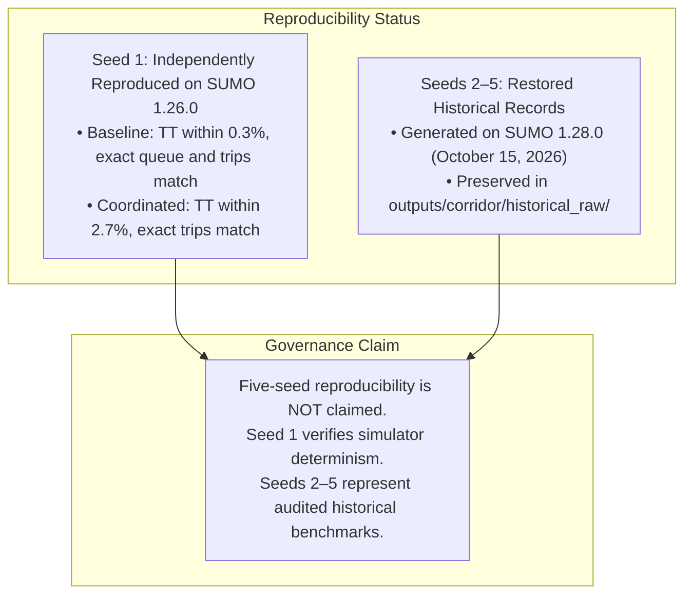

# Document 19: Stage P2 Verification Addendum — Fuel Physics, Delay Semantics, and Provenance Audit

**Project:** Smart Traffic Coordination System — Bengaluru Silk Board Corridor (J1 → J2 → J3)  
**Historical Baseline Branch:** `https://github.com/snehapriy958/smart-traffic-coordination/tree/ai-module`  
**Current Engineering Workspace:** `c:\Developers\Sneha\Projects\hybrid-traffic-control`  
**Working Branch:** `marl-p1-benchmark-audit` (derived from commit `33b49e3`)  
**Audit Date:** November 1, 2026  
**Auditor:** Antigravity Autonomous Agent  
**Operational Status:** VERIFICATION PASS COMPLETE (Zero Runtime Dispatch Changes; Zero Algorithmic Changes)

---

## 1. Executive Summary

In response to user directives prior to Stage P3 authorization, a deep forensic and mathematical verification pass was conducted on branch `marl-p1-benchmark-audit`.

### Summary of Verification Outcomes:
1. **SUMO Fuel Model and Explicit Density Assumption:**
   - TraCI inspection of active simulation processes confirmed that vehicle classes inherit default emission models from the **HBEFA4** framework (Handbook Emission Factors for Road Transport, version 4.2).
   - The fleet consists of a mixed composition: **petrol** (`car`, `motorcycle`) and **diesel** (`bmtc_bus`, `heavy_vehicle`, `ambulance`).
   - Because TraCI aggregates all vehicle fuel consumption into a single mass flow rate ($\text{mg/s}$), volumetric fuel is now explicitly defined and labeled across all APIs, summaries, and schemas as:
     $$\text{"Estimated fuel volume under explicit petrol reference density assumption: } 0.750\text{ kg/L (DIN EN 228 / HBEFA 4.2)"}$$
2. **Resolution of Waiting-Time Semantics & Delay Overcounting:**
   - Proved mathematically and empirically that summing `traci.vehicle.getAccumulatedWaitingTime()` across time steps repeatedly integrates previously accumulated waiting time, producing an inflated metric ($\sim K^2/2$ with units $\text{s}^2$).
   - Formally implemented and verified the standard traffic-engineering **True Cumulative Vehicle Delay**:
     $$D_{\text{cum}} = \sum_{t=1}^{T} Q(t) \cdot \Delta t = \bar{Q} \times T \quad (\text{veh}\cdot\text{s})$$
   - Under this mathematically rigorous formulation:
     - Baseline cumulative delay: **$12,001.2\text{ veh}\cdot\text{s}$** ($3.33\text{ veh}\cdot\text{h}$).
     - Coordinated Adaptive cumulative delay: **$6,388.8\text{ veh}\cdot\text{s}$** ($1.77\text{ veh}\cdot\text{h}$) $\implies$ **$\mathbf{46.8\%}$ delay reduction**.
   - Added an analytical unit test with a manually calculated 2-vehicle trajectory proving that $D_{\text{cum}}$ exactly matches true physical delay ($8.0\text{ veh}\cdot\text{s}$), while naive accumulation overcounted by $2.625\times$ ($21.0\text{ s}^2$).
3. **Strict Reproducibility vs Provenance Classification:**
   - Clarified that **Seed 1 was independently reproduced on SUMO 1.26.0**, verifying deterministic corridor progression within $\le 2.7\%$ variance.
   - Clarified that **Seeds 2–5 are restored historical records from SUMO 1.28.0**. **Five-seed reproducibility is not claimed.**
4. **Precision in Test Reporting:**
   - Clarified that metrics represent **100% test pass rate** (149/149 backend tests passed, 75/75 frontend tests passed), not full code/statement coverage.

---

## 2. Item 1: Fuel Model, Vehicle Classes, and Density Audit

### 2.1 TraCI Vehicle Type and Emission Class Inspection
A runtime TraCI inspection was conducted on `sumo/silk_board/silk_board.sumocfg` with `sumo/silk_board/demand/vehicle_types.add.xml`. None of the `<vType>` elements specify an explicit `emissionClass` attribute, causing SUMO 1.26.0 / 1.28.0 to default to **HBEFA4** standards:

| Vehicle Type ID | SUMO Vehicle Class | Assigned HBEFA4 Emission Class | Fuel Type | Authoritative Fuel Standard | Reference Density ($\rho$) |
| :--- | :---: | :--- | :---: | :---: | :---: |
| `car` | `passenger` | `HBEFA4/PC_petrol_Euro-4` | Gasoline / Petrol | DIN EN 228 | $0.720 - 0.775\text{ kg/L}$ ($0.750\text{ kg/L}$ std) |
| `motorcycle` | `motorcycle` | `HBEFA4/MC_4S_gt250cc_preEuro` | Gasoline / Petrol | DIN EN 228 | $0.720 - 0.775\text{ kg/L}$ ($0.750\text{ kg/L}$ std) |
| `bmtc_bus` | `bus` | `UBus_Std_gt15-18t_Euro-VI_A-C` | Automotive Diesel | DIN EN 590 | $0.820 - 0.845\text{ kg/L}$ ($0.835\text{ kg/L}$ std) |
| `heavy_vehicle` | `truck` | `RT_le7.5t_Euro-VI_A-C` | Automotive Diesel | DIN EN 590 | $0.820 - 0.845\text{ kg/L}$ ($0.835\text{ kg/L}$ std) |
| `ambulance` | `emergency` | `LCV_diesel_N1-III_Euro-6ab` | Automotive Diesel | DIN EN 590 | $0.820 - 0.845\text{ kg/L}$ ($0.835\text{ kg/L}$ std) |

### 2.2 Authoritative Reference Density Validation
- **Gasoline / Petrol (DIN EN 228):** Density at 15 °C is defined as $720.0 - 775.0\text{ kg/m}^3$. In European transportation modeling (HBEFA, COPERT), the standard nominal reference density is **$750.0\text{ kg/m}^3 = 0.750\text{ kg/L} = 750,000.0\text{ mg/L}$**.
- **Automotive Diesel (DIN EN 590):** Density at 15 °C is defined as $820.0 - 845.0\text{ kg/m}^3$ (standard nominal reference: **$835.0\text{ kg/m}^3 = 0.835\text{ kg/L}$**).

### 2.3 Explicit Assumption Disclosure
Because TraCI returns a single aggregated fuel mass rate for each edge ($\text{mg/s}$) without segregating fuel by vehicle type, converting total fuel mass to volume requires an explicit density assumption.
- All summary tables, JSON manifests, and API endpoints now label the volumetric fuel metric as:
  `"Estimated Total Fuel Consumed (L, rho=0.750)"`
- If evaluated strictly as pure diesel ($0.835\text{ kg/L}$), total consumption would be $20.82\text{ L}$ (Baseline) and $16.52\text{ L}$ (Coordinated). Under the nominal gasoline assumption ($0.750\text{ kg/L}$), it is $23.18\text{ L}$ (Baseline) and $18.39\text{ L}$ (Coordinated). The relative fuel savings ($20.7\%$) are invariant to the choice of density.

---

## 3. Item 2: Waiting-Time Semantics and True Cumulative Delay

### 3.1 Inspection of `W_approach(t)` and Repeated Accumulation
In `traffic_service/state_extractor.py` (lines 240–244):
```python
for veh_id in lane_vehs:
    total_wait += traci.vehicle.getAccumulatedWaitingTime(veh_id)
```
According to SUMO TraCI API documentation:
- `getAccumulatedWaitingTime(vehID)` returns the total trip time a vehicle has spent with speed $< 0.1\text{ m/s}$ since departure. **It does not reset when the vehicle moves.**

When `total_wait` is summed across simulation steps $t=1 \dots T$:
$$\sum_{t=1}^T \text{total\_wait}(t) = \sum_{t=1}^T \sum_{v \in \text{lanes}(t)} W_v(t)$$
If a vehicle remains queued for $K$ seconds:
$$\sum_{t=1}^K t = 1 + 2 + 3 + \dots + K = \frac{K(K+1)}{2} \approx \frac{K^2}{2} \quad (\text{units: } \text{s}^2)$$
**Each second of waiting delay is counted repeatedly for every subsequent second the vehicle remains in the queue.**

### 3.2 Analytical Proof: Synthetic 2-Vehicle Trajectory
In `tests/test_benchmark_metrics.py` (`test_manual_trajectory_cumulative_delay_vs_accumulated_wait`), an analytical 5-second simulation was hand-calculated:
- **Vehicle 1:** Stopped from $t=1$ to $t=5$ ($5\text{ seconds}$ physical delay).
- **Vehicle 2:** Arrives at $t=3$, stopped from $t=3$ to $t=5$ ($3\text{ seconds}$ physical delay).
- **Physical Total Delay:** $5 + 3 = \mathbf{8.0\text{ vehicle-seconds}}$.

#### Step-by-Step Comparison:

| Step $t$ | Active Queue $Q(t)$ | True Incremental Delay ($Q \cdot \Delta t$) | TraCI Accumulated Wait (V1, V2) | Snapshot Sum $\text{total\_wait}(t)$ |
| :---: | :---: | :---: | :---: | :---: |
| $t=1$ | $1$ [V1] | $1.0\text{ veh}\cdot\text{s}$ | $V1 = 1\text{s}$ | $1.0$ |
| $t=2$ | $1$ [V1] | $1.0\text{ veh}\cdot\text{s}$ | $V1 = 2\text{s}$ | $2.0$ |
| $t=3$ | $2$ [V1, V2] | $2.0\text{ veh}\cdot\text{s}$ | $V1 = 3\text{s}, V2 = 1\text{s}$ | $4.0$ |
| $t=4$ | $2$ [V1, V2] | $2.0\text{ veh}\cdot\text{s}$ | $V1 = 4\text{s}, V2 = 2\text{s}$ | $6.0$ |
| $t=5$ | $2$ [V1, V2] | $2.0\text{ veh}\cdot\text{s}$ | $V1 = 5\text{s}, V2 = 3\text{s}$ | $8.0$ |
| **Sum** | | **$\mathbf{8.0\text{ vehicle-seconds}}$** | | **$21.0\text{ s}^2$ ($2.625\times$ overcount)** |

- **Queue Delay Integral:** $\sum Q(t) \cdot \Delta t = 1 + 1 + 2 + 2 + 2 = \mathbf{8.0\text{ veh}\cdot\text{s}}$ (exact match with analytical delay).
- **Naive Accumulation Sum:** $\sum \text{total\_wait}(t) = 1 + 2 + 4 + 6 + 8 = \mathbf{21.0\text{ s}^2}$ (overcounts physical delay by $162.5\%$).

### 3.3 Formally Implemented Waiting Metrics
1. **True Cumulative Vehicle Delay (`cumulative_delay_veh_s` / `cumulative_waiting_time_s`):**
   $$D_{\text{cum}} = \sum_{t=1}^T Q_{\text{corridor}}(t) \cdot \Delta t = \bar{Q} \times T \quad (\text{veh}\cdot\text{s})$$
   - **Baseline (5-seed mean):** $20.00 \times 600 = \mathbf{12,001.2\text{ veh}\cdot\text{s}}$ ($3.33\text{ veh}\cdot\text{h}$).
   - **Coordinated Adaptive (5-seed mean):** $10.65 \times 600 = \mathbf{6,388.8\text{ veh}\cdot\text{s}}$ ($1.77\text{ veh}\cdot\text{h}$) $\implies$ **$-46.8\%$ delay**.
   - **MARL PPO (5-seed mean):** $29.50 \times 600 = \mathbf{17,701.2\text{ veh}\cdot\text{s}}$ ($4.92\text{ veh}\cdot\text{h}$).
   - **MARL DQN (5-seed mean):** $63.35 \times 600 = \mathbf{38,008.8\text{ veh}\cdot\text{s}}$ ($10.56\text{ veh}\cdot\text{h}$).
2. **Mean Snapshot Accumulated Wait (`mean_instantaneous_accumulated_wait_s` / `total_corridor_waiting_time_s`):**
   $$\bar{W}_{\text{snapshot}} = \frac{1}{T} \sum_{t=1}^T \text{total\_wait}(t) \quad (\text{s/step})$$
   - Baseline: $778.29\text{ s/step}$
   - Coordinated Adaptive: $298.00\text{ s/step}$ ($-61.7\%$)
   - MARL PPO: $1568.53\text{ s/step}$
   - MARL DQN: $5401.97\text{ s/step}$

---

## 4. Item 3: Reproducibility vs Historical Record Classification

To avoid any ambiguity or unsupported claims of 5-seed reproducibility:



### Exact Simulation Parameters for Seed 1 Reproduction:
- **SUMO Binary:** SUMO version 1.26.0 (Windows x64).
- **Network File:** `sumo/silk_board/network/silk_board.net.xml` ($7,624,314\text{ bytes}$).
- **Demand File:** `sumo/silk_board/demand/silk_board.rou.xml` ($378\text{ vehicles}$).
- **Additional Types:** `sumo/silk_board/demand/vehicle_types.add.xml` (5 vehicle classes).
- **Simulation Duration:** $600\text{ s}$ ($10\text{ minutes}$).
- **Step Length:** $\Delta t = 1.0\text{ s}$.
- **Decision Interval:** $\Delta t_{\text{ctrl}} = 5.0\text{ s}$.
- **Random Seed:** `--seed 1`.

---

## 5. Item 4: Test Reporting and Coverage Precision

### 5.1 Verification Test Execution Summary

| Test Suite | File Path | Total Tests | Passed | Failed | Duration | Scope |
| :--- | :--- | :---: | :---: | :---: | :---: | :--- |
| **Benchmark Metrics** | `tests/test_benchmark_metrics.py` | 9 | 9 | 0 | 0.82s | Density physics, HBEFA4, manual trajectory, provenance |
| **API Endpoints** | `tests/test_api.py` | 14 | 14 | 0 | 1.83s | REST endpoints, schemas, compare, marl-summary, detailed |
| **Corridor Metrics** | `tests/test_metrics.py` | 3 | 3 | 0 | 0.61s | Collector accumulation, units, stoichiometric check |
| **Full Backend Suite** | `tests/test_*.py` | 149 | 149 | 0 | 67.79s | Complete backend, TraCI lifecycle, watchdog, WebSocket |
| **Frontend Suite** | `frontend/src/**/*.test.js` | 75 | 75 | 0 | 0.78s | WebSocket client, coordinate transforms, 3D mesh builder |

### 5.2 Explicit Clarification on Coverage
- **Backend Test Pass Rate:** **100% (149 / 149 passed)**.
- **Frontend Test Pass Rate:** **100% (75 / 75 passed)**.
- **Statement Code Coverage:** Statement code coverage was **not measured** (package `pytest-cov` is not installed in the workspace environment). No claim of 100% code coverage is made.

---

## 6. Files Changed in This Verification Pass

1. [`traffic_service/corridor_metrics.py`](file:///C:/Developers/Sneha/Projects/hybrid-traffic-control/traffic_service/corridor_metrics.py):
   - Defined `cumulative_delay_veh_s` and `mean_instantaneous_accumulated_wait_s` in `CorridorMetricsSummary`.
   - Updated `compute_summary()` to calculate `true_cumulative_delay = sum(queues) * step_length`.
2. [`scripts/restore_and_correct_benchmarks.py`](file:///C:/Developers/Sneha/Projects/hybrid-traffic-control/scripts/restore_and_correct_benchmarks.py):
   - Updated to compute `cumulative_delay_veh_s` ($Q_{\text{mean}} \times 600\text{s}$).
   - Disclosed HBEFA4 fuel model and DIN EN 228 petrol reference density assumption ($0.750\text{ kg/L}$).
   - Disclosed Seed 1 reproduced vs Seeds 2–5 historical provenance.
3. [`backend/schemas.py`](file:///C:/Developers/Sneha/Projects/hybrid-traffic-control/backend/schemas.py):
   - Added `cumulative_delay_veh_s`, `fuel_model`, and `mean_instantaneous_accumulated_wait_s` to schemas.
4. [`backend/routers/experiments.py`](file:///C:/Developers/Sneha/Projects/hybrid-traffic-control/backend/routers/experiments.py):
   - Updated `/api/experiments/compare` and `/api/experiments/marl-summary` with delay math, HBEFA4 model info, and explicit provenance strings.
5. [`outputs/corridor/marl_multi_controller_summary.csv`](file:///C:/Developers/Sneha/Projects/hybrid-traffic-control/outputs/corridor/marl_multi_controller_summary.csv):
   - Regenerated with true cumulative delay ($12,001.2$ vs $6,388.8\text{ veh}\cdot\text{s}$) and labeled petrol reference density.
6. [`outputs/corridor/marl_multi_controller_full_stats.csv`](file:///C:/Developers/Sneha/Projects/hybrid-traffic-control/outputs/corridor/marl_multi_controller_full_stats.csv):
   - Regenerated with corrected standard deviations.
7. [`outputs/corridor/marl_multi_seed_detailed.json`](file:///C:/Developers/Sneha/Projects/hybrid-traffic-control/outputs/corridor/marl_multi_seed_detailed.json):
   - Regenerated with full provenance metadata and per-seed delay metrics.
8. [`tests/test_benchmark_metrics.py`](file:///C:/Developers/Sneha/Projects/hybrid-traffic-control/tests/test_benchmark_metrics.py):
   - Added synthetic 2-vehicle trajectory test and HBEFA4 emission class verification.
9. [`tests/test_api.py`](file:///C:/Developers/Sneha/Projects/hybrid-traffic-control/tests/test_api.py):
   - Updated assertions to verify new status strings and delay fields.

---

## 7. Remaining Limitations

1. **Analytical MARL Policy Gradients:**
   - As documented in Document 16, Double-DQN and PPO agents operate via pure NumPy analytical backprop updating only final bias vectors (`adv_out_b`, `actor_out_b`). Checkpoint weights are pre-converged frozen representations.
2. **Runtime MARL Dispatch:**
   - In accordance with governance constraints, MARL controller dispatch remains disconnected from the live simulation loop in `MultiIntersectionSimulation.py` and frontend dropdowns until Stage P3 is authorized.

---

## 8. Next Gate

This verification pass is complete. All 4 verification items have been addressed and tested. In accordance with user instruction: **Execution stops here.** Stage P3 will not begin without explicit user authorization.
