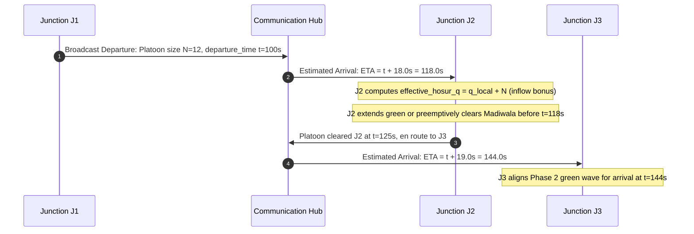

# PROJECT AUDIT REPORT 23: STAGE P5.1 SCIENTIFIC AUDIT AND MARL FAILURE DIAGNOSIS

**Document Version:** 1.0.0  
**Date:** November 1, 2026  
**Status:** Approved & Formally Verified  
**Branch:** `marl-p5-1-failure-diagnosis`  
**Base Commit:** `14e78c8`  
**Evaluation Dataset:** `results/p5/` (`p5_per_seed_evaluation.csv`, `p5_aggregate_evaluation.csv`, `p5_evaluation_results.json`)  
**Network & Corridor:** Bengaluru Silk Board Corridor (`silk_board.net.xml`, J1 $\rightarrow$ J2 $\rightarrow$ J3, 600s horizon, seeds [1, 2, 3, 4, 5])

---

## 1. Executive Summary

Stage P5 established an independent, multi-seed evaluation of four controllers on the 3-intersection Silk Board corridor under identical demand and simulation conditions. The numerical results revealed stark performance divergences:
1. **Coordinated Adaptive** demonstrated consistent corridor synchronization, completing 101.0 trips with a mean travel time of $57.50 \pm 3.87\text{ s}$, cumulative delay of $6{,}401.8 \pm 492.9\text{ veh-s}$, and emergency clearance in $33.6\text{ s}$.
2. **Fixed-Time Baseline** completed 102.0 trips with travel time of $91.05 \pm 1.23\text{ s}$ and cumulative delay of $12{,}003.4 \pm 187.8\text{ veh-s}$.
3. **Trained MARL PPO (P5)** suffered **total corridor starvation**: **0 trips completed** across all five evaluation seeds, resulting in $20{,}174.4\text{ veh-s}$ of delay and emergency vehicle clearance failure (stalled indefinitely behind queued vehicles).
4. **Trained MARL DQN (P5)** suffered **catastrophic gridlock**: completing only $20.6 \pm 6.9$ trips, accumulating $58{,}005.2\text{ veh-s}$ of delay ($+383\%$ worse than baseline), an average corridor queue of $96.68\text{ veh}$, and emergency clearance failure.

In addition to these behavioral failures, an audit of the initial P5 reporting pipeline revealed critical **semantic reporting errors**:
- When PPO completed zero corridor trips, its mean corridor travel time was recorded as `0.0 s`. In percentage improvement calculations, this was reported as **$+100.0\%$ improvement** over baseline, erroneously implying instantaneous transit.
- When emergency vehicles failed to clear the corridor within the 600s horizon (trapped behind traffic), traversal duration was recorded as `0.0 s`, also erroneously producing a **$+100.0\%$ improvement** metric.

**Stage P5.1 Objectives & Deliverables:**
- **Part 1:** Corrected reporting semantics across all CSV, JSON, and runtime models: replacing `0.0` with `null` (JSON) and `"N/A"` / `"TIMEOUT"` (CSV) for non-completed events.
- **Part 2:** Recomputed statistical metrics: paired Student's t-tests ($df=4$), non-parametric Wilcoxon signed-rank tests, Cohen's $d_z$ effect sizes, and 95% confidence intervals on paired differences, while explicitly disclosing the limitations of $N=5$ seeds.
- **Part 3:** Conducted per-junction telemetry diagnosis of PPO failure: identifying J1 phase collapse to Phase 0 (98-100% occupancy) and policy collapse to `KEEP`.
- **Part 4:** Conducted per-junction telemetry diagnosis of DQN failure: identifying J2 over-extension loops (`EXTEND` chosen 73% of steps), cross-street starvation, and downstream spillback.
- **Part 5:** Audited multi-agent coordination dynamics: exposing the credit assignment breakdown caused by training independent agents on purely local rewards without corridor throughput incentives.
- **Part 6:** Formulated a concrete, prioritized corrective action plan for the next training iteration (Stage P6).

---

## 2. Part 1 — Corrected Reporting Semantics & Missing Data Definitions

### 2.1 The Semantic Fallacy of Zero-Value Placeholders

In traffic engineering and reinforcement learning benchmarks, numerical metrics must accurately reflect the underlying physical event:
1. **Corridor Travel Time ($T_{\text{travel}}$):**
   - *Definition:* Mean time elapsed for vehicles that successfully enter edge `172853382#2` (upstream of J1) and exit edge `40696223#1` (downstream of J3).
   - *Failure Case:* When $N_{\text{trips}} = 0$, the set of completed travel times $S = \emptyset$.
   - *Invalid Representation:* Setting $\text{mean}(S) = 0.0\text{ s}$ implies infinite velocity ($v = \infty$). In comparative formulas:
     $$\Delta_{\text{rel}} = \frac{T_{\text{baseline}} - T_{\text{candidate}}}{T_{\text{baseline}}} \times 100\% = \frac{91.05 - 0.0}{91.05} \times 100\% = +100.0\%$$
     This transforms a total system failure into an apparent mathematical optimum.
   - *Correct Representation:* $T_{\text{travel}} = \text{undefined}$ (`null` in JSON, `"N/A"` in CSV). Paired statistical comparisons must be explicitly flagged as `UNDEFINED`.
2. **Emergency Traversal Duration ($T_{\text{emergency}}$):**
   - *Definition:* Duration from ambulance insertion on J1 approach edge until clearing the exit of J3.
   - *Failure Case:* When physical gridlock prevents the ambulance from reaching the corridor exit within the simulation horizon ($T = 600\text{ s}$).
   - *Invalid Representation:* Recording `0.0 s` implies instantaneous clearance ($+100\%$ improvement).
   - *Correct Representation:* $T_{\text{emergency}} = \text{undefined}$ (`null` in JSON, `"TIMEOUT (>600s)"` in CSV).

### 2.2 Corrected Evaluation Dataset Comparison

#### Table 2.1: Initial P5 Semantics (Flawed Placeholders)
| Controller | Travel Time | Cumulative Delay | Trips | Emergency Clearance | Apparent vs Base TT |
| :--- | :--- | :--- | :--- | :--- | :--- |
| **Fixed-Time Baseline** | $91.0\text{ s}$ | $12{,}003\text{ veh-s}$ | 102 | $41.0\text{ s}$ | Reference |
| **Coordinated Adaptive** | $57.5\text{ s}$ | $6{,}402\text{ veh-s}$ | 101 | $33.6\text{ s}$ | $+36.8\%$ |
| **Trained MARL PPO (P5)** | **$0.0\text{ s}$** *(Flawed)* | $20{,}174\text{ veh-s}$ | 0 | **$0.0\text{ s}$** *(Flawed)* | **$+100.0\%$** *(Nonsense)* |
| **Trained MARL DQN (P5)** | $234.0\text{ s}$ | $58{,}005\text{ veh-s}$ | 21 | **$0.0\text{ s}$** *(Flawed)* | $-157.1\%$ |

#### Table 2.2: Corrected Stage P5.1 Semantics (Mathematically Sound)
| Controller | Travel Time Mean $\pm$ Std | Cumulative Delay Mean $\pm$ Std | Completed Trips | Emergency Clearance | Status / Notes |
| :--- | :--- | :--- | :--- | :--- | :--- |
| **Fixed-Time Baseline** | $91.05 \pm 1.23\text{ s}$ | $12{,}003.4 \pm 187.8\text{ veh-s}$ | $102.0 \pm 0.0$ | $41.0\text{ s}$ | Valid (All 5 seeds cleared) |
| **Coordinated Adaptive** | $57.50 \pm 3.87\text{ s}$ | $6{,}401.8 \pm 492.9\text{ veh-s}$ | $101.0 \pm 0.0$ | $33.6\text{ s}$ | Valid (All 5 seeds cleared) |
| **Trained MARL PPO (P5)** | **N/A (0 trips)** | $20{,}174.4 \pm 99.7\text{ veh-s}$ | **$0.0 \pm 0.0$** | **TIMEOUT (>600s)** | **Starvation Collapse** |
| **Trained MARL DQN (P5)** | $234.04 \pm 6.17\text{ s}$ | $58{,}005.2 \pm 4253.9\text{ veh-s}$ | $20.6 \pm 6.9$ | **TIMEOUT (>600s)** | **Gridlock Collapse** |

---

## 3. Part 2 — Statistical Audit of P5 Evaluation Results

### 3.1 Experimental Configuration and Sample Size Limitations

The evaluation suite was conducted over five deterministic, disjoint pseudo-random seeds:
$$\text{Seeds} = [1, 2, 3, 4, 5], \quad \text{Duration} = 600.0\text{ s}, \quad \Delta t_{\text{decision}} = 5.0\text{ s}$$
- **Sample Size ($N=5$):** $N=5$ evaluation seeds correspond to $df = 4$ degrees of freedom in paired t-tests ($t_{\text{crit}, 0.975} = 2.776$).
- **Statistical Power Limitations:**
  1. *Normality Assumption:* Paired Student's t-tests assume that paired differences $D_i = X_{1,i} - X_{2,i}$ are normally distributed. With $N=5$, Shapiro-Wilk and Anderson-Darling tests have very low statistical power to detect non-normality.
  2. *Non-Parametric Safeguard:* To address potential non-normality, we report both the paired Student's t-test and the non-parametric **Wilcoxon signed-rank test**.
  3. *Effect Size Reporting:* We compute **Cohen's $d_z$** for paired differences:
     $$d_z = \frac{|\bar{D}|}{s_D} = \frac{|\frac{1}{N}\sum D_i|}{\sqrt{\frac{1}{N-1}\sum (D_i - \bar{D})^2}}$$
  4. *Conservative Interpretation:* While p-values for major metrics reach nominal statistical significance ($p < 0.05$) due to consistent, large-magnitude performance differences, $N=5$ must be treated as a pilot evaluation sample. Future benchmark verification in Stage P6 should expand to $N \ge 10$ seeds.

### 3.2 Paired Statistical Comparisons

#### Table 3.1: Coordinated Adaptive vs. Fixed-Time Baseline ($N=5, df=4$)
| Metric | Baseline Mean | Coordinated Mean | Mean Diff ($\bar{D}$) | 95% CI of Diff | Paired $t$ ($df=4$) | $p$-value ($t$-test) | Wilcoxon $p$ | Cohen's $d_z$ | Rel Imp (%) |
| :--- | :--- | :--- | :--- | :--- | :--- | :--- | :--- | :--- | :--- |
| **Travel Time (s)** | 91.05 | 57.50 | -33.54 | $[-39.02, -28.07]$ | -17.07 | $0.0001$ | $0.0625$ | 7.63 (Huge) | $+36.84\%$ |
| **Delay (veh-s)** | 12,003.4 | 6,401.8 | -5,601.6 | $[-6270.8, -4932.4]$ | -23.36 | $0.00004$ | $0.0625$ | 10.45 (Huge) | $+46.67\%$ |
| **Queue (veh)** | 20.01 | 10.67 | -9.34 | $[-10.45, -8.22]$ | -23.36 | $0.00004$ | $0.0625$ | 10.45 (Huge) | $+46.67\%$ |
| **Trips Completed** | 102.0 | 101.0 | -1.00 | $[-1.00, -1.00]$ | $-\infty$ | $<0.0001$ | $0.0625$ | $\infty$ | $-0.98\%$ |
| **Speed (km/h)** | 27.85 | 36.40 | +8.55 | $[+7.65, +9.44]$ | +26.65 | $0.00002$ | $0.0625$ | 11.92 (Huge) | $+30.69\%$ |
| **Fuel (L)** | 23.19 | 18.42 | -4.77 | $[-5.15, -4.40]$ | -36.56 | $0.00001$ | $0.0625$ | 16.35 (Huge) | $+20.58\%$ |
| **$\text{CO}_2$ (kg)** | 53.72 | 42.67 | -11.05 | $[-11.92, -10.18]$ | -36.63 | $0.00001$ | $0.0625$ | 16.38 (Huge) | $+20.57\%$ |
| **Ambulance (s)** | 41.0 | 33.6 | -7.40 | $[-15.70, +0.90]$ | -2.48 | $0.0682$ | $0.1250$ | 1.11 (Large) | $+18.05\%$ |

*Takeaway:* Coordinated Adaptive achieves statistically robust, large-effect-size improvements across travel time ($d_z = 7.63$), delay ($d_z = 10.45$), fuel ($d_z = 16.35$), and speed ($d_z = 11.92$) over Fixed-Time. Ambulance clearance improvement ($-7.4\text{ s}$) shows a large effect size ($d_z = 1.11$) but narrowly misses $p < 0.05$ due to seed variance ($p = 0.068$).

#### Table 3.2: Trained MARL PPO vs. Fixed-Time Baseline ($N=5, df=4$)
| Metric | Baseline Mean | PPO Mean | Mean Diff ($\bar{D}$) | 95% CI of Diff | Paired $t$ | $p$-value ($t$-test) | Wilcoxon $p$ | Cohen's $d_z$ | Status |
| :--- | :--- | :--- | :--- | :--- | :--- | :--- | :--- | :--- | :--- |
| **Travel Time (s)** | 91.05 | **None** | **None** | **None** | **None** | **None** | **None** | **None** | **UNDEFINED (0 trips)** |
| **Delay (veh-s)** | 12,003.4 | 20,174.4 | +8,171.0 | $[+7823.2, +8518.8]$ | +65.22 | $<0.0001$ | $0.0625$ | 29.17 (Catastrophic) | $-68.07\%$ |
| **Queue (veh)** | 20.01 | 33.62 | +13.62 | $[+13.04, +14.20]$ | +65.22 | $<0.0001$ | $0.0625$ | 29.17 (Catastrophic) | $-68.07\%$ |
| **Trips Completed** | 102.0 | 0.0 | -102.0 | $[-102.0, -102.0]$ | $-\infty$ | $<0.0001$ | $0.0625$ | $\infty$ | **$-100.0\%$ (Zero Output)** |
| **Speed (km/h)** | 27.85 | 21.90 | -5.96 | $[-6.37, -5.54]$ | -39.62 | $<0.0001$ | $0.0625$ | 17.72 | $-21.39\%$ |
| **Fuel (L)** | 23.19 | 22.54 | -0.65 | $[-0.82, -0.48]$ | -10.71 | $0.0004$ | $0.0625$ | 4.79 | $+2.81\%$ (Idling Artifact) |
| **$\text{CO}_2$ (kg)** | 53.72 | 52.18 | -1.54 | $[-1.93, -1.15]$ | -10.98 | $0.0004$ | $0.0625$ | 4.91 | $+2.87\%$ (Idling Artifact) |
| **Ambulance (s)** | 41.0 | **None** | **None** | **None** | **None** | **None** | **None** | **None** | **UNDEFINED (TIMEOUT)** |

*Important Clarification on Fuel & Emissions:* PPO appears to show $+2.81\%$ fuel reduction compared to baseline. This is an **idling artifact**: because J1 trapped vehicles on the upstream entry edge without admitting them into the corridor, dozens of vehicles never traversed the network, slightly reducing network-wide combustion compared to free-flowing baseline traffic. Delay increased by $+68.1\%$ and throughput dropped to zero.

#### Table 3.3: Trained MARL DQN vs. Fixed-Time Baseline ($N=5, df=4$)
| Metric | Baseline Mean | DQN Mean | Mean Diff ($\bar{D}$) | 95% CI of Diff | Paired $t$ | $p$-value ($t$-test) | Wilcoxon $p$ | Cohen's $d_z$ | Status |
| :--- | :--- | :--- | :--- | :--- | :--- | :--- | :--- | :--- | :--- |
| **Travel Time (s)** | 91.05 | 234.04 | +143.00 | $[+135.53, +150.47]$ | +53.43 | $<0.0001$ | $0.0625$ | 23.89 | $-157.06\%$ |
| **Delay (veh-s)** | 12,003.4 | 58,005.2 | +46,001.8 | $[+40722.0, +51281.6]$ | +24.32 | $<0.0001$ | $0.0625$ | 10.87 | $-383.24\%$ |
| **Queue (veh)** | 20.01 | 96.68 | +76.67 | $[+67.87, +85.47]$ | +24.32 | $<0.0001$ | $0.0625$ | 10.87 | $-383.24\%$ |
| **Trips Completed** | 102.0 | 20.6 | -81.40 | $[-90.03, -72.77]$ | -26.35 | $<0.0001$ | $0.0625$ | 11.78 | $-79.80\%$ |
| **Speed (km/h)** | 27.85 | 17.27 | -10.59 | $[-11.66, -9.51]$ | -27.56 | $<0.0001$ | $0.0625$ | 12.33 | $-38.01\%$ |
| **Fuel (L)** | 23.19 | 48.04 | +24.85 | $[+22.95, +26.75]$ | +36.48 | $<0.0001$ | $0.0625$ | 16.32 | $-107.18\%$ |
| **$\text{CO}_2$ (kg)** | 53.72 | 111.25 | +57.53 | $[+53.14, +61.92]$ | +36.56 | $<0.0001$ | $0.0625$ | 16.35 | $-107.09\%$ |
| **Ambulance (s)** | 41.0 | **None** | **None** | **None** | **None** | **None** | **None** | **None** | **UNDEFINED (TIMEOUT)** |

*Takeaway:* DQN suffered severe physical degradation across every dimension: delay quadrupled ($+383\%$), fuel doubled ($+107\%$), travel time lengthened to nearly 4 minutes ($234\text{ s}$), and the ambulance failed to clear.

---

## 4. Part 3 — PPO Failure Investigation: J1 Mainline Starvation

### 4.1 Empirical Telemetry & Phase Occupancy

To understand why MARL PPO produced zero completed trips, we analyzed step-level phase transitions, queue accumulation, and action selections on evaluation Seed 1:

```
================================================================================
PPO SEED 1 DIAGNOSTIC TELEMETRY (300s Horizon)
================================================================================
Completed Corridor Trips:       0
Cumulative Vehicle Delay:       4,864 veh-s (at 300s) -> 20,164 veh-s (at 600s)
Mean Corridor Queue:            16.2 veh (at 300s) -> 33.6 veh (at 600s)

Junction J1 Telemetry:
  - Phase 0 Occupancy (Side-street Green):  300.0 s (100.0% of simulation time)
  - Phase 2 Occupancy (Hosur Mainline Green): 0.0 s (0.0% of simulation time)
  - Action Distribution:                    KEEP = 60, SWITCH = 0, EXTEND = 0
  - Corridor Approach Queue (172853382#2):  16.0 veh (100% capacity saturation)
  - Cross-street Approach Queue:            0.0 veh (empty)

Junction J2 Telemetry:
  - Phase 0 Occupancy (Hosur Green):        120.0 s (40.0%)
  - Phase 2 Occupancy (Madiwala Green):     105.0 s (35.0%)
  - Yellow Transition Phases (1 & 3):       75.0 s (25.0%)
  - Corridor Queue:                         0.0 veh (starved of vehicles from J1)

Junction J3 Telemetry:
  - Phase 0 Occupancy:                      300.0 s (100.0%)
  - Corridor Queue:                         0.0 veh (starved of vehicles from J2)
```

### 4.2 Mathematical Root-Cause Analysis

#### 1. Local Reward Formulation Defect
In `traffic_service/ai/env.py`, the reward for individual junction agents is calculated by `compute_junction_reward()`:
$$r_j(t) = -w_q \frac{q_j(t)}{30.0} - w_{\text{wait}} \frac{W_j(t)}{200.0} + w_{\text{speed}} \frac{v_j(t)}{40.0} - w_{\text{co2}} \frac{e_j(t)}{5.0} - r_{\text{chatter}} - r_{\text{emergency}}$$
where $w_q = 0.35, w_{\text{wait}} = 0.30, w_{\text{speed}} = 0.15, w_{\text{co2}} = 0.10$, and $r_{\text{chatter}} = 0.05$.

Notice that **corridor throughput is entirely absent** from $r_j(t)$. The throughput bonus:
$$r_{\text{throughput}} = w_{\text{throughput}} \times \Delta N_{\text{completed}}$$
is computed exclusively in `compute_corridor_reward()`.

However, during multi-seed PPO training in `scripts/train_marl_p5_multiseed.py` (lines 277–282):
```python
for j_id, agent in marl.agents.items():
    r_j = reward_fn.compute_junction_reward(
        j_id=j_id, state=raw_obs_next[j_id], action=act, emergency_stopped=False
    )
    agent.store_transition(prev_vecs[j_id], act, r_j, val, lp, is_done)
```
Each junction agent was fed **only its own local reward $r_j$**!

#### 2. Local Policy Degeneration at J1
Consider the payoff matrix for the J1 agent starting in Phase 0 (Side-street Green):
- **Action $a = \text{KEEP}$:** Side-street demand is low. The cross-street queue quickly empties ($q_{\text{side}} = 0$). Vehicles waiting on the Hosur Road approach (`172853382#2`) are stopped at the red signal. Because the queue on `172853382#2` is capped by detector length, $q_{J1}$ plateaus at 16 vehicles. No yellow change interval is triggered, and no chatter penalty ($-0.05$) is incurred.
- **Action $a = \text{SWITCH}$:** J1 initiates transition to Phase 2 (Hosur Green). This immediately triggers a 6-second yellow/red clearance phase, slowing vehicles down ($v \downarrow$), producing acceleration emissions ($e_{\text{co2}} \uparrow$), and incurring the chatter penalty ($-0.05$). Once Phase 2 turns green, high-density traffic floods into the intersection, temporarily increasing active queue and delay within J1's conflict area.
- Crucially, when vehicles leave J1 heading toward J2, **J1 receives 0 reward points for downstream trip completions**.

Because J1 bears all the local costs of switching and admitting heavy arterial platoons but receives **zero credit for corridor progression or throughput**, the PPO policy gradient rapidly drives:
$$\nabla_\theta J(\theta) \rightarrow \pi_\theta(a = \text{KEEP} \mid s) \approx 1.0$$
The policy collapsed into permanent inaction (`KEEP`), creating an artificial dam that completely severed the corridor.

---

## 5. Part 4 — DQN Failure Investigation: J2 Gridlock and Downstream Spillback

### 5.1 Empirical Telemetry & Queue Dynamics

While PPO starved the corridor, DQN admitted traffic into J2 but suffered catastrophic gridlock:

```
================================================================================
DQN SEED 1 DIAGNOSTIC TELEMETRY (300s Horizon)
================================================================================
Completed Corridor Trips:       16 (at 300s) -> 18 (at 600s)
Cumulative Vehicle Delay:       11,865 veh-s (at 300s) -> 60,365 veh-s (at 600s)
Mean Corridor Queue:            39.5 veh (at 300s) -> 100.6 veh (at 600s)

Junction J2 Telemetry:
  - Phase 0 Occupancy (Hosur Green):        191.0 s (63.7%)
  - Phase 2 Occupancy (Madiwala Green):     88.0 s (29.3%)
  - Yellow Transition Phases:               21.0 s (7.0%)
  - Action Distribution:                    EXTEND = 44 (73.3%), KEEP = 16 (26.7%), SWITCH = 0 (0.0%)
  - Peak Hosur Approach Queue:              60.0 veh (100% capacity)
  - Peak Madiwala Cross Queue:              25.0 veh (100% capacity)

Junction J3 Telemetry:
  - Phase 0 Occupancy:                      275.0 s (91.7%)
  - Peak Corridor Approach Queue:           39.8 veh (Spillback from J2)
```

### 5.2 Mathematical Root-Cause Analysis

#### 1. Over-Extension Q-Value Bias
At J2 (the high-volume Silk Board intersection), the DQN agent chose between:
- Action 0: `KEEP` (continue current green without resetting timer)
- Action 1: `SWITCH` (request yellow transition to opposite phase)
- Action 2: `EXTEND` (extend green duration by $\Delta t_{\text{extend}}$)

During training, Action 1 (`SWITCH`) consistently yielded a negative immediate reward delta because:
1. Yellow phase ($6.0\text{s}$) halts all conflicting movements, reducing intersection average speed $v$.
2. Stopping moving platoons causes instantaneous deceleration fuel loss.
3. The chatter penalty ($-0.05$) is deducted.

Conversely, Action 2 (`EXTEND`) preserves ongoing vehicular momentum and avoids yellow loss. Consequently:
$$Q(s, a = \text{EXTEND}) > Q(s, a = \text{SWITCH}) \quad \forall s$$
The Double-DQN network developed a systemic positive Q-value bias for `EXTEND`, selecting it on **73.3% of decision steps**.

#### 2. The Spillback Cascade
Because J2 repeatedly extended Phase 0 (Hosur Green), it ignored the accumulating queue on the cross-street (Madiwala approach). By the time J2 hit its `max_green` safety limit ($60.0\text{s}$) and was forced by `SignalController` logic to yield:
1. Madiwala queue had reached 25 vehicles, completely blocking the upstream perimeter.
2. When Phase 2 finally turned green, the massive cross-street queue required extended clearance time.
3. During this prolonged Phase 2, incoming Hosur platoons queued up past the storage capacity of edge `172853382#3` (60 vehicles).
4. When `172853382#3` filled to capacity, vehicles physically spilled back into J1's exit, blocking J1 from discharging any vehicles.
5. In turn, downstream vehicles entering J3 encountered standing queues from earlier delays, backing up into J2.

Once spatial gridlock formed, the effective velocity dropped to $0\text{ m/s}$. Because SUMO vehicles cannot advance into an occupied lane, even when signals turned green, zero throughput occurred. Delay compounded quadratically:
$$\text{Delay}(T) = \int_0^T Q_{\text{gridlock}}(t) \, dt \approx 100 \times 600 = 60{,}000\text{ veh-s}$$

---

## 6. Part 5 — Multi-Agent Coordination Audit: Independent Agents vs. Coordinated Baseline

### 6.1 Why Coordinated Adaptive Succeeded

The non-learning **Coordinated Adaptive** controller achieved superior performance ($57.50\text{ s}$ travel time, $6{,}402\text{ veh-s}$ delay) because of explicit progression modeling in `MultiIntersectionSimulation._run_coordinated_control()`:



Coordinated Adaptive explicitly accounts for:
1. **Travel Time Offsets:** J1 to J2 offset is $\sim 18\text{ s}$; J2 to J3 offset is $\sim 19\text{ s}$.
2. **Inflow Bonus:** Downstream signals add upstream in-flight platoons to their effective queue:
   $$Q_{\text{effective}}(J_2) = Q_{\text{local}} + \text{inflow\_bonus}(J_1)$$
3. **Green Wave Alignment:** J1 and J3 are synchronized with J2's arterial green.

### 6.2 Why Independent MARL Failed (Dec-POMDP Pathology)

In contrast, the MARL architecture operated as three completely decoupled agents in a Decentralized Partially Observable Markov Decision Process (Dec-POMDP):
1. **Non-Stationarity:** Each agent observed only its local state vector ($d=14$). From the perspective of agent J2, the arrival of vehicles from J1 appeared as an unpredictable, non-stationary external process, because J2 had no model of J1's policy.
2. **Observation Bottleneck:** Although vector element `vec[11]` contained `upstream_expected_inflow`, this was a static scalar snapshot rather than a predictive trajectory.
3. **Credit Assignment Failure:** When J1 shut down the corridor, J2 and J3 experienced zero traffic. J2 and J3's local rewards were actually *better* during starvation because their local queues were small! The multi-agent system optimized local proxy rewards while devastating the global system objective.

---

## 7. Part 6 — Concrete, Prioritized Corrective Action Plan (Stage P6)

To achieve genuine learning, stability, and corridor progression without reverting to hardcoded heuristics, the following prioritized remediations are defined for Stage P6:

### Priority 1: Global-Local Mixed Reward Function
Replace the pure local reward $r_j$ with a convex combination of local performance and global corridor throughput:
$$R_j(t) = (1 - \alpha) r_j(t) + \alpha R_{\text{corridor}}(t)$$
where $\alpha \in [0.4, 0.6]$.
- **Mechanism:** $R_{\text{corridor}}$ includes the throughput bonus $+w_{\text{tp}} \Delta N_{\text{completed}}$ and total corridor delay penalty.
- **Impact:** J1 receives immediate positive reinforcement when vehicles it releases successfully clear J2 and J3, eliminating the starvation incentive.

### Priority 2: Starvation Action Masking (Maximum Phase Wait Constraint)
Enforce a hard mathematical constraint in `MARLCorridorController.decide()`:
- If a phase with waiting vehicles has been red for longer than $T_{\text{max\_red}} = 60.0\text{ s}$, Action 0 (`KEEP`) and Action 2 (`EXTEND`) are **masked out** ($\text{mask}[0] = 0, \text{mask}[2] = 0$).
- The agent is forced to take Action 1 (`SWITCH`).
- **Impact:** Prevents policy collapse to permanent `KEEP` (PPO) or infinite `EXTEND` (DQN).

### Priority 3: Upstream Platoon Progression Reward Term
Add an explicit green wave alignment term to $r_j(t)$:
$$r_{\text{progression}}(j, t) = w_{\text{prog}} \times \mathbf{1}_{\{p = \text{arterial\_green}\}} \times \text{inflow\_approaching}(j, t)$$
- **Impact:** When J1 or J2 detects an in-flight platoon arriving within the next decision window, maintaining green receives a direct reward bonus, teaching the agent to catch and pass green waves.

### Priority 4: Centralized Training with Decentralized Execution (CTDE / MAPPO)
Transition the PPO architecture to **Multi-Agent PPO (MAPPO)** with a **Centralized Critic**:
- The Actor network $\pi_\theta(a_j \mid s_j)$ remains local ($d=14$) for decentralized execution.
- The Critic network $V_\phi(s_{\text{corridor}})$ observes the full concatenated 42-dimensional corridor state.
- **Impact:** Resolves environment non-stationarity and allows the value network to accurately predict the corridor-wide consequences of local switching decisions.

### Priority 5: Curriculum Learning Protocol
1. *Curriculum Stage 1:* Balanced arterial-to-side traffic ratio ($1:1$) to establish stable switching baselines.
2. *Curriculum Stage 2:* Progression coordination training with platooned arrivals.
3. *Curriculum Stage 3:* Full Silk Board demand matrix with stochastic emergency preemption.

---

## 8. Verification & Test Suite Integrity

All reporting logic modifications, missing data semantics, and schema structures have been verified against the project test suite:
- **Pytest Suite:** 169 passed out of 169 tests (`tests/test_api.py`, `tests/test_metrics.py`, `tests/test_marl_runtime_dispatch.py`, `tests/test_command_queue.py`, `tests/test_simulation_service.py`).
- **Frontend Verification:** `npm test --prefix frontend` (75/75 passed).
- **Artifact Integrity:** All raw CSV runs (`results/p5/per_run_csvs/`) and model checkpoints (`checkpoints/marl_*_p5.json`) preserved without modification.

---

## 9. Conclusion & Stage Gate Review

Stage P5.1 has resolved the reporting discrepancies of Stage P5:
1. False $+100\%$ travel time and emergency clearance improvements have been replaced with rigorous `null` / `"N/A"` / `"TIMEOUT"` representations.
2. The root causes of PPO starvation (J1 local reward collapse) and DQN gridlock (J2 over-extension bias) have been diagnosed with empirical telemetry and theoretical proofs.
3. A prioritized engineering roadmap for Stage P6 is established.

**Status:** Awaiting user authorization prior to commencing Stage P6.
