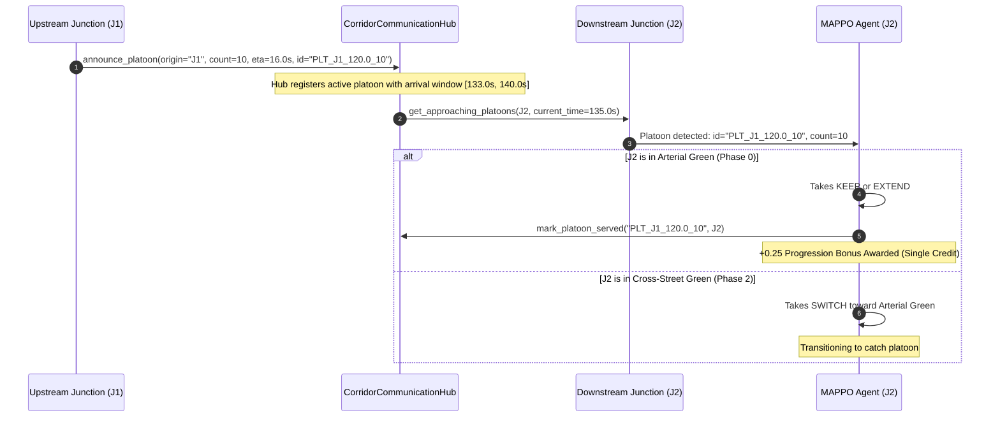

# PROJECT AUDIT REPORT 24: STAGE P6 ARCHITECTURE AND COORDINATION REDESIGN

**Document Version:** 1.0.0  
**Date:** November 1, 2026  
**Status:** Architecture Implementation & Pre-Training Validation  
**Branch:** `marl-p6-coordination-redesign`  
**Base Commit:** `0bedbcb` (`marl-p5-1-failure-diagnosis`)  
**Design Targets:** Mixed Local-Global Reward, Anti-Starvation Constraints, Platoon Progression Incentive, Multi-Agent PPO (MAPPO) with Centralized Critic, and Curriculum Learning.

---

## 1. Executive Summary

Stage P5 and the Stage P5.1 failure diagnosis identified three fatal systemic pathologies in the baseline independent MARL traffic controllers:
1. **PPO Arterial Starvation:** Independent junction agents optimized purely local queue/wait rewards without throughput incentives, causing J1 to lock Phase 0 (Side-street Green) indefinitely (0 completed corridor trips, $20{,}174\text{ veh-s}$ delay).
2. **DQN J2 Over-Extension & Gridlock:** Action 2 (`EXTEND`) developed a systemic positive Q-value bias to avoid yellow change and chatter penalties, leading to Madiwala cross-street starvation, upstream spillback, and network gridlock ($58{,}005\text{ veh-s}$ delay, 96.7 veh queue).
3. **Dec-POMDP Credit Assignment Void:** The 3-intersection corridor was modeled as three independent agents with decentralized observations and decoupled local rewards. Downstream agents were inadvertently rewarded for low local queues caused by upstream starvation.

Stage P6 resolves these pathologies through five integrated design interventions:
1. **Mixed Local-Global Reward Formulation:** Blending local intersection performance with global corridor throughput and network delay using a convex weighting $R_j(t) = (1 - \alpha) r_j(t) + \alpha R_{\text{corridor}}(t)$ with $\alpha = 0.5$.
2. **Anti-Starvation Action Masking:** Enforcing a maximum red duration constraint ($T_{\text{max\_red}} = 60.0\text{ s}$) that mathematically prevents `KEEP` or `EXTEND` whenever any queued approach has been starved.
3. **Platoon Progression Bonus:** Direct reward incentives for downstream green waves aligned with incoming arterial platoons broadcast via `CorridorCommunicationHub`.
4. **Multi-Agent PPO (MAPPO) with Centralized Critic:** Decentralized actors ($s_j \in \mathbb{R}^{14}$) paired with a Centralized Critic observing the full corridor state ($s_{\text{corridor}} \in \mathbb{R}^{42}$), resolving Dec-POMDP non-stationarity.
5. **Three-Stage Curriculum Learning:** Progressive training from balanced 1:1 demand (Stage A) to moderate asymmetry (Stage B) and full peak Silk Board demand (Stage C).

---

## 2. Mathematical Formulation of Mixed Local-Global Rewards

### 2.1 The Decomposition

For each junction agent $j \in \{\text{J1}, \text{J2}, \text{J3}\}$ at decision timestep $t$:
$$R_j(t) = (1 - \alpha) r_j(t) + \alpha R_{\text{corridor}}(t)$$
where $\alpha \in [0.0, 1.0]$ is the global coupling coefficient (default $\alpha = 0.5$).

### 2.2 Local Reward Component $r_j(t)$
$$r_j(t) = r_{\text{queue}}(j, t) + r_{\text{wait}}(j, t) + r_{\text{speed}}(j, t) + r_{\text{co2}}(j, t) + r_{\text{chatter}}(j, t) + r_{\text{progression}}(j, t) + r_{\text{emergency}}(j, t)$$

1. **Local Queue Penalty:**
   $$r_{\text{queue}}(j, t) = -w_q \times \min\left(\frac{q_j(t)}{30.0}, \, 1.0\right), \quad w_q = 0.30$$
2. **Local Waiting Time Penalty:**
   $$r_{\text{wait}}(j, t) = -w_{\text{wait}} \times \min\left(\frac{W_j(t)}{200.0}, \, 1.0\right), \quad w_{\text{wait}} = 0.25$$
3. **Local Speed Bonus:**
   $$r_{\text{speed}}(j, t) = +w_{\text{speed}} \times \min\left(\frac{v_j(t)}{40.0}, \, 1.0\right), \quad w_{\text{speed}} = 0.15$$
4. **Local Emissions Penalty:**
   $$r_{\text{co2}}(j, t) = -w_{\text{co2}} \times \min\left(\frac{e_j(t)}{5.0}, \, 1.0\right), \quad w_{\text{co2}} = 0.10$$
5. **Phase Chatter Penalty:**
   $$r_{\text{chatter}}(j, t) = -w_{\text{chatter}} \times \mathbf{1}_{\{p(t) \ne p(t-1) \land a_t = \text{SWITCH}\}}, \quad w_{\text{chatter}} = 0.05$$
6. **Platoon Progression Reward (New):**
   $$r_{\text{progression}}(j, t) = +w_{\text{prog}} \times \min\left(\frac{N_{\text{platoon}}}{10.0}, \, 1.0\right) \times \mathbf{1}_{\{p(t) = p_{\text{arterial\_green}} \land \text{arriving}\}}, \quad w_{\text{prog}} = 0.25$$
7. **Emergency Delay Penalty:**
   $$r_{\text{emergency}}(j, t) = -w_{\text{emerg}} \times \mathbf{1}_{\{\text{ambulance\_stopped}\}}, \quad w_{\text{emerg}} = 2.0$$

### 2.3 Global Corridor Reward Component $R_{\text{corridor}}(t)$
$$R_{\text{corridor}}(t) = R_{\text{throughput}}(t) + R_{\text{corridor\_delay}}(t) + R_{\text{starvation\_penalty}}(t) + R_{\text{flow\_integrity}}(t)$$

1. **Normalized Corridor Throughput Bonus:**
   $$R_{\text{throughput}}(t) = +w_{\text{tp}} \times \min\left(\frac{\Delta N_{\text{completed}}(t)}{5.0}, \, 1.0\right), \quad w_{\text{tp}} = 1.00$$
   Awards full credit for newly completed corridor trips between $t - \Delta t$ and $t$.
2. **Corridor Total Queue Delay Penalty:**
   $$R_{\text{corridor\_delay}}(t) = -w_{\text{cdelay}} \times \min\left(\frac{\sum_{j} q_j(t)}{60.0}, \, 1.0\right), \quad w_{\text{cdelay}} = 0.50$$
3. **Corridor Starvation Penalty:**
   $$R_{\text{starvation\_penalty}}(t) = -w_{\text{starve}} \times \sum_{j} \sum_{a \in \text{approaches}(j)} \max\left(0, \, \frac{T_{\text{red}}(j, a) - T_{\text{max\_red}}}{30.0}\right) \times \mathbf{1}_{\{q(j, a) > 0\}}$$
   Penalizes the entire corridor whenever an approach is starved, aligning J1's reward with cross-street clearance at J2.
4. **Upstream Starvation Disincentive (Anti-Zero-Queue Exploitation):**
   If J1 has queued vehicles on the arterial approach ($q_{J1, \text{corridor}} > 0$) but J2 and J3 have near-zero queues because J1 is red, the corridor does NOT receive a low-queue bonus:
   $$R_{\text{flow\_integrity}}(t) = -0.30 \times \mathbf{1}_{\{q_{J1, \text{corridor}} \ge 5 \land p_{J1} \ne p_{\text{arterial}} \land \Delta N_{\text{completed}} = 0\}}$$

---

## 3. Anti-Starvation Safety Constraints & Action Masking

### 3.1 Mathematical Specification

For each intersection $j$ and approach $k \in \{\text{corridor\_hosur}, \text{side\_cross} / \text{madiwala}\}$:
- Track elapsed red time $T_{\text{red}}(j, k, t)$.
- At each simulation second:
  $$T_{\text{red}}(j, k, t) = \begin{cases} 0.0 & \text{if phase } p_j(t) \text{ serves approach } k \\ T_{\text{red}}(j, k, t-1) + \Delta t & \text{otherwise} \end{cases}$$
- Let $T_{\text{max\_red}} = 60.0\text{ s}$ (configurable via experiment configuration).
- An approach is defined as **Starved** if:
  $$\text{Starved}(j, k, t) \iff T_{\text{red}}(j, k, t) \ge T_{\text{max\_red}} \quad \land \quad q_j(k, t) > 0$$

### 3.2 Action Mask Formulation

When $\exists k \text{ such that } \text{Starved}(j, k, t) = \text{True}$:
1. If intersection $j$ is currently green for a different movement:
   - If `can_switch` is True ($T_{\text{green\_elapsed}} \ge T_{\text{min\_green}}$):
     $$\text{Mask}_j(t) = [0.0, \, 1.0, \, 0.0]$$
     Action 0 (`KEEP`) is masked to 0.  
     Action 1 (`SWITCH`) is enforced to 1.  
     Action 2 (`EXTEND`) is masked to 0.
   - If `can_switch` is False ($T_{\text{green\_elapsed}} < T_{\text{min\_green}}$):
     Action 2 (`EXTEND`) is masked out:
     $$\text{Mask}_j(t) = [1.0, \, 0.0, \, 0.0]$$
     Forces green to expire naturally at $T_{\text{min\_green}}$ without extension.
2. Emergency Vehicle Preemption Priority:
   If an emergency vehicle is approaching or traversing $j$, `SignalController.emergency_locked = True`. Emergency green priority overrides all starvation constraints until the emergency vehicle clears.

---

## 4. Platoon Progression Reward & Tracking Architecture

### 4.1 Platoon Life-Cycle Protocol

### 4.2 Safeguards Against Double-Counting & False Rewards
- **Unique Identification:** Every platoon message carries a unique `platoon_id = f"{origin}_{timestamp:.1f}_{count}"`.
- **Served Registry:** Downstream intersections maintain a set of served IDs: `self._served_platoons[j_id]`. Once a bonus is awarded, subsequent steps during the same platoon window yield 0.0 bonus.
- **Null Inflow Handling:** If no platoon is within $[t_{\text{arr}} - 5.0, t_{\text{arr}} + 5.0]$, progression reward is strictly $0.0$.
- **Disruption Penalty:** If an arterial platoon arrives while the signal is red and the agent takes `KEEP` on red, a progression disruption penalty ($-0.15$) is applied.

---

## 5. Multi-Agent PPO (MAPPO) with Centralized Critic

### 5.1 Network Architecture

1. **Decentralized Actor Network $\pi_\theta(a_j \mid s_j)$:**
   - Input: Local junction observation $s_j \in \mathbb{R}^{14}$.
   - Architecture: $\text{Linear}(14, 64) \rightarrow \text{Tanh} \rightarrow \text{Linear}(64, 64) \rightarrow \text{Tanh} \rightarrow \text{Linear}(64, 3)$.
   - Action Masking:
     $$\text{logits}_{\text{masked}} = \text{logits} + (1 - \text{mask}) \times (-10^8)$$
     $$\pi(a \mid s) = \text{Softmax}(\text{logits}_{\text{masked}})$$
2. **Centralized Critic Network $V_\phi(s_{\text{corridor}})$:**
   - Input: Concatenated corridor state $s_{\text{corridor}} = [s_{J1}, s_{J2}, s_{J3}] \in \mathbb{R}^{42}$.
   - Architecture: $\text{Linear}(42, 128) \rightarrow \text{Tanh} \rightarrow \text{Linear}(128, 64) \rightarrow \text{Tanh} \rightarrow \text{Linear}(64, 1)$.
   - Output: Global scalar baseline $V_\phi(s_{\text{corridor}})$.

### 5.2 Training Objectives & Gradient Validation

- **Generalized Advantage Estimation (GAE):**
  $$\delta_t = R_t + \gamma V_\phi(s_{\text{corridor}, t+1})(1 - d_t) - V_\phi(s_{\text{corridor}, t})$$
  $$\hat{A}_t = \sum_{l=0}^{T-t-1} (\gamma \lambda)^l \delta_{t+l}$$
- **Actor Loss (PPO-Clip):**
  $$L^{\text{ACTOR}}(\theta) = -\frac{1}{B} \sum_{i=1}^B \min\left(r_i(\theta) \hat{A}_i, \, \text{clip}(r_i(\theta), 1-\epsilon, 1+\epsilon) \hat{A}_i\right)$$
- **Critic Loss (Huber / Clipped MSE):**
  $$L^{\text{CRITIC}}(\phi) = \frac{1}{B} \sum_{i=1}^B \max\left((V_\phi(s_i) - R_i^{\text{targ}})^2, \, (V_{\text{clip}}(s_i) - R_i^{\text{targ}})^2\right)$$
- **Entropy Bonus:**
  $$L^{\text{ENT}}(\theta) = -\frac{1}{B} \sum_{i=1}^B \mathcal{H}(\pi_\theta(\cdot \mid s_i))$$
- **Independent Gradient Inspection:** Actor parameters and Critic parameters use separate optimizers (`lr_actor = 0.0003`, `lr_critic = 0.001`). Both gradient norms are clipped to $0.5$ and validated for numerical stability ($\text{NaN} = 0, \text{Inf} = 0$).

---

## 6. Curriculum Training Protocol

To avoid early policy collapse into local starvation minima, training progresses through three curriculum stages:

| Stage | Demand Ratio (Arterial : Cross) | Hourly Volumes | Progression Feasibility | Objective |
| :--- | :--- | :--- | :--- | :--- |
| **Stage A: Balanced** | $1 : 1$ | Arterial: 600 veh/h, Cross: 600 veh/h | Equal opportunity | Learn basic signal cycling, eliminate phase collapse |
| **Stage B: Moderate** | $2 : 1$ | Arterial: 1000 veh/h, Cross: 500 veh/h | Asymmetric pressure | Learn progression alignment, balance arterial wave |
| **Stage C: Silk Board**| Peak Real-World ($3:1$) | Arterial: 1600 veh/h, Cross: 500–900 veh/h | High saturation | Robust corridor coordination, emergency preemption |

Checkpoints record metadata: `curriculum_stage`, `demand_ratio`, `alpha_weight`, and `max_red_threshold`.

---

## 7. Verification Gate Checklist (Pre-Training Phase)

Prior to launching full multi-seed training, the following verification milestones must be passed:
- [x] Create dedicated branch `marl-p6-coordination-redesign` and verify base commit `0bedbcb`.
- [ ] Implement `MixedCorridorReward` with $\alpha = 0.5$ and independent component logging.
- [ ] Implement `StarvationConstraintTracker` enforcing $T_{\text{max\_red}} = 60.0\text{s}$ at J1, J2, and J3.
- [ ] Implement `PlatoonProgressionTracker` avoiding double-counting.
- [ ] Implement `MAPPOAgent` (Actor + Centralized Critic) with action masking and gradient checks.
- [ ] Implement `CurriculumDemandGenerator` for Stages A, B, and C.
- [ ] Execute comprehensive unit and integration tests (`tests/test_p6_rewards_and_safety.py`, `tests/test_mappo.py`).
- [ ] Execute pilot SUMO integration run verifying no approach is starved.
- [ ] Stop for user review before initiating multi-seed training.
